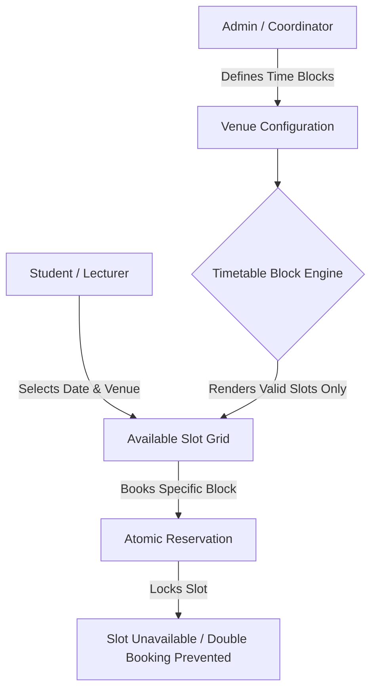
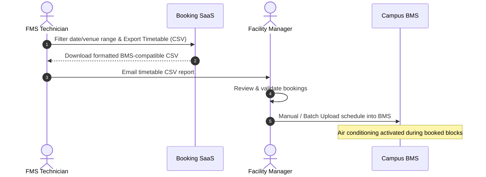
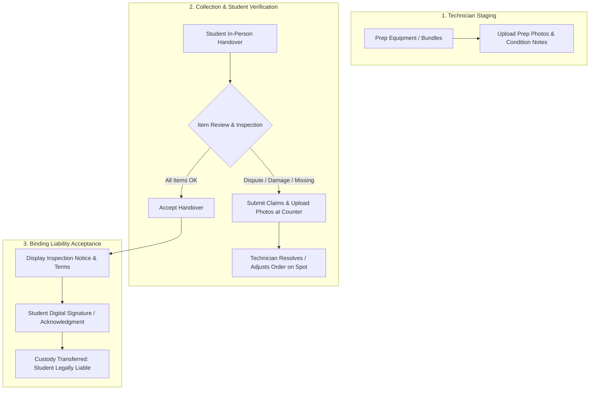
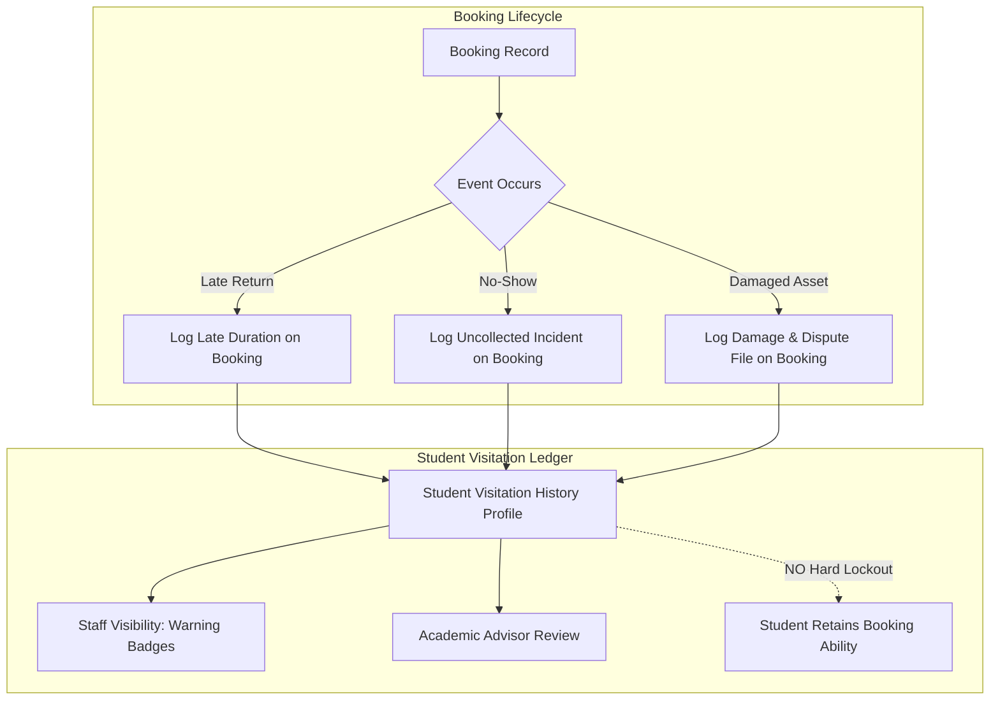
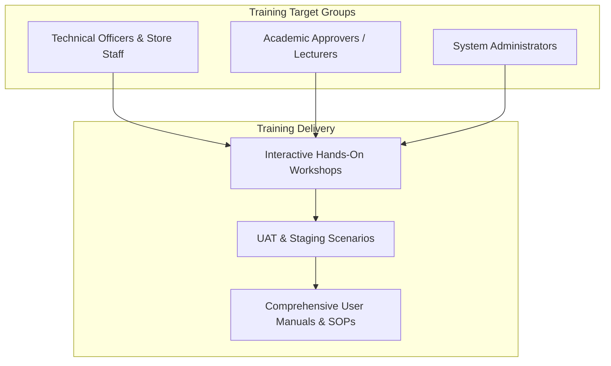
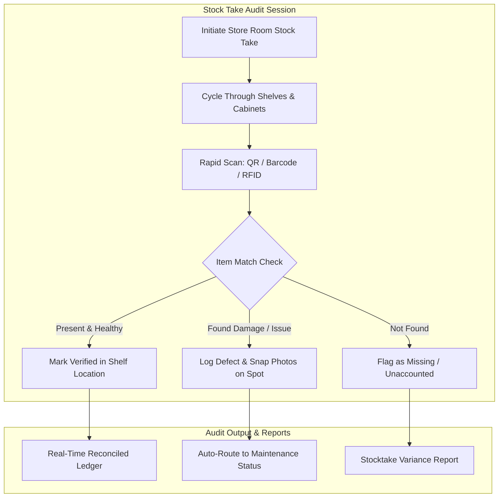

# Tender Briefing & Site Clarification Notes (15th Nov Session)

**Tender Reference:** `FY26/FMS/003x/ITQ`  
**Project:** Provision of a Cloud-Based Resource Booking System (SaaS) for School of Film & Media Studies (FMS)  
**Session Focus:** 15th Nov Operational Issues, Hardware Assessment & Facility Management Requirements  
**Status:** Documented / Architecture & Scope Review

---

## 1. Executive Summary & Critical Highlights

During the briefing and review session, several critical architectural and operational realities were clarified that directly impact system scoping, costing, and technical architecture:

1. **Smart Locker Infrastructure (Hardware Overhaul Required):** Existing smart lockers are effectively abandoned/unmaintained by the previous vendor. Integration cannot rely on software APIs; the project scope must account for a hardware refurbishment/overhaul (rewiring, custom IoT gateways, controllers, and locks).
2. **Facility Booking Module (Dedicated Architecture for 50+ Venues):** Facility booking is confirmed as mandatory across 50+ venues. Due to operational differences between equipment custody and physical room usage, Facility Booking must be built as a distinct, dedicated module driven by configurable **Timetable Blocks**.
3. **Aircon / BMS Timetable Integration Friction:** Venue booking requires periodic schedule extraction in CSV format so technicians can email room utilization windows to Facility Managers, who manually review and upload them into the campus Building Management System (BMS) to schedule air-conditioning.
4. **Student vs. Technician Custody Disputes:** High-frequency disputes regarding unreturned/missing items, alleged pre-existing equipment damage, or venue condition require an evidence-backed custody verification workflow (technician pre-prep photos, student collection photo/dispute submission, venue check-in reports, and binding liability acceptance).
5. **Multi-Modal Asset Tagging & Dimension Constraints:** While QR code remains the primary standard, the platform must support diverse tagging options (RFID, 1D/2D Barcodes). In addition, items with physical size or surface restrictions shall be classified as non-taggable and tracked through kit manifests rather than forced physical tagging.
6. **Disciplinary Governance (No Hard Blacklists / Soft Visitation History):** The school does not enforce punitive blacklisting or system lockouts against students to avoid impeding academic curriculum and coursework. Instead, all infractions (late returns, uncollected bookings, damage claims) are recorded at the booking level to maintain a transparent student visitation and conduct history for staff awareness.
7. **Client Internet Connectivity & Isolated 4G Cellular Gateway:** Customer workstations and client machines have unhindered access to the public Internet, ensuring smooth SaaS cloud connectivity. For isolated facility hardware (smart lockers/controllers), an independent 4G cellular router will provide dedicated connectivity strictly for logic interfacing and telemetry, with a low-bandwidth envelope capped at $\le$ 5 GB per month.
8. **Technician Mobile Tablet Staging Operations:** To maximize store efficiency during pre-handover equipment preparation, technicians will operate via a dedicated tablet-optimized interface. This supports walkabout mobility across store racks, digital picklist checking, fast kit referencing, and direct photo capture.
9. **Staff-Exclusive Training Scope & Documentation Deliverables:** Training obligations are focused strictly on institutional **Staff** (Technical Officers, Store Managers, Academic Approvers, and Administrators), rather than students (who rely on self-explanatory consumer UX). Scope includes interactive staff training sessions, step-by-step User Manuals, and operational SOPs.
10. **Stock Take Facilitation & Granular Asset Health Tracking:** The platform must provide dedicated tools for periodic and ad-hoc stocktaking, enabling Technical Officers to rapidly scan and verify inventory across stores. Officers can log damages, functional defects, maintenance tickets, and condition updates directly on individual equipment items to maintain an accurate real-time inventory state.

---

## 2. Issue 1: Smart Locker Status & Turnkey Hardware Overhaul

### 2.1 Current Hardware State

- **Unmaintained Status:** The existing on-site smart lockers at Block 52 are not actively maintained, lacking vendor software support, reliable maintenance contracts, or active API firmware.
- **Integration Infeasibility via Software Alone:** Direct software-level API integration against the legacy controllers is not viable due to obsolete/proprietary firmware and lack of vendor SLA.

### 2.2 Required Engineering & Operational Scope

To make the smart lockers operational for after-hours equipment checkout and returns, our implementation must include a full physical and electrical retrofit:

- **Rewiring & Power Distribution:** Re-cabling and electrical inspection of all locker columns and locker bays.
- **Custom IoT Gateways:** Deployment of vendor-managed edge IoT gateways (cellular 4G/5G or isolated local interface complying with NP zero-campus-LAN integration constraints).
- **Locker Controller Boards:** Replacement of legacy lock boards with modern multi-channel relay/bus controllers (e.g., RS485/Modbus or direct GPIO/CAN bus).
- **Electronic Locks & Sensors:** Replacement/servicing of electronic solenoid/magnetic cabinet locks and door-state detection sensors (open/closed feedback).

### 2.3 Commercial & Operational Impact

- **Hardware Bill of Materials (BOM):** Must reflect gateways, controllers, cabling, relays, and lock solenoids in the tender proposal budget.
- **Physical Installation Window:** Cabling and hardware installation works will require scheduled site access windows coordinated with FMS technical officers before system Go-Live.

### 2.4 Network Connectivity: Client Public Internet & Dedicated 4G Cellular Router

- **Client Machine Direct Internet Access:** All customer workstations, store PCs, and staff desktop browsers have direct outbound access to the public Internet. This confirms that accessing the cloud-hosted SaaS system will work natively without custom campus proxy exceptions.
- **Facility-Restricted Hardware & Cellular Gateway:** For hardware devices located within the facility (e.g. smart locker controllers, lock relays, and sensor hubs), physical connections are restricted locally within the facility footprint.
- **Independent 4G Industrial Router:** To maintain strict isolation from the campus institutional network, an independent vendor-managed 4G industrial cellular router will be installed in the locker bay.
- **Bandwidth Consumption Envelope ($\le$ 5 GB / Month):** The cellular channel is dedicated solely to **logic interfacing, command triggers, and state telemetry** (e.g. lightweight MQTT / HTTPS payloads for `UNLOCK_COMPARTMENT`, `DOOR_STATUS_POLL`, and `HEARTBEAT`). Data consumption will strictly not exceed **5 GB per month**, preventing excessive telecom costs while guaranteeing continuous remote operation.

---

## 3. Issue 2: Facility Booking & Timetable Block Engine

### 3.1 Background & Scale

- **Scope:** 50+ distinct facilities/venues across FMS (studios, edit suites, sound recording booths, screening rooms, lecture spaces, and specialized media labs).
- **Mandate:** Facility Booking is confirmed mandatory for Go-Live.

### 3.2 Operational Differences: Facility vs. Equipment Booking

Equipment booking and facility booking have fundamentally distinct operational lifecycles:

| Dimension              | Equipment Booking                                                  | Facility Booking                                        |
| :--------------------- | :----------------------------------------------------------------- | :------------------------------------------------------ |
| **Primary Unit**       | Physical asset custody (QR tagged item / kit bundle).              | Physical space / room occupancy.                        |
| **Scheduling Model**   | Flexible loan periods, multi-day shoots, return inspections.       | Discrete timetable blocks, session-based occupancy.     |
| **Turnaround / Check** | Physical check-in/out, damage inspection, missing accessory audit. | Auto-release or keycard/check-in presence verification. |
| **Custody Transfer**   | High liability hand-off from store counter / locker.               | Presence at room; shared or individual access.          |

### 3.3 Core Functional Requirements

1. **Venue-Specific Timetable Block Definition:**
   - Administrators and timetable coordinators can define standard recurring or venue-specific time blocks for each of the 50+ facilities (e.g., Block 1: 09:00–12:00, Block 2: 13:00–16:00, Block 3: 16:30–19:30).
   - Allows different schedules for different facility types (e.g., sound suites vs. main production studios).

2. **Strict Timeblock-Restricted Booking:**
   - Students and Lecturers are restricted to booking venues strictly within these pre-configured timetable blocks.
   - Freeform / arbitrary start and end timestamp selections are disallowed to prevent fragmented, orphaned room hours.

3. **Collision Avoidance & Discrete Slot Locking:**
   - Venue bookings must execute atomic slot reservation.
   - Once a designated block on a venue is booked and confirmed, that exact block is marked unavailable and blocked from duplicate reservations, eliminating double-booking risks.

### 3.4 Architectural Recommendation: Modular Decoupling

- **Approach:** Decouple **Facility Booking** as an independent module separate from the **Equipment Loan Engine**.
- **Rationale:**
  - Prevents bloat and leaky abstractions in the asset state machine.
  - Allows the Facility Module to focus on calendar matrix views, timetable imports, and room capacity rules.
  - Leaves the Equipment Module focused on serialized item tracking, accessories, kit hierarchies, and store counter workflows.

---

## 4. Key Frictions: Facility Schedule Export & BMS Air-Conditioning Provisioning

### 4.1 The Operational Bottleneck

On campus, centralized air-conditioning systems are managed strictly via the polytechnic's **Building Management System (BMS)** rather than direct API integrations (complying with NP's zero-integration policy on campus operational networks).

### 4.2 System Requirements for BMS CSV Export

1. **Configurable Date & Venue Filtering:** Technicians must be able to export bookings across custom date ranges (e.g., weekly or bi-weekly blocks) and specific clusters of venues.
2. **Standardized BMS Export Schema:** The exported CSV must output clean tabular columns tailored for facility review:
   - `Venue_ID` / `Room_Code` (e.g., `BLK52-01-01`)
   - `Booking_Reference_ID`
   - `Event_Date` (`YYYY-MM-DD`)
   - `Start_Time` & `End_Time` (24-hour format matching BMS scheduling blocks)
   - `User_Type` (`Student` / `Staff`)
   - `Status` (`Confirmed` / `Approved`)
3. **Automated Scheduled Report Option:** Ability for technicians to trigger automated periodic email exports directly to designated Facility Manager distribution lists.

---

## 5. Student vs. Technician Disputes & Evidence-Backed Verification

### 5.1 Common Dispute Root Causes

During live equipment handover and facility occupancy, recurrent friction points arise between students and technical staff:

1. **Missing Items at Return:** When returning kit bundles (e.g., lens caps, HDMI cables, adapters, cold shoe mounts), items are missing. Students claim the missing items _were never handed to them during collection_.
2. **Pre-Existing Equipment Damage:** Upon return, staff discover cracked filters, loose zoom rings, or scratched chassis. Students claim the damage was _already present prior to collection_.
3. **Pre-Existing Facility / Room Damage:** Damage in studios or edit suites (e.g., torn soundproofing, unplugged patch panels, broken studio lights) is discovered post-session. Students claim the damage was _caused by previous occupants before their session started_.

### 5.2 Resolution Process & New Verification Features

To resolve these disputes conclusively and eliminate he-said-she-said ambiguities, the system will implement an **Evidence-Backed Custody Handover Workflow**:

#### Detailed Feature Breakdown:

1. **Technician Pre-Prep Documentation (Staging Phase):**
   - During equipment kit preparation, technicians can photograph assembled kits and log cosmetic remarks/known blemishes before making items available for collection.
   - Timestamped photos are attached directly to the loan record.

2. **Student Collection Review & Immediate Dispute Submission:**
   - At the collection counter or smart locker retrieval, students are prompted in the app/mobile UI to review the manifest of included items/accessories.
   - **Dispute/Claim Trigger:** If an accessory is missing or pre-existing damage is spotted, students can instantly flag the item and upload timestamped photos directly into the system before leaving the counter.
   - Technicians receive an immediate alert to verify, adjust the manifest, or swap defective accessories.

3. **Facility Takeover / Check-In Issue Reporting:**
   - Upon entering a booked venue, the student/lecturer performs a quick room check-in.
   - The user can submit pre-session condition reports with photo uploads (e.g., reporting broken light stands or damaged acoustic foam) within the first 15 minutes of occupancy.
   - If no report is filed, the room is presumed in good order.

4. **Binding Check-In Notice & Liability Agreement:**
   - Prior to finalizing collection, students must acknowledge an explicit legal notice and custody agreement:
     > _"Notice: You are required to physically verify all items, serial numbers, and accessories listed in this kit before completing collection. By acknowledging receipt without logging an immediate dispute or damage photo, you confirm that all equipment has been received complete and in good working condition. Any subsequent missing accessories or unrecorded damages upon return shall remain your sole financial and disciplinary responsibility."_
   - Digital audit trail: Acknowledgment timestamp, user ID, and device metadata are permanently linked to the audit log.

---

## 6. Issue 3: Equipment Tagging Versatility & Physical Form Factor Constraints

### 6.1 Multi-Modal Tagging Options (QR, RFID, Barcode)

Equipment across the School of Film & Media Studies encompasses diverse categories, usage environments, and physical geometries. While QR code is the primary standard, the platform architecture must natively support multiple identification modalities:

| Tagging Modality        | Primary Use Case & Advantages                                                                               | Hardware / Scanning Compatibility                                    |
| :---------------------- | :---------------------------------------------------------------------------------------------------------- | :------------------------------------------------------------------- |
| **QR Code (Preferred)** | High data density, mobile camera friendly, direct asset URL resolution for student mobile check-in/dispute. | Standard smartphone cameras, 2D industrial handheld scanners.        |
| **RFID (UHF / HF)**     | Contactless proximity scanning, bulk verification of kit bags, smart locker bay antenna detection.          | Fixed RFID readers, smart locker antennas, Bluetooth UHF RFID sleds. |
| **Barcode (1D / 2D)**   | Retaining pre-existing legacy NP asset numbers or manufacturer serial barcodes without duplicate tagging.   | Standard laser / optical 1D barcode scanners, 2D imager scanners.    |

#### Software Unification Architecture:

- The system will employ an **Asset Identifier Abstraction Layer**: an asset record has a primary UUID/Asset ID, with flexible alias mapping for:
  - `qr_payload`
  - `rfid_epc`
  - `barcode_code128` / `upc`
- Any scanning input from mobile apps, smart lockers, or counter USB scanners resolves instantaneously to the unified asset record.

### 6.2 Handling Non-Taggable Items (Size & Dimension Constraints)

Certain film, audio, and studio gear cannot physically accommodate an adhesive or riveted tag due to physical form factor constraints:

1. **Physical Limitations Encountered:**
   - **Micro Dimensions:** Lavalier mic clips, hot shoe adapters, 1/4" to 3/8" thread adapters, micro Allen keys, cold shoe screws.
   - **Thermal & Optical Surfaces:** Precision optical filters, lens hoods, high-heat continuous studio lamps, delicate diaphragms.
   - **Curved or Flexible Surfaces:** Thin audio cables, elastomeric suspension bands on shock mounts.

2. **Operational Policy for Non-Taggable Assets:**
   - **Exemption from Physical Tagging:** Items meeting defined physical constraint criteria **shall not be physically tagged**, preventing surface damage, tag peeling, or interference with mechanical tolerances.
   - **Kit Manifest Association:** Non-taggable items are declared and tracked as non-serialized checklist items bundled under their tagged parent kit (e.g., a tagged "Sony FX6 Cinema Kit" manifest explicitly itemizes `1x Hot Shoe Mic Mount`, `2x Allen Keys`, `1x Lens Cap`).
   - **Verification at Counter:** Inventory counts and missing piece verifications for non-taggable accessories are verified digitally via the counter dispute and student inspection workflow (Section 5) rather than discrete barcode scans.

---

## 7. Issue 4: Penalty Tracking & Non-Blacklisting Governance (Booking-Level Visitation History)

### 7.1 Academic Context: Pedagogical Policy vs. Hard Blacklisting

In tertiary media education (such as NP FMS), studio coursework, film shoots, and broadcast assessments are tied directly to academic grades.

- **The School's Operating Stance:** FMS does **not** enforce hard blacklisting, automated system bans, or account suspensions that lock students out of booking venues or reserving equipment.
- **Rationale:** Automated blacklisting creates severe academic friction—locking a student out of a camera kit or audio booth can cause missed coursework deadlines or exam failure.
- **Requirement:** The system must remove punitive automated lockouts while establishing strong **individual accountability** through an immutable, booking-level tracking ledger.

### 7.2 Booking-Level Infraction Tracking Architecture

Instead of applying binary account-level blocks (`profiles.is_suspended = TRUE`), penalties and infractions are recorded directly at the **Booking Level**:

#### Booking-Level Incident Schema & Attributes:

Every `bookings` record maintains incident tracking flags:

- `is_overdue`: Boolean flag if returned past the designated block/deadline.
- `overdue_duration_minutes`: Exact late duration recorded upon return scan.
- `uncollected_flag`: Logged if reservation was never retrieved during the collection window.
- `damage_flag`: Linked to inspection dispute and photo records.
- `resolution_status`: `OPEN`, `RESOLVED`, `UNDER_DISPUTE`, or `WAIVED_BY_LECTURER`.

### 7.3 Student Visitation & Behavioral History Ledger

When a student creates a booking, visits the collection counter, or enters a venue, technicians and approvers are presented with a **Visitation & Conduct Summary Card**:

1. **At Store Counter (Dispatch / Collection):**
   - Technicians see the student's historical conduct stats:
     - Total Lifetime Bookings (e.g., `42 completed`).
     - On-Time Return Metric (e.g., `92% on-time`).
     - Past Term Incidents (e.g., `2 late returns (avg 25 mins)`, `0 damaged items`).
   - Enables technicians to provide verbal counseling, demand extra verification, or conduct stricter handover inspections without system lockouts.

2. **At Lecturer / Approver Level:**
   - Approvers can view the student's historical responsibility score alongside the project pitch before approving high-value tier gear (e.g., high-end cinema packages).

3. **Academic Advisory Reporting:**
   - Rather than an automatic IT suspension, chronic repeat offenders are aggregated into periodic reports sent to diploma course chairs and academic advisors for pastoral or departmental intervention.

---

## 8. Issue 5: Technician Mobile Tablet Operations & Staging Interface

### 8.1 Operational Reality in Media Stores

In Block 52 media stores (#01-01, #01-02, and #01-03), equipment is distributed across aisles, dry cabinets, flight case stacks, and lighting grids.

- **The Friction:** Forcing technicians to work off desktop workstations at the front counter requires either printing paper picklists or repeatedly walking back and forth between warehouse racks and counter PCs.
- **The Solution:** A dedicated **Tablet-Optimized Web App Interface** (designed for 10"–12" tablets such as iPads or Android tablets) that provides full mobility during equipment picking, kit staging, and pre-collection inspections.

### 8.2 Key Tablet Interface Requirements

1. **Touch-First Responsive Layout:**
   - Large, tactile tap targets ($\ge 48 \text{ px}$) optimized for two-handed tablet grip or single-hand operation while carrying gear.
   - High-contrast UI mode suitable for varied warehouse lighting conditions in camera store rooms.

2. **Interactive Staging & Picking Checklist:**
   - Displays required equipment by location code (e.g., `Store #01-02 > Rack C > Bin 4`).
   - Interactive tap-to-verify checkboxes for every serialized body and non-taggable accessory in the manifest.
   - Immediate warning flags if an item requires battery charging or scheduled calibration.

3. **Inline Photo Capture via Tablet Camera:**
   - Seamless HTML5 camera integration: Technicians tap _"Capture Staging Photo"_ to directly open the tablet’s camera, take high-resolution snapshots of the staged kit, and upload them without navigating external file pickers.
   - Automatic image compression on the client side before upload to optimize storage and speed.

4. **Integrated Software Scanning:**
   - Tablet rear camera acts as a barcode/QR code reader for quick item verification, eliminating the need to drag tethered desktop USB scanners down store aisles.

5. **Instant State Transition:**
   - Moving from `PREPARING` to `READY_FOR_COLLECTION` triggers automated push/email notifications to the student and stages locker compartment assignments if designated for after-hours locker retrieval.

---

## 9. Issue 6: Staff-Exclusive Training Scope & Documentation Deliverables

### 9.1 Target Audience Demarcation (Staff Only vs. Students)
A key clarification from the session is that training obligations are focused strictly on institutional **Staff** and do not extend to the general student body:
- **Zero Student Classroom Training:** The student booking interface is designed following modern B2C mobile standards—intuitive, self-guiding, and responsive—with contextual tooltips and in-app guidance. Students do not require classroom training sessions.
- **Staff-Centric Training Mandate:** Formal training is reserved entirely for operational, academic, and technical personnel who execute inventory custody, approval gates, and timetable administration.

### 9.2 Tailored Training Tracks & Roles

| Staff Role | Key Training Curriculum Focus | Delivery Format |
| :--- | :--- | :--- |
| **Technical Officers & Store Managers** | • Mobile tablet walkabout picking & staging workflows • Counter check-in/out and rapid barcode/RFID scanning • Photo evidence capture & dispute resolution handling • Smart locker bay allocation & manual maintenance override • Booking-level conduct review (visitation history cards) | Hands-on workshop (in store rooms with live tablet & locker hardware). |
| **Academic Approvers / Lecturers** | • Reviewing student script/project loan requests • Interpreting student responsibility metrics & past dispute records • Granting conditional approvals or quota adjustments | 1-hour interactive webinar / recorded walkthrough. |
| **System Administrators** | • Academic term calendar setup & roster sync • Venue timetable block configuration (50+ facilities) • BMS air-conditioning schedule CSV extraction workflow • Role-Based Access Control (RBAC) & audit log forensics | Deep-dive configuration session + Admin UAT. |

### 9.3 Documentation Deliverables & Knowledge Artifacts
The vendor will provide an authoritative documentation suite prior to system Go-Live:

1. **Store Operations & Counter Staff User Manual:**
   - Step-by-step illustrated guide covering daily store routines: morning picklists, tablet staging, student inspection protocols, counter dispute management, and locker parceling.
2. **System Administration & Facility Configuration Guide:**
   - Technical guide detailing facility timetable engine management, block creation, master data CSV imports, BMS export cadence, and audit compliance.
3. **Laminated Counter SOP Cheat Sheets & Digital Quick Guides:**
   - Physical quick-reference laminated placards for store counters at Block 52 (#01-01, #01-02, #01-03).
   - In-app digital help links embedded directly into the tablet app header for instant operational assistance.

---

## 10. Issue 7: Stock Take Facilitation & Granular Asset Health Tracking

### 10.1 The Stock Take Operational Mandate
Managing high-turnover audiovisual and production equipment across Block 52 (#01-01, #01-02, and #01-03) requires regular physical audits. 
- **The Challenge:** Conducting manual paper-based stocktakes across 1,000+ items leads to discrepancy backlogs, misplaced gear, and unrecorded equipment wear.
- **The Requirement:** The system must provide dedicated **Stock Take Facilitation Tools** that enable Technical Officers to execute rapid, digital stock audits, reconcile item physical locations, and maintain an authoritative real-time inventory ledger.

### 10.2 Granular Equipment Operational Statuses
Every serialized asset in the database is tracked through explicit lifecycle states:

| Lifecycle State | Description & System Behavior |
| :--- | :--- |
| **`AVAILABLE`** | In store room, verified operational, eligible for online student reservation. |
| **`RESERVED` / `PREPARING`** | Allocated to an approved upcoming booking; staged in technician picklist. |
| **`ON_LOAN`** | Handed over to student or staff; currently in field circulation. |
| **`DAMAGED_PENDING_REVIEW`** | Returned with reported faults; temporarily locked from future bookings pending assessment. |
| **`UNDER_MAINTENANCE`** | Out of circulation for vendor repair, sensor cleaning, or scheduled calibration. |
| **`MISSING` / `LOST`** | Unaccounted for following loan non-return or stocktake audit variance. |
| **`DECOMMISSIONED`** | Permanently retired, written off, or scrapped per polytechnic asset guidelines. |

### 10.3 In-Field Issue, Damage & Maintenance Logging
Store officers must be able to log equipment defects dynamically without jumping through bureaucratic menus:
1. **Immediate Defect Logging:**
   - Officers can scan any asset tag to pull up its health card.
   - Categorize issues: Optical (lens fungus/scratch), Mechanical (loose mount, broken latch), Electrical (power failure, dead port), or Accessory Defect.
   - Attach timestamped defect photos directly using the tablet camera.
2. **Maintenance Ticket Lifecycle:**
   - Moving an item to `UNDER_MAINTENANCE` automatically withdraws it from the available booking pool, preventing students from reserving defective gear.
   - Logs vendor repair details, quotation reference numbers, return-to-service dates, and maintenance costs.

### 10.4 Tablet-Driven Stock Take Workflow
1. **Room & Shelf Audit Mode:**
   - Officers select the target store (e.g., `#01-02 Dry Cabinet A`) on their mobile tablet.
   - The UI displays expected assets within that physical container.
2. **Continuous Scanning & Color-Coded Tally:**
   - **Green (Verified):** Item scanned and confirmed in correct location.
   - **Yellow (Displaced):** Item found, but belongs to another room/shelf (auto-updates new location code).
   - **Red (Pending/Missing):** Expected item not yet scanned as the audit progresses.
3. **Variance Report Generation:**
   - Instant export of stocktake reconciliation reports (PDF/CSV) highlighting missing assets, damaged units, and misplaced equipment for management sign-off.

---

## 11. Action Items & Follow-Up Deliverables

- [ ] **Locker Hardware BOM & Quotation:** Compile hardware specification and pricing for rewiring, controllers, gateways, and electronic locks.
- [ ] **Dedicated 4G Router & SIM Sizing:** Specify industrial 4G cellular router and procure data plan budgeted within $\le$ 5 GB/month for logic/telemetry interfacing.
- [ ] **Facility Schema & Timetable Matrix:** Design the data schema for 50+ venues, recurring timetable blocks, and atomic slot reservations.
- [ ] **BMS Timetable CSV Export Utility:** Define CSV column specification and build export/filter interface for technician-to-facility-manager reporting.
- [ ] **Handover Verification & Photo Upload Workflow:** Design UI/UX mockups and storage architecture for technician prep photos, student counter inspections, and venue check-in claims.
- [ ] **Technician Tablet Staging UI/UX Mockups:** Create touch-first, mobile tablet wireframes and component specs for warehouse walkabout picking and camera photo capture.
- [ ] **Stock Take & Equipment Health Module:** Design mobile stocktake audit interface, barcode continuous scanning mode, defect logging modal, and variance reporting engine.
- [ ] **Multi-Modal Tagging & Non-Taggable Catalog Schema:** Formulate the database schema supporting multi-modal identifiers (QR, RFID, Barcode) and parent-kit manifest structures for non-taggable accessories.
- [ ] **Booking Incident & Visitation History Data Model:** Refactor penalty schema from user-suspension locks to booking-level incident tracking and staff-facing visitation ledger components.
- [ ] **Staff User Manuals & Training Plan:** Author draft table of contents for Store Operations Manual, Admin Configuration Guide, and schedule staff training curriculum.
- [ ] **Terms of Custody & Liability Notice:** Draft standardized legal acknowledgment copy for student check-out and facility check-in confirmation modals.
- [ ] **Tender Clarification & Commercial Update:** Update submission pricing schedules and clarification records to reflect physical locker retrofit scope, facility module sizing, multi-tag options, tablet mobility, staff training sessions, stocktake tooling, and audit/evidence storage requirements.
