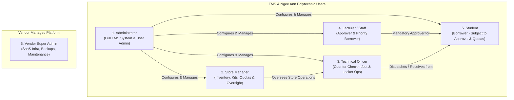

# User Roles & RBAC Architecture Specification

**Tender Reference:** `FY26/FMS/003x/ITQ`  
**Target:** School of Film & Media Studies (FMS), Ngee Ann Polytechnic  
**Document Purpose:** Define system user roles, permission boundaries, and Role-Based Access Control (RBAC) hierarchy based on the GeBIZ Specification Form (GSF).

---

## 1. Executive Summary of Roles

Based on **Section 5.1** (*Approval Workflow*) and **Section 9.1** (*User Management and Authentication - Roles*), the tender explicitly mandates **five (5) business user roles**, complemented by a vendor-managed platform support role:

---

## 2. Detailed Role Definitions & Responsibilities

### Role 1: Administrator (FMS Administrator)
- **Tender Reference:** Clause 5.1, Clause 7.1, Clause 9.1, Clause 9.3, Clause 10.2, Clause 15.1
- **Persona:** FMS IT coordinator, Senior Laboratory Manager, or designated Department Administrative Lead.
- **Key Responsibilities:**
  1. **User Account Governance:** Bulk user import via Excel/CSV rosters (semesterly onboarding); manual user CRUD; activation and deactivation of accounts (Clause 9.3).
  2. **Approval Hierarchy & Escalation:** Setup and mapping of lecturer approvers to academic courses, modules, and student cohorts (Clause 5.1, 5.2).
  3. **Operational Policy Configuration:** Define booking windows, lead times, maximum loan durations, quota caps per module/course, auto-release timers for uncollected bookings (Clause 4.3, 6.1).
  4. **Timetable & Facility Management:** Bulk upload of semester timetables via Excel/CSV and configuration of studio/facility operational hours (Clause 7.1).
  5. **Block & Ad-Hoc Bookings:** Authority to create block bookings, recurring administrative holds, and review ad-hoc booking requests (Clause 4.2).
  6. **Audit & Governance:** Access to full system audit logs (36 months retention), system utilization metrics, and export compliance reports (Clause 3.0, 10.2, 10.3).
  7. **Privileges:** All Administrator self-bookings are **automatically approved** without manual intervention (Clause 5.1).

---

### Role 2: Store Manager (Inventory & Store Lead)
- **Tender Reference:** Clause 6.1, Clause 6.2, Clause 9.1, Clause 10.2, Clause 14.1, Clause 14.2
- **Persona:** Senior Technical Officer or Equipment Store In-Charge managing FMS stores across Block 52 (#01-01, #01-02, #01-03).
- **Key Responsibilities:**
  1. **Master Catalog & Kit Management:** Add, retire, and maintain equipment assets. Define "Package Bookings" (e.g. Cinema Camera Kits comprising body, lenses, rigs, batteries) vs. "Loose Items" (cables, memory cards) (Clause 4.2).
  2. **QR Code Lifecycle:** Oversee QR label generation, reprinting, barcode mapping, and assignment across the 1,000+ tagged items (Clause 6.2, 14.1).
  3. **Locker Strategy & Allocation:** Determine which items/packages are routed to smart locker self-service vs. counter collection (Clause 14.2, 14.3).
  4. **Daily Reconciliations & Overdue Management:** Review daily transaction summaries, investigate missing/damaged equipment, handle overdue escalation and blacklisting flags (Clause 6.2, 8.2).
  5. **Stock Auditing & Utilization:** Generate store-level inventory valuation, available equipment lists, and utilization trends (Clause 10.2).

---

### Role 3: Technical Officer (Store Counter & Lab Technician)
- **Tender Reference:** Clause 5.1, Clause 6.2, Clause 9.1, Clause 14.1, Clause 14.3
- **Persona:** Lab technicians and counter staff physically stationed at Block 52 store counters.
- **Key Responsibilities:**
  1. **Fast Counter Check-Out:** Scan QR codes on reservation slips or mobile booking passes, scan corresponding equipment tags, capture optional borrower signature on screen, and release gear (Clause 6.2).
  2. **Return & Inspection Check-In:** Scan incoming QR tags, inspect equipment condition, verify completeness of packages (cables, accessories), and check-in items back to available inventory.
  3. **Smart Locker Loading/Replenishment:** Load approved packages/individual items into designated smart locker compartments for self-service pickup (Clause 14.3, 14.4).
  4. **Ad-Hoc Issue Tracking:** Flag defective, damaged, or unreturned items during check-in and immediately trigger repair/maintenance status.
  5. **Daily Shift Summaries:** Generate shift handover reports and counter transaction summaries.
  6. **Privileges:** Technical Officer bookings for lab/course prep are **automatically approved** (Clause 5.1).

---

### Role 4: Lecturer (Academic Staff / Approver)
- **Tender Reference:** Clause 4.2, Clause 5.1, Clause 5.2, Clause 9.1
- **Persona:** Teaching faculty, course chairs, and module leaders in the School of Film & Media Studies.
- **Key Responsibilities:**
  1. **Booking Approval Engine:** Review and approve/reject pending booking requests submitted by students enrolled in their assigned modules/courses (Clause 5.1).
  2. **Multi-Level Workflow Participation:** Participate in multi-tier approval chains (e.g., standard kit approved by Lecturer; high-end/specialized kit escalates to Module Chair) (Clause 5.2).
  3. **Direct Teaching Bookings:** Reserve equipment kits, production gear, and studios for classes, tutorials, and demonstration shoots.
  4. **Privileges:** All Lecturer bookings are **automatically approved** by the system without requiring third-party approval (Clause 5.1).
  5. **Student Quota Oversight:** View quota consumption and booking histories for students within their supervised modules.

---

### Role 5: Student (End User / Borrower)
- **Tender Reference:** Clause 4.1–4.3, Clause 5.1, Clause 6.1, Clause 9.1, Clause 14.3
- **Persona:** Enrolled full-time and part-time students in FMS diploma and certificate programs.
- **Key Responsibilities & Capabilities:**
  1. **Catalog Search & Multi-Item Cart:** Search equipment/facilities by keyword, course, module, or tags; add multiple items to a single booking transaction (Clause 4.1).
  2. **Eligible Booking Types:** Submit individual, group project, package kit, and recurring bookings (Clause 4.2).
  3. **Approval Compliance:** All student reservations are automatically routed as "Pending Approval" to their assigned module lecturer (Clause 5.1).
  4. **Quota Adherence:** Bound strictly by configured quota caps based on enrolled course, active module, and student tier (Clause 6.1).
  5. **Collection & Return:** Collect items at the store counter (via QR scan + signature) or smart locker (self-service scan/code); return items within the designated time window (Clause 14.3).
  6. **Notifications & Self-Service:** Receive collection reminders, overdue notices, auto-cancellation notifications; cancel pending/uncollected bookings (Clause 8.1, 8.2).

---

### Role 6: Vendor Super Admin (Infrastructure & Support - Standalone SaaS)
- **Tender Reference:** Clause 1.1, Clause 3.0, Clause 10.4, Clause 11.2–11.4, Clause 13.1, Annex A
- **Persona:** SaaS Vendor Engineering / DevOps Operations Team.
- **Key Responsibilities:**
  1. **Platform Maintenance:** Provisioning, updates, security patching outside office hours, and database backups (daily automated backups with 30-day retention) (Clause 11.4, 13.4).
  2. **Initial Onboarding & Migration:** One-time migration of historical data, courses, modules, and initial 1,000 QR asset mappings (Clause 1.2, 10.4, 14.1).
  3. **SLA & Uptime:** Ensuring $\ge 99.5\%$ monthly uptime, monitoring critical issue resolution (within 4 hours / 1–2 business days) (Clause 11.1–11.3).
  4. **Data Protection & Privacy Safeguards:** Strict adherence to Annex A (PDPA compliance, zero data transfer outside Singapore, role isolation, no direct access to personal data except for maintenance).

---

## 3. RBAC Permissions Matrix

The following matrix maps granular capabilities across the six identified roles:

| Functional Module | Capability / Action | Student | Lecturer | Technical Officer | Store Manager | Administrator | Vendor Super Admin |
| :--- | :--- | :---: | :---: | :---: | :---: | :---: | :---: |
| **Catalog & Booking** | Search & View Equipment/Facilities | ✔ | ✔ | ✔ | ✔ | ✔ | ✔ |
| | Create Individual / Group Booking | ✔ *(Requires Approval)* | ✔ *(Auto-approved)* | ✔ *(Auto-approved)* | ✔ *(Auto-approved)* | ✔ *(Auto-approved)* | ✖ |
| | Multi-Item Basket Booking | ✔ | ✔ | ✔ | ✔ | ✔ | ✖ |
| | Book Packages & Kits | ✔ | ✔ | ✔ | ✔ | ✔ | ✖ |
| | Block / Pre-Book Resources | ✖ | ✖ | ✖ | ✔ | ✔ | ✖ |
| **Approval Engine** | Approve Student Module Bookings | ✖ | ✔ | ✖ | Optional | ✔ | ✖ |
| | Configure Multi-Level Workflows | ✖ | ✖ | ✖ | ✖ | ✔ | ✖ |
| | Override / Ad-Hoc Approvals | ✖ | ✖ | ✖ | ✖ | ✔ | ✖ |
| **Store Operations** | Counter QR Scan Check-Out / In | ✖ | ✖ | ✔ | ✔ | ✔ | ✖ |
| | Capture Stylus/Touch Signature | ✖ | ✖ | ✔ | ✔ | ✔ | ✖ |
| | Smart Locker Load & Replenish | ✖ | ✖ | ✔ | ✔ | ✔ | ✖ |
| | Smart Locker Self-Service Pickup | ✔ | ✔ | ✖ | ✖ | ✖ | ✖ |
| **Asset & QR Management** | Generate & Print QR Labels | ✖ | ✖ | ✔ | ✔ | ✔ | ✖ |
| | Define Kits / Package Bundles | ✖ | ✖ | ✖ | ✔ | ✔ | ✖ |
| | Mark Equipment Damaged / Lost | ✖ | ✖ | ✔ | ✔ | ✔ | ✖ |
| | Create / Edit Equipment Catalog | ✖ | ✖ | ✖ | ✔ | ✔ | ✖ |
| **Timetable & Facilities** | View Weekly Timetable & Calendar | ✔ | ✔ | ✔ | ✔ | ✔ | ✔ |
| | Bulk Timetable Upload (CSV/Excel) | ✖ | ✖ | ✖ | ✖ | ✔ | ✖ |
| **User & Access Admin** | Bulk User Roster Import (CSV) | ✖ | ✖ | ✖ | ✖ | ✔ | Initial Migration |
| | Manual User CRUD / Activation | ✖ | ✖ | ✖ | ✖ | ✔ | ✖ |
| | Role & Approver Assignment | ✖ | ✖ | ✖ | ✖ | ✔ | ✖ |
| **Reports & Audit** | View Standard Operational Reports | ✖ | Module-Only | Daily Summary | ✔ | ✔ | ✖ |
| | Custom Reports & CSV/Excel Export| ✖ | ✖ | ✖ | ✔ | ✔ | ✖ |
| | View 36-Month Audit Trail | ✖ | ✖ | ✖ | ✖ | ✔ | Logs Only |
| **Platform Ops** | System Upgrades & DB Backups | ✖ | ✖ | ✖ | ✖ | ✖ | ✔ |

---

## 4. Key Role Governance Rules from the Tender

1. **Auto-Approval Rule (Clause 5.1):**
   - Bookings initiated by **Staff (Lecturers, Technical Officers, Store Managers)** and **Administrators** are **automatically approved** immediately upon creation.
   - Bookings initiated by **Students** *must* route through the approval engine to designated Lecturer approvers.

2. **Multi-Store Synchronization (Clause 1.2):**
   - Technical Officers and Store Managers operate across **three distinct store locations** at Block 52:
     - Room `#01-01`
     - Room `#01-02`
     - Room `#01-03`
   - Store role permissions can be scoped to specific locations or span all three facilities with real-time state synchronization.

3. **Quota & Window Enforcement (Clause 4.3 & 6.1):**
   - Roles determine quota allowances:
     - **Students:** Enforced quotas based on currently enrolled course and module.
     - **Lecturers:** Higher academic quota ceilings tailored for teaching demonstrations.
     - **Store Managers & Admins:** Quota-exempt.

4. **Authentication Boundary (Clause 9.2):**
   - Initial Go-Live utilizes self-contained credentials (username/password with optional MFA/OTP).
   - Roles must be cleanly architected with standard claims/scopes so that when NP enables SSO/Active Directory in the future, roles can seamlessly map to institutional security groups.
