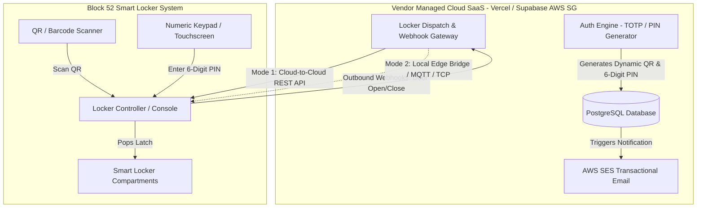
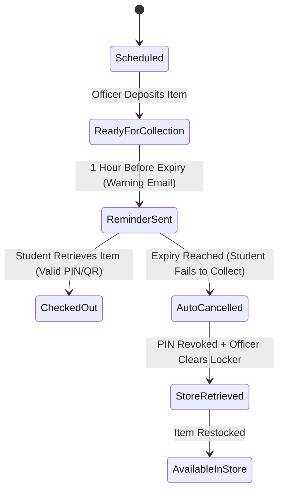

# Smart Locker Integration Architecture & Operational Workflows

**Tender Reference:** `FY26/FMS/003x/ITQ`  
**Target:** School of Film & Media Studies (FMS), Ngee Ann Polytechnic  
**Focus:** Clause 14.2, 14.3 & 14.4 — Smart Locker System Integration & Asset Operations  
**Contract Duration:** 36 Months  

---

## 1. Architectural Strategy: Dual-Mode Integration

To comply with **Clause 14.4** (*"The system shall support integration with existing smart locker systems via vendor-managed interfaces... No integration with Ngee Ann Polytechnic core systems or infrastructure is required"*), our cloud SaaS implements a **Dual-Mode Integration Architecture** that accommodates whatever hardware/software setup is revealed at the October 15 briefing:



### Integration Modes:
1. **Mode 1: Cloud-to-Cloud REST API & Webhooks (Primary)**
   - Used if the smart locker vendor operates a cloud management backend or public REST endpoints.
   - Our SaaS calls the Locker API to reserve compartments and register access tokens (QR payload or PIN).
   - The locker controller fires outbound webhooks back to our SaaS upon door open/close events.
2. **Mode 2: Local Edge Gateway / On-Premise Controller (Fallback)**
   - Used if the smart locker runs on an isolated local controller (e.g. 4G cellular IoT gateway or RS-485 / TCP socket).
   - A lightweight edge bridge or webhook relay routes commands between the cloud SaaS and local locker hardware without touching NP institutional networks.

---

## 2. Operational Workflows: The 5 Core Interaction Scenarios

### Workflow 1: Store Officer Staging & Deposit
*Scenario: Store Officer deposits an approved equipment item into a smart locker compartment for student collection.*

1. **Item Eligibility Filter:** The system only allows individual equipment or pre-packaged standalone kits suitable for locker dimensions to be allocated to lockers (Clause 14.2). Bulk or heavy gear is routed to the counter desk.
2. **Compartment Discovery:**
   - **Smart Auto-Assign:** Our system queries the Locker API for vacant compartments filtered by equipment size category (`Small`, `Medium`, `Large`).
   - **Manual Override:** If the locker API does not report compartment occupancy (or in case of a temporary sync delay), the Store Officer can physically inspect the locker array at Block 52 and tap the desired locker number (e.g., *Locker #12*) on their mobile/tablet UI.
3. **Physical Deposit:**
   - The Officer scans the equipment's physical QR label using their tablet/mobile device.
   - The system sends a signal to unlock the designated compartment (or issues a Store Master PIN).
   - The Officer places the gear inside, securely shuts the door, and taps **Confirm Deposit** in the app.
4. **State Transition:** The booking status updates to `READY_FOR_COLLECTION`, and the locker compartment status becomes `OCCUPIED`.

---

### Workflow 2: Student Locker Retrieval
*Scenario: Student arrives at Block 52 to collect reserved equipment.*

1. **Dual-Method Unlocking (Either/Or):**
   - The student accesses their booking pass in the mobile web app.
   - The system presents **two redemption options**:
     1. **Dynamic High-Contrast QR Code:** Can be presented directly to the locker terminal scanner.
     2. **6-Digit Numeric OTP/PIN:** Can be entered on the physical locker keypad or touchscreen.
2. **Hardware Execution:**
   - The locker terminal validates the QR code or PIN against its local memory / cloud token cache.
   - Upon a match, the specific compartment latch pops open automatically.
3. **Physical Extraction:**
   - The student retrieves the equipment item and firmly pushes the locker door closed.

---

### Workflow 3: Item Retrieval Verification & Confirmation
*Scenario: Verifying that the item was successfully retrieved and updating system state.*

1. **Door Sensor Event:** The smart locker's magnetic door contact switch detects the `DOOR_OPENED` followed by `DOOR_CLOSED` event.
2. **Webhook Ingestion:** The locker controller dispatches a signed webhook payload to our API:
   ```json
   {
     "event": "LOCKER_RETRIEVED",
     "timestamp": "2026-10-15T14:32:10Z",
     "locker_id": "LOC-BLK52-01",
     "compartment_number": 12,
     "booking_reference": "NP-FMS-2026-0891",
     "auth_method": "PIN"
   }
   ```
3. **Booking State Transition:** 
   - Status instantly updates from `READY_FOR_COLLECTION` to `CHECKED_OUT`.
   - The active loan timer begins ticking.
4. **Compartment State Transition:** The compartment is marked as `VACANT` and returned to the pool of available lockers.

---

### Workflow 4: Officer & Staff Notification Architecture
*Scenario: Keeping Store Officers and Technicians informed of locker activity.*

1. **Internal Notification (Store Dashboard):**
   - The Store Management Dashboard at Block 52 store desks updates upon normal page navigation or periodic fetch.
   - Completed locker retrievals are highlighted in the daily transaction log.
2. **External Notification (Email Alerts via AWS SES Singapore):**
   - Because email is the primary operational communication channel at Ngee Ann Polytechnic, automated transactional emails are dispatched to Store Officers:
     - **Subject:** `[NP-FMS Store Alert] Locker #12 Retrieved — Booking #0891`
     - **Body:** Borrower Name, Student ID, Item Description, and exact timestamp of retrieval.
3. **Audit Trail Logging:** An immutable record is written to the PostgreSQL `security_audit_logs` table (satisfying Clause 3.0).

---

### Workflow 5: Uncollected Items & Lifecycle Escalation
*Scenario: An item remains in the locker past the scheduled collection window.*



1. **Stage 1: Advance Reminder (1 Hour Before Expiry)**
   - Automated email alert sent to the student:  
     *“Reminder: Your booked equipment is waiting in Locker #12. Please retrieve it by 4:00 PM today, or your booking will be automatically cancelled.”*
2. **Stage 2: Expiry & PIN Revocation (At Expiry Deadline)**
   - The collection window elapses without a retrieval event.
   - The booking status transitions to `CANCELLED_UNCOLLECTED`.
   - **PIN/QR Revocation:** The system immediately sends an API command to the locker controller revoking the student's access PIN and QR code. The student can no longer open the locker.
   - Automated notification email sent to student confirming booking cancellation due to non-collection.
3. **Stage 3: Store Officer Clearance Task**
   - The uncollected item is added to the Store Officers' **“Pending Locker Clearance”** task queue.
   - An email alert is dispatched to Store Officers:  
     *“Action Required: Locker #12 has expired (Booking #0891). Please retrieve the uncollected equipment and return it to store inventory.”*
   - Officer walks to the locker, unlocks it using their Master Override key/PIN, returns the equipment to the shelf, and taps **Cleared & Restocked** in the app.

---

### Workflow 6: Return Verification — Store Counter Only
*Scenario: Equipment return and condition inspection.*

1. **Strict Counter-Only Returns:**
   - **Lockers are strictly for collection/dispensation.**
   - All returns **must be returned in person to the Block 52 Store Counters** (`#01-01`, `#01-02`, `#01-03`).
2. **Operational Rationale:**
   - Audio/video equipment (cameras, cinema lenses, wireless mics, lighting kits) is prone to hidden damage, missing SD cards, lost lens caps, or scratch marks.
   - Dropping gear into a locker prevents physical condition inspection.
   - Physical counter check-in guarantees that a Technical Officer:
     - Scans the durable QR asset label.
     - Inspects optical elements, cables, and battery health.
     - Captures an optional digital touch/stylus signature from the student (Clause 6.2).
     - Closes out the loan safely with zero discrepancy.

---

## 3. Hardware & Network Resilience (Contingency Handling)

| Failure Scenario | Impact | Built-in Mitigation / Fail-Safe |
| :--- | :--- | :--- |
| **Locker Offline / Cellular Drop** | Cloud SaaS cannot reach locker controller via API. | **Offline Token Pre-Caching:** Dynamic PINs are pre-synced to the local locker controller upon deposit. The locker can validate PINs locally even if disconnected from the internet. |
| **Complete Power / Hardware Failure** | Compartment latches fail to open electronically. | **Physical Master Key:** Standard smart lockers feature physical master cylinder keys held by Senior Store Officers to manually unlock compartments. |
| **Student Phone Battery Dead** | Student cannot display the dynamic QR code. | **Keypad PIN Fallback:** The student can view their 6-digit numeric PIN beforehand (or from any friend/terminal browser) and enter it directly on the numeric keypad. |
| **Locker Door Left Ajar** | Student takes gear but does not latch the door. | **Ajar Sensor Alarm:** Smart locker controllers trigger a local beeper alert after 30 seconds of open door status, and fire an `AJAR_WARNING` alert to the store dashboard. |

---

## 4. Key Questions for the October 15 Compulsory Briefing

These technical decisions give us exact clarity on what to verify during the site briefing:
1. **Locker Hardware Controller:** What make, model, and controller OS are installed at Block 52?
2. **API & Connectivity:** Is the locker connected to the internet via dedicated 4G IoT router, or does it have an existing vendor cloud API?
3. **Console Interface:** Does the physical locker console include both an optical barcode/QR scanner and a physical/touch numeric keypad?
4. **Door Sensing:** Do compartments have integrated magnetic contact sensors for door open/close detection?

---

## 5. Comprehensive API Specification

To plan future development, the table below lists all endpoints required across three architectural tiers: **Outbound Hardware APIs**, **Inbound Webhooks**, and **Internal Application APIs**.

```
┌────────────────────────────────────────────────────────────────────────┐
│                        API ARCHITECTURE OVERVIEW                       │
├────────────────────────────────────────────────────────────────────────┤
│                                                                        │
│   1. Outbound Controller APIs  : SaaS Cloud  ──►  Locker Hardware/API  │
│   2. Inbound Webhooks          : Locker H/W  ──►  SaaS Cloud Gateway   │
│   3. Internal App APIs         : Web/Mobile  ──►  Next.js/Supabase     │
│   4. Scheduled Cron Workers    : Vercel Cron ──►  Expiry Handler       │
│                                                                        │
└────────────────────────────────────────────────────────────────────────┘
```

### 5.1 Outbound Hardware Controller APIs (SaaS Cloud ──► Locker Hardware / API)
*These endpoints are called by our SaaS application to control and query the physical locker system.*

| Method | Endpoint | Description | Key Payload / Query Params | Expected Response |
| :--- | :--- | :--- | :--- | :--- |
| `GET` | `/api/v1/locker/status` | Heartbeat & system connectivity check. | `?locker_id=LOC-BLK52-01` | `{ status: "online", battery_ok: true, firmware: "v2.4" }` |
| `GET` | `/api/v1/locker/compartments` | List all compartments, sizes, and occupancy state. | `?locker_id=LOC-BLK52-01&status=vacant` | `{ compartments: [{ id: 12, size: "M", state: "vacant", door: "closed" }] }` |
| `POST` | `/api/v1/locker/compartments/{id}/stage` | Register student access credentials for an assigned compartment. | `{ booking_id: "BK-0891", pin_hash: "...", qr_payload: "...", expires_at: "..." }` | `{ success: true, compartment_id: 12, token_status: "active" }` |
| `POST` | `/api/v1/locker/compartments/{id}/open` | Remotely trigger solenoid latch to pop compartment open (Staff deposit/override). | `{ officer_id: "usr_to_102", reason: "STAFF_DEPOSIT" }` | `{ success: true, door_state: "opened", timestamp: "..." }` |
| `DELETE`| `/api/v1/locker/compartments/{id}/tokens` | Immediately revoke student PIN and QR access upon booking cancellation or expiry. | `{ booking_id: "BK-0891", reason: "EXPIRED_UNCOLLECTED" }` | `{ success: true, revoked: true }` |

---

### 5.2 Inbound Webhook APIs (Locker Hardware ──► SaaS Cloud Gateway)
*These endpoints are hosted on our Vercel / Next.js backend to receive real-time hardware telemetry and user interactions.*

| Method | Endpoint | Event Name | Trigger Condition | Payload Data Received |
| :--- | :--- | :--- | :--- | :--- |
| `POST` | `/api/v1/webhooks/locker/events` | `DOOR_OPENED` | Student enters valid PIN or scans QR code at locker console. | `{ event: "DOOR_OPENED", compartment_id: 12, auth_type: "PIN", timestamp: "..." }` |
| `POST` | `/api/v1/webhooks/locker/events` | `DOOR_CLOSED` | Door is physically shut after extraction (Triggers checkout transition). | `{ event: "DOOR_CLOSED", compartment_id: 12, booking_id: "BK-0891", timestamp: "..." }` |
| `POST` | `/api/v1/webhooks/locker/events` | `AJAR_WARNING` | Door remains open $> 30$ seconds (Triggers local alarm + dashboard warning). | `{ event: "AJAR_WARNING", compartment_id: 12, duration_seconds: 35 }` |
| `POST` | `/api/v1/webhooks/locker/events` | `OFFICER_OVERRIDE`| Master key used or technician cleared uncollected gear. | `{ event: "OFFICER_OVERRIDE", compartment_id: 12, action: "MANUAL_KEY_OPEN" }` |
| `POST` | `/api/v1/webhooks/locker/heartbeat`| `HEARTBEAT` | Periodic 60-second ping from locker controller gateway. | `{ locker_id: "LOC-BLK52-01", status: "ok", last_sync: "..." }` |

---

### 5.3 Internal SaaS Application APIs (Frontend ──► Backend / Supabase)
*These endpoints power the staff management screens and student mobile web interfaces.*

| Method | Endpoint | Auth Role | Description |
| :--- | :--- | :--- | :--- |
| `GET` | `/api/store/lockers` | Technical Officer / Store Manager | Retrieve current grid view of Block 52 lockers with active booking associations. |
| `POST` | `/api/store/locker/deposit` | Technical Officer / Store Manager | Scan asset QR, assign compartment (auto or manual), pop door, and mark as `READY_FOR_COLLECTION`. |
| `GET` | `/api/student/bookings/{id}/locker-pass`| Student (Borrower) | Retrieve active locker redemption pass containing the dynamic QR code and 6-digit OTP. |
| `POST` | `/api/store/locker/clear-expired` | Technical Officer / Store Manager | Confirm manual physical removal of uncollected gear from expired locker compartment. |
| `GET` | `/api/store/locker/audit-log` | Store Manager / Administrator | Fetch historical log of all door openings, deposits, retrivals, and overrides. |

---

### 5.4 Scheduled Background Cron Tasks (Vercel Cron ──► Edge Handler)
*Automated background workers running on configured schedules.*

| Worker Route | Frequency | Purpose & Workflow Triggered |
| :--- | :--- | :--- |
| `/api/cron/locker-advance-reminder` | Every 10 mins | Identifies bookings with collection deadlines within the next 60 minutes. Triggers advance warning email to student via Singapore AWS SES. |
| `/api/cron/locker-expiry-handler` | Every 5 mins | Identifies bookings past their collection deadline. Automatically:<br>1. Transitions booking status to `CANCELLED_UNCOLLECTED`.<br>2. Calls `DELETE /compartments/{id}/tokens` to revoke PIN/QR on hardware.<br>3. Dispatches cancellation email to student.<br>4. Creates `CLEAR_LOCKER` task for Store Officers and sends alert email. |
| `/api/cron/locker-health-monitor` | Every 15 mins | Checks timestamp of last received `HEARTBEAT`. If $> 15$ mins stale, flags locker as `OFFLINE` on the store dashboard and suppresses auto-assignment. |

