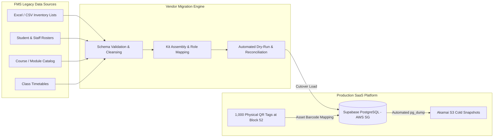

# Data Migration, Onboarding & Go-Live Transition Plan

**Tender Reference:** `FY26/FMS/003x/ITQ`  
**Target:** School of Film & Media Studies (FMS), Ngee Ann Polytechnic  
**Focus:** Clause 1.2, 10.4, 14.1, & 15.1 — Master Data Migration, Verification & System Setup  
**Implementation Timeline:** Target Go-Live within 6 Months from Contract Award  
**Storage Architecture:** Automated `pg_dump` targeting **Akamai Object Storage (Singapore)**  

---

## 1. Executive Summary & Migration Scope

Under **Clause 1.2** and **Clause 10.4**, the Vendor is responsible for the end-to-end setup, one-time historical data migration, validation, and on-site physical asset synchronization before system Go-Live.



### Data Domains to be Migrated:
1. **Equipment Master Records (Up to 1,000 assets):** Serial numbers, asset codes, categories, brand/model, accessories, physical store location (Block 52 `#01-01`, `#01-02`, `#01-03`), and maintenance flags.
2. **Kits & Package Hierarchies (Clause 4.2):** Grouping parent items (camera bodies) with child accessories (lenses, batteries, tripod plates, audio adapters).
3. **Academic Reference Data:** Diplomas (FSV, MCM, etc.), academic modules, semester calendars, and module coordinator lecturer assignments.
4. **User Directory & RBAC Roles (Clause 9.1 & 9.3):** Active student cohort profiles, lecturers, technical officers, and department administrators.
5. **Quota & Booking Rules (Clause 6.1):** Loan limits, maximum booking durations, and approval policies mapped per module.

---

## 2. The 6-Phase Migration Lifecycle (6-Month Implementation Window)

```
Month 1           Month 2           Month 3           Month 4           Month 5           Month 6
┌─────────────────┬─────────────────┬─────────────────┬─────────────────┬─────────────────┬─────────────────┐
│ Phase 1:        │ Phase 2:        │ Phase 3:        │ Phase 4:        │ Phase 5:        │ Phase 6:        │
│ Discovery &     │ ETL Pipeline &  │ Dry-Run & Data  │ On-Site QR      │ UAT & End-User  │ Cutover,        │
│ Schema Mapping  │ Sanitization    │ Reconciliation  │ Tagging (1000)  │ Admin Training  │ Final Sync &    │
│                 │                 │                 │                 │                 │ Production Live │
└─────────────────┴─────────────────┴─────────────────┴─────────────────┴─────────────────┴─────────────────┘
```

### Phase 1: Discovery, Schema Definition & Templates (Weeks 1 – 4)
- **Standardized Excel/CSV Ingestion Templates:** Issue standardized, typed ingestion templates to FMS coordinators for inventory, user rosters, and modules.
- **Data Gap Analysis:** Review FMS's historical records to identify missing fields (e.g. unrecorded serial numbers, orphaned modules, duplicate barcodes).
- **Milestone 1 Deliverable:** *Approved Data Dictionary and Migration Mapping Specification.*

### Phase 2: Cleansing, Normalization & ETL Scripting (Weeks 5 – 8)
- **ETL Transformation Scripts:** Build reproducible Node.js/Python ingestion pipelines connecting to Supabase via Postgres Admin API.
- **Data Cleansing Rules:**
  - Standardize phone formats, email domains (`@np.edu.sg` / `@connect.np.edu.sg`), and student ID syntax.
  - Normalise equipment naming conventions (e.g. "Sony FX6 Kit A", "Sony FX6 Kit B").
  - Flag legacy assets marked for decommissioning or disposal.

### Phase 3: Staged Dry-Run & Reconciliation (Weeks 9 – 12)
- **Dry-Run Migration:** Ingest sample data into an isolated Staging/Sandbox database environment.
- **Automated Reconciliation Checks:**
  - Row-count validation (Source vs Target counts).
  - Foreign key referential integrity (ensuring every student is tied to a valid active module).
  - Anomaly & Exception Report generated for FMS administrative sign-off.

### Phase 4: On-Site Physical QR Tagging & Mapping (Weeks 13 – 16) — *Clause 14.1 Mandate*
- **Physical Label Printing:** Print up to 1,000 durable, synthetic waterproof/oil-resistant QR labels with unique asset IDs.
- **On-Site Vendor Manpower Tagging:** Vendor deployment team visits Block 52 stores (`#01-01`, `#01-02`, `#01-03`) to physically affix labels onto cinema rigs, audio kits, lenses, and flight cases.
- **Real-Time Barcode Association:** As each label is pasted, the technician scans the physical QR code with the store tablet and binds it directly to the corresponding database asset record.

### Phase 5: User Acceptance Testing (UAT) & Training (Weeks 17 – 20) — *Clause 15.1 Mandate*
- **UAT Execution:** FMS administrators, lecturers, and student test groups perform mock bookings, loan check-outs, smart locker retrievals, and auto-approval workflows using real staged data.
- **Formal Training Sessions:**
  - One (1) 2-hour session for End Users (up to 10 pax).
  - One (1) 2-hour session for Administrators (up to 10 pax).

### Phase 6: Final Cutover, Delta Load & Go-Live (Weeks 21 – 24)
- **Pre-Cutover Backup:** Execute full database snapshot using `pg_dump` and archive to Akamai Object Storage (Singapore).
- **Delta Sync:** Import any late additions, new student intake rosters, or timetable schedule adjustments.
- **Production Switch:** Confirm operational readiness and officially declare Go-Live.

---

## 3. Data Integrity & Automated Validation Framework

To ensure 100% data correctness prior to Go-Live (as demanded by Clause 10.4), the automated ingestion pipeline executes strict programmatic pre-checks before committing records:

| Validation Category | Automated Rule Enforced | Failure Action |
| :--- | :--- | :--- |
| **User Identity** | Valid format `S[0-9]{7}[A-Z]` and official NP email domains. | Rejected to Exception Log; admin review required. |
| **Asset Serial Numbers** | Uniqueness constraint per physical hardware unit. | Duplicates flagged; prevents dual-booking of identical serials. |
| **Package Bundles** | Parent package kit must link to valid child loose items. | Warning raised if kit has 0 assigned sub-items. |
| **Quota Allocations** | Maximum simultaneous loan count must be integer $\ge 1$. | Defaults to module standard policy if unassigned. |
| **Store Locations** | Facility code must strictly match `#01-01`, `#01-02`, or `#01-03`. | Rejects unmapped storage rooms. |

---

## 4. Disaster Recovery & Rollback Strategy (Using Akamai Object Storage)

```
┌────────────────────────────────────────────────────────────────────────┐
│                   BACKUP & ROLLBACK WORKFLOW (S3 SG)                   │
├────────────────────────────────────────────────────────────────────────┤
│                                                                        │
│   Supabase Postgres  ──►  Daily pg_dump Cron  ──►  GPG Encryption      │
│                                                          │             │
│                                                          ▼             │
│   Rollback / Restore  ◄──  Akamai S3 Bucket   ◄──  Multi-Part Upload   │
│   (Instant pg_restore)     (Singapore ap-south)    (30-Day Auto Purge) │
│                                                                        │
└────────────────────────────────────────────────────────────────────────┘
```

### Backup Implementation Details:
1. **Automated Daily Dump:** A scheduled lightweight container/worker runs at 02:00 SGT every morning:
   ```bash
   pg_dump -Fc --clean --if-exists -h aws-0-ap-southeast-1.pooler.supabase.com \
     -U postgres.xxxx -d postgres \
     | gpg --batch --symmetric --passphrase "$BACKUP_KEY" \
     | aws s3 cp - s3://np-fms-backups/daily/$(date +%Y-%m-%d).dump.gpg \
     --endpoint-url https://ap-south-1.linodeobjects.com
   ```
2. **Cold Storage Retention:**
   - Backups reside strictly in **Akamai’s Singapore Object Storage (`ap-south-1`)**.
   - An automated S3 Lifecycle Rule permanently deletes snapshots older than **30 days** (satisfying Clause 13.4).
   - Storage utilization for 30 daily compressed dumps is $< 2 \text{ GB}$ (negligible cost, well within Akamai's $5/mo 250 GB allowance).
3. **Disaster Recovery (RTO / RPO):**
   - **Recovery Point Objective (RPO):** $< 24$ hours (nightly automated snapshot) + Supabase 7-day point-in-time transaction log.
   - **Recovery Time Objective (RTO):** $< 30$ minutes to restore full schema, user accounts, and inventory state via `pg_restore`.

---

## 5. Summary of Deliverables for Proposal Submission

In Part B of the GSF compliance schedule, we can mark **Item 1.2, 10.4, 14.1, and 15.1 as Complied ('Y')**, citing:
- End-to-end staged migration with automated ETL cleansing and sign-off reconciliation reports.
- Full on-site physical tagging manpower for up to 1,000 assets at Block 52.
- Pre-cutover and daily disaster recovery automated via `pg_dump` targeting encrypted Akamai Singapore Object Storage with 30-day compliance retention.
