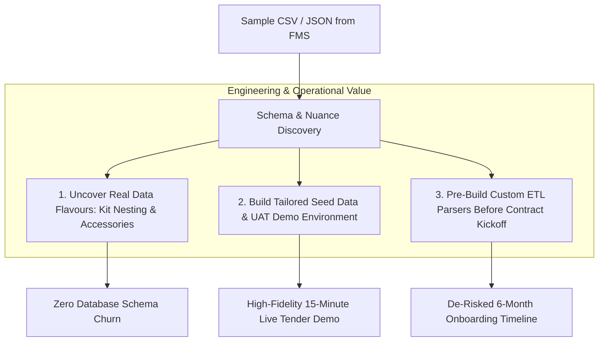

# Tender Clarification Question: Sample Equipment Data Request

**Tender Reference:** `FY26/FMS/003x/ITQ`  
**Target:** School of Film & Media Studies (FMS), Ngee Ann Polytechnic  
**Subject:** Request for Anonymized Sample Dataset (CSV / JSON) of Existing Equipment Inventory  
**Relevant Clauses:** Clause 1.2 (Scope), Clause 4.2 (Package Bundles & Loose Items), Clause 10.4 (Data Migration), Clause 14.1 (Physical QR Tagging)  

---

## 1. Formal Clarification Request Text

### Question for GeBIZ Tender / ITQ Briefing:

> **Clarification Query:**  
> *"To ensure optimal alignment of the database schema, kit hierarchies, and migration pipelines as required under Clause 1.2 and Clause 10.4, could the Polytechnic kindly provide an anonymized sample extract (approx. 20–50 rows in CSV or JSON format) of the current equipment inventory, asset tags, kit structures, and facility store codes?*  
> 
> *The intent is to ensure that our automated data ingestion parsers, validation rules, and demonstration environments accurately mirror FMS's real-world asset taxonomy, kit bundling nuances, and serial numbering conventions, thereby minimizing onboarding friction and guaranteeing a seamless migration toward Go-Live."*

---

## 2. Why This Request is Critical to the Migration Plan

Requesting sample real-world data early serves three strategic engineering and operational purposes:

### 1. Uncovering Real-World "Data Flavours" & Kit Hierarchies
Institutional media schools have unique equipment configurations that generic templates cannot anticipate:
- **Kit Nesting (Clause 4.2):** How does FMS currently represent that a *Sony FX6 Kit* includes a body, 2x batteries, a charger, a baseplate, and a shotgun mic? Is it a single comma-separated text cell, multi-row sub-items, or loose parent-child IDs?
- **Serial Number Quirks:** Are serial numbers purely alphanumeric, or do they include departmental prefixes, dashes, or missing values for passive accessories (like light stands or XLR cables)?
- **Location Codes:** How are storage bays in Block 52 (`#01-01`, `#01-02`, `#01-03`) formatted in legacy spreadsheets?

### 2. Tailored Demonstration & Seed Data
Having representative sample data enables the vendor to populate the local development environment (`supabase/seed.sql`) and live tender demo instance with authentic FMS equipment models (Sony FX6, Canon C70, Arri, Aputure, Sennheiser). This creates an immediate "WOW factor" during the mandatory 15-minute tender evaluation presentation.

### 3. De-Risking the Phase 1 & 2 Migration Timeline
Under Clause 10.4, the vendor must validate and migrate up to 1,000 physical assets within the 6-month implementation window. Analyzing sample data during tender planning allows the engineering team to write, test, and refine the CSV ingestion scripts **before** contract award, shaving 3 to 4 weeks off Phase 1 Discovery.

---

## 3. Recommended Sample Data Structure (Reference Guide for FMS)

If FMS agrees to provide the extract, the following fields represent the ideal schema:

| Target Field Name | Sample Value | Data Type | Purpose in New Booking System |
| :--- | :--- | :--- | :--- |
| `asset_tag_id` | `NP-FMS-CAM-0142` | String (Unique) | Physical barcode/QR tag affixed to hardware. |
| `serial_number` | `4029188` | String | Manufacturer serial number for tracking & warranty. |
| `brand` | `Sony` | String | Filter facet in student catalog. |
| `model_name` | `FX6 Full-Frame Cinema Camera` | String | Primary display title in booking catalog. |
| `category` | `Cameras & Rigs` | String | Top-level category dropdown. |
| `subcategory` | `Cinema Cameras` | String | Sub-filter tier. |
| `item_type` | `KIT_PARENT` | Enum (`STANDALONE`, `KIT_PARENT`, `ACCESSORY`) | Governs whether item has child accessories. |
| `parent_asset_tag` | *null* or `NP-FMS-CAM-0142` | String (Foreign Key) | Associates lenses/batteries with their parent kit. |
| `included_accessories` | `2x BP-U60, 1x Dual Charger, 1x Top Handle` | String / Array | Checklist presented to staff during check-in/out. |
| `store_location` | `Block 52 #01-01` | String | Physical room and shelf location. |
| `operational_status`| `OPERATIONAL` | Enum (`OPERATIONAL`, `MAINTENANCE`, `RETIRED`) | Real-time booking availability flag. |
| `eligible_diploma` | `FSV, MCM` | String / Array | RBAC restriction (e.g. restricted to Film majors). |
| `replacement_cost_sgd`| `8500.00` | Decimal | Used for damage assessment and insurance reports. |

---

## 4. Alternative Contingency Plan (If FMS Cannot Share Data Pre-Award)

If institutional procurement policies prevent Ngee Ann Polytechnic from releasing legacy spreadsheets prior to contract award:
1. **Vendor Self-Synthesized FMS Archetype:** The vendor will synthesize a 100-asset realistic seed dataset based on publicly available FMS diploma curriculum lists (modules for Film, Sound & Video, and Mass Media Management).
2. **Standardized Ingestion Template:** The vendor will publish the structured CSV template above in the tender submission proposal, demonstrating complete technical readiness to ingest FMS data the moment the contract is awarded.
