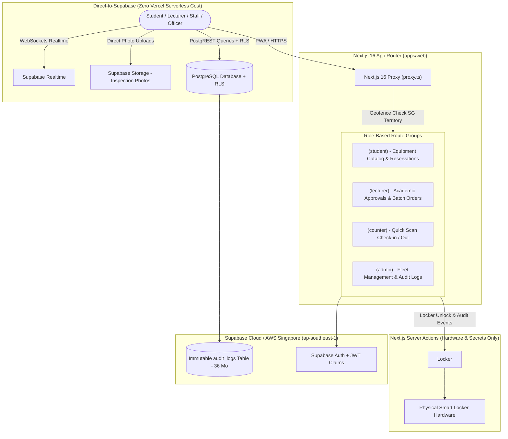

# Technical Architecture & Monorepo Design Blueprint

**Project:** Ngee Ann Polytechnic School of Film & Media Studies (FMS) Equipment & Facility Booking System  
**Tender Reference:** `FY26/FMS/003x/ITQ`  
**Architecture Spec Version:** `1.0.0`  
**Target Release:** Next.js 16.4.0 (Latest) • PWA • Supabase • Shadcn UI • Turborepo Monorepo  

---

## 1. Architecture Overview & Core Stack Decisions

Following our architectural interview and requirements alignment, the system is designed as a **unified, high-performance, edge-accelerated Progressive Web App (PWA)** hosted in Singapore (`sin1` / `ap-southeast-1`), adhering strictly to Singapore Personal Data Protection Act (PDPA) mandates and the 36-month institutional audit trail.



---

## 2. Definitive Monorepo Folder Structure

The repository uses a **pnpm + Turborepo** architecture to maximize code reusability, strict dependency isolation, and instant development iteration.

```
ngee-ann-booking-system/
├── .gitignore                     # Root gitignore (covers planning + dev build artifacts)
├── README.md                      # High-level repo index & developer onboarding
├── 01-planning/                   # Documentation, Tender Reviews, Blueprints
│   ├── 00-tender-review/
│   ├── 01-tender-submission/
│   └── 02-technical-architecture/ # Architecture specifications & schemas
└── dev/                           # <-- Code Monorepo Root (Turborepo + pnpm)
    ├── package.json               # Monorepo root scripts & dev dependencies
    ├── pnpm-workspace.yaml        # Workspace catalog (apps/*, packages/*)
    ├── turbo.json                 # Turborepo task pipeline (build, dev, lint, test)
    ├── tsconfig.json              # Root TypeScript base configuration
    ├── .npmrc                     # Strict hoist & peer dependency settings
    ├── .mcp/                      # Local MCP Server Configs (Supabase, Shadcn, Vercel)
    │   └── mcp-servers.json
    ├── supabase/                  # Supabase CLI Local Dev & Migrations
    │   ├── config.toml            # Supabase local environment config
    │   ├── migrations/            # Pure PostgreSQL SQL migrations (timestamped)
    │   │   ├── 20261011000001_initial_schema.sql
    │   │   ├── 20261011000002_rbac_and_rls_policies.sql
    │   │   └── 20261011000003_audit_trail_triggers.sql
    │   └── seed.sql               # Development seed data (equipment, lockers, roles)
    ├── apps/
    │   └── web/                   # Main Next.js 16.4.0 PWA Web Application
    │       ├── package.json
    │       ├── next.config.ts     # Next.js 16 config (Serwist PWA + Image domains)
    │       ├── tsconfig.json
    │       ├── postcss.config.mjs
    │       ├── public/
    │       │   ├── manifest.json  # PWA Web App Manifest
    │       │   ├── icons/         # 192x192, 512x512, maskable PWA icons
    │       │   └── sw.js          # Service Worker entry (generated by Serwist)
    │       └── src/
    │           ├── proxy.ts       # Next.js 16 Proxy (Replaces middleware.ts)
    │           ├── app/           # App Router
    │           │   ├── layout.tsx # Root layout (Fonts, Providers, Theme)
    │           │   ├── (auth)/    # Auth routes (Login, Magic Link, SSO callback)
    │           │   │   ├── login/
    │           │   │   └── callback/
    │           │   ├── (student)/ # Student portal (Catalog, Cart, Active Passes)
    │           │   │   ├── catalog/
    │           │   │   ├── bookings/
    │           │   │   └── pass/  # Offline QR Booking Pass
    │           │   ├── (lecturer)/# Lecturer approval portal
    │           │   │   ├── approvals/
    │           │   │   └── courses/
    │           │   ├── (counter)/ # Equipment store staff counter portal
    │           │   │   ├── checkout/ # Rapid barcode/QR scan checkout
    │           │   │   ├── checkin/  # Return inspection & photo upload
    │           │   │   └── lockers/  # Locker bay staging
    │           │   ├── (admin)/   # System Admin & Compliance
    │           │   │   ├── inventory/
    │           │   │   ├── audit-trail/
    │           │   │   └── settings/
    │           │   └── api/       # API Handlers & Hardware Webhooks
    │           │       ├── lockers/webhook/
    │           │       └── health/
    │           ├── components/    # App-specific composite components
    │           │   ├── camera-scanner.tsx  # Camera Barcode/QR Scanner modal
    │           │   ├── geofence-banner.tsx # Geofencing warning/status alert
    │           │   └── offline-banner.tsx  # Network status & cached mode alert
    │           ├── services/      # Business Logic Layer (loan quotas, approvals)
    │           │   ├── equipment.service.ts
    │           │   ├── booking.service.ts
    │           │   └── locker.service.ts
    │           ├── hooks/         # Custom React 19 hooks & TanStack Query Layer
    │           │   ├── queries/   # TanStack useQuery hooks (catalog, locker status)
    │           │   ├── mutations/ # TanStack useMutation & Server Action triggers
    │           │   ├── use-camera-scanner.ts
    │           │   ├── use-geofence.ts
    │           │   └── use-online-status.ts
    │           ├── stores/        # Zustand client stores
    │           │   ├── use-scanner-store.ts
    │           │   └── use-offline-booking-store.ts
    │           └── lib/           # App-level utility helpers
    │               ├── geofence.ts# SG Territory & Campus coordinate checks
    │               └── server-actions/# Type-safe Server Actions (mutations)
    └── packages/
        ├── ui/                    # Shared Shadcn UI Component Library & Theme
        │   ├── package.json
        │   ├── tsconfig.json
        │   └── src/
        │       ├── components/    # Radix + Tailwind primitives (Button, Dialog, etc.)
        │       ├── lib/utils.ts   # cn() clsx + twMerge utility
        │       └── styles/        # Global theme variables (light, dark, NP brand)
        ├── database/              # Supabase Client, Types & Database Access Layer
        │   ├── package.json
        │   ├── tsconfig.json
        │   └── src/
        │       ├── index.ts       # Main client factory exports
        │       ├── server.ts      # Server-side Supabase client (@supabase/ssr)
        │       ├── client.ts      # Client-side Supabase browser client
        │       ├── types.ts       # Generated Database types (supabase gen types)
        │       ├── repositories/  # Pure Data Access Layer (PostgREST queries)
        │       │   ├── equipment.repository.ts
        │       │   ├── booking.repository.ts
        │       │   └── audit.repository.ts
        │       └── audit.ts       # Audit log client helper
        ├── locker-client/         # Smart Locker Hardware Abstraction Layer
        │   ├── package.json
        │   ├── tsconfig.json
        │   └── src/
        │       ├── index.ts       # Adapter interface & factory
        │       ├── types.ts       # Locker, Compartment, Status contracts
        │       ├── adapters/
        │       │   ├── mock.adapter.ts    # Local development & offline mock
        │       │   ├── http.adapter.ts    # REST IoT Controller adapter
        │       │   └── mqtt.adapter.ts    # MQTT hardware broker adapter
        │       └── validation.ts  # Locker payload Zod schemas
        ├── config-eslint/         # Shared ESLint 9 Flat Config
        │   ├── package.json
        │   └── index.mjs
        ├── config-typescript/     # Shared tsconfig bases
        │   ├── package.json
        │   ├── base.json
        │   ├── nextjs.json
        │   └── react-library.json
        └── config-tailwind/       # Shared Tailwind CSS tokens & plugins
            ├── package.json
            └── tailwind.config.ts
```

---

## 3. Technology Stack & Third-Party Library Directory

All dependencies are strictly categorized and vetted for Next.js 16, React 19, and enterprise production stability:

| Category | Library | Version | Purpose & Rationale |
| :--- | :--- | :--- | :--- |
| **Core Framework** | `next` | `^16.4.0` | Latest App Router, React 19 support, Server Actions, modern `proxy.ts`. |
| **Runtime & React** | `react`, `react-dom` | `^19.0.0` | React 19 core, `useActionState`, `useOptimistic`, async transitions. |
| **Monorepo Engine** | `turbo` | `^2.4.0` | High-speed task runner, build caching, dependency graph management. |
| **Package Manager** | `pnpm` | `^9.15.0` | Strict, non-flat `node_modules`, atomic hoisting, fast disk-efficient installs. |
| **Database & Auth** | `@supabase/supabase-js` | `^2.49.0` | Official client for Postgres, Auth, Storage, and Realtime channels. |
| **Server-Side Auth** | `@supabase/ssr` | `^0.5.2` | Next.js 16 cookie-based session hydration across Server Components & Proxy. |
| **PWA Service Worker**| `@serwist/next` | `^9.0.0` | Industry standard for Next.js App Router PWA, offline caching, push notifications. |
| **UI Primitives** | `@radix-ui/*` | `latest` | Headless, accessible primitives powering Shadcn UI components. |
| **Styling & CSS** | `tailwindcss`, `postcss`| `^3.4.17` or `v4` | Utility-first styling with CSS variables for dynamic theming. |
| **Styling Helpers** | `clsx`, `tailwind-merge`| `latest` | Conditional class merging (`cn()`) prevents class conflicts. |
| **Icons** | `lucide-react` | `^0.475.0` | Modern, tree-shakeable SVG icon collection. |
| **Client State** | `zustand` | `^5.0.0` | Lightweight store for camera scanner modal, offline booking pass state. |
| **Server State & Cache**| `@tanstack/react-query`| `^5.66.0` | Real-time status polling (locker door states, live equipment availability). |
| **Forms & Validation** | `react-hook-form`, `zod`| `^7.54.0`, `^3.24.0` | Type-safe form validation and Server Action payload schema verification. |
| **Form Resolvers** | `@hookform/resolvers` | `^3.10.0` | Bridges Zod schemas directly into React Hook Form. |
| **Camera & QR Scanner**| `html5-qrcode` / `@zxing/browser` | `^2.3.8` | Cross-browser barcode and QR code reading using device camera feed. |
| **Charts & Analytics** | `recharts` | `^2.15.0` | Official Shadcn chart engine; integrates with `--color-chart-*` CSS variables. |
| **PDF Generation (Forms)**| `@react-pdf/renderer` | `^4.2.0` | Server/client declarative PDF generation for handover sign-offs and receipts. |
| **PDF Generation (Reports)**| `jspdf`, `html2canvas` | `^2.5.2`, `^1.4.1` | Client-side snapshot export for visual chart reports and dashboard summaries. |
| **Excel Generation** | `exceljs` | `^4.4.0` | Multi-sheet, styled Excel (`.xlsx`) export with headers, formulas, and auto-widths. |
| **Date & Time** | `date-fns` | `^4.1.0` | Lightweight date manipulation for booking intervals and loan periods. |
| **Local Testing** | `vitest` | `^3.0.0` | Fast unit and integration testing engine. |
| **E2E Testing** | `@playwright/test` | `^1.50.0` | End-to-end device simulation (mobile viewport, camera mock, offline PWA). |

---

## 4. Shadcn UI Theming, CSS Variables & Token Architecture

The monorepo standardizes on **Shadcn UI’s modern CSS variables theming system** using OKLCH color spaces and Tailwind CSS `@theme inline` mappings. This ensures consistent design tokens across `@repo/ui` and `apps/web` with zero class rewriting when switching between light and dark modes.

### 4.1 Configuration: `components.json`

Configured in `@repo/ui` and `apps/web`:

```json
{
  "$schema": "https://ui.shadcn.com/schema.json",
  "style": "default",
  "rsc": true,
  "tsx": true,
  "tailwind": {
    "config": "",
    "css": "src/styles/globals.css",
    "baseColor": "neutral",
    "cssVariables": true
  },
  "aliases": {
    "components": "@/components",
    "utils": "@/lib/utils",
    "ui": "@/components/ui",
    "lib": "@/lib",
    "hooks": "@/hooks"
  },
  "iconLibrary": "lucide"
}
```

### 4.2 Semantic Token System & Domain Extensions

We adopt semantic background/foreground pairs. The base token controls the surface fill, and the `-foreground` token controls the typography and iconography sitting on that surface:

| Token Pair | Purpose in Booking System | Used By |
| :--- | :--- | :--- |
| `background` / `foreground` | App canvas & primary text | Page shells, main layout, modals. |
| `card` / `card-foreground` | Elevated inventory & booking cards | Equipment catalog cards, order summaries. |
| `popover` / `popover-foreground` | Floating surfaces & dropdowns | Date-time pickers, category dropdowns, filter menus. |
| `primary` / `primary-foreground` | High-emphasis actions & NP brand accent | "Confirm Booking", "Scan Barcode", active tabs. |
| `secondary` / `secondary-foreground` | Secondary actions & tags | "Add to Kit", category tags, filter pills. |
| `muted` / `muted-foreground` | Subdued surfaces & helper text | Serial numbers, return time hints, placeholders. |
| `accent` / `accent-foreground` | Interactive hover & selected states | Table row hovers, calendar active day hover. |
| `destructive` / `destructive-foreground` | Destructive alerts & cancellation | "Cancel Reservation", overdue alerts, damage reports. |
| `warning` / `warning-foreground` *(Custom)* | Overdue equipment & near-expiry warnings | Overdue badges, locker timeout warnings. |
| `success` / `success-foreground` *(Custom)* | Confirmed bookings & locker door unlocked | Completed returns, locker compartment unlocked. |
| `sidebar-*` | Store staff & admin navigation drawer | Collapsible sidebar, group headings, active nav items. |
| `radius` / `radius-*` | Single source of truth for border radiuses | Derived `--radius-sm` through `--radius-4xl`. |

### 4.3 Master Theme CSS (`packages/ui/src/styles/globals.css`)

```css
@import "tailwindcss";

@custom-variant dark (&:is(.dark *));

@theme inline {
  --color-background: var(--background);
  --color-foreground: var(--foreground);
  --color-card: var(--card);
  --color-card-foreground: var(--card-foreground);
  --color-popover: var(--popover);
  --color-popover-foreground: var(--popover-foreground);
  --color-primary: var(--primary);
  --color-primary-foreground: var(--primary-foreground);
  --color-secondary: var(--secondary);
  --color-secondary-foreground: var(--secondary-foreground);
  --color-muted: var(--muted);
  --color-muted-foreground: var(--muted-foreground);
  --color-accent: var(--accent);
  --color-accent-foreground: var(--accent-foreground);
  --color-destructive: var(--destructive);
  --color-border: var(--border);
  --color-input: var(--input);
  --color-ring: var(--ring);

  /* Domain Tokens for Booking & Locker States */
  --color-warning: var(--warning);
  --color-warning-foreground: var(--warning-foreground);
  --color-success: var(--success);
  --color-success-foreground: var(--success-foreground);

  /* Chart Tokens */
  --color-chart-1: var(--chart-1);
  --color-chart-2: var(--chart-2);
  --color-chart-3: var(--chart-3);
  --color-chart-4: var(--chart-4);
  --color-chart-5: var(--chart-5);

  /* Sidebar Tokens */
  --color-sidebar: var(--sidebar);
  --color-sidebar-foreground: var(--sidebar-foreground);
  --color-sidebar-primary: var(--sidebar-primary);
  --color-sidebar-primary-foreground: var(--sidebar-primary-foreground);
  --color-sidebar-accent: var(--sidebar-accent);
  --color-sidebar-accent-foreground: var(--sidebar-accent-foreground);
  --color-sidebar-border: var(--sidebar-border);
  --color-sidebar-ring: var(--sidebar-ring);

  /* Proportional Radius Scale */
  --radius-sm: calc(var(--radius) * 0.6);
  --radius-md: calc(var(--radius) * 0.8);
  --radius-lg: var(--radius);
  --radius-xl: calc(var(--radius) * 1.4);
  --radius-2xl: calc(var(--radius) * 1.8);
  --radius-3xl: calc(var(--radius) * 2.2);
  --radius-4xl: calc(var(--radius) * 2.6);
}

:root {
  --radius: 0.625rem;

  /* Surfaces & Typography (OKLCH) */
  --background: oklch(1 0 0);
  --foreground: oklch(0.145 0 0);
  --card: oklch(1 0 0);
  --card-foreground: oklch(0.145 0 0);
  --popover: oklch(1 0 0);
  --popover-foreground: oklch(0.145 0 0);

  /* Brand Accents */
  --primary: oklch(0.205 0 0);
  --primary-foreground: oklch(0.985 0 0);
  --secondary: oklch(0.97 0 0);
  --secondary-foreground: oklch(0.205 0 0);
  --muted: oklch(0.97 0 0);
  --muted-foreground: oklch(0.556 0 0);
  --accent: oklch(0.97 0 0);
  --accent-foreground: oklch(0.205 0 0);

  /* Status Colors */
  --destructive: oklch(0.577 0.245 27.325);
  --warning: oklch(0.84 0.16 84);
  --warning-foreground: oklch(0.28 0.07 46);
  --success: oklch(0.72 0.19 148);
  --success-foreground: oklch(0.18 0.06 148);

  /* Structural Outlines */
  --border: oklch(0.922 0 0);
  --input: oklch(0.922 0 0);
  --ring: oklch(0.708 0 0);

  /* Analytics Charts */
  --chart-1: oklch(0.646 0.222 41.116);
  --chart-2: oklch(0.6 0.118 184.704);
  --chart-3: oklch(0.398 0.07 227.392);
  --chart-4: oklch(0.828 0.189 84.429);
  --chart-5: oklch(0.769 0.188 70.08);

  /* Navigation Sidebar */
  --sidebar: oklch(0.985 0 0);
  --sidebar-foreground: oklch(0.145 0 0);
  --sidebar-primary: oklch(0.205 0 0);
  --sidebar-primary-foreground: oklch(0.985 0 0);
  --sidebar-accent: oklch(0.97 0 0);
  --sidebar-accent-foreground: oklch(0.205 0 0);
  --sidebar-border: oklch(0.922 0 0);
  --sidebar-ring: oklch(0.708 0 0);
}

.dark {
  /* Surfaces & Typography (Dark Mode OKLCH) */
  --background: oklch(0.145 0 0);
  --foreground: oklch(0.985 0 0);
  --card: oklch(0.205 0 0);
  --card-foreground: oklch(0.985 0 0);
  --popover: oklch(0.205 0 0);
  --popover-foreground: oklch(0.985 0 0);

  /* Brand Accents */
  --primary: oklch(0.922 0 0);
  --primary-foreground: oklch(0.205 0 0);
  --secondary: oklch(0.269 0 0);
  --secondary-foreground: oklch(0.985 0 0);
  --muted: oklch(0.269 0 0);
  --muted-foreground: oklch(0.708 0 0);
  --accent: oklch(0.269 0 0);
  --accent-foreground: oklch(0.985 0 0);

  /* Status Colors */
  --destructive: oklch(0.704 0.191 22.216);
  --warning: oklch(0.41 0.11 46);
  --warning-foreground: oklch(0.99 0.02 95);
  --success: oklch(0.45 0.14 148);
  --success-foreground: oklch(0.98 0.02 148);

  /* Structural Outlines */
  --border: oklch(1 0 0 / 10%);
  --input: oklch(1 0 0 / 15%);
  --ring: oklch(0.556 0 0);

  /* Analytics Charts */
  --chart-1: oklch(0.488 0.243 264.376);
  --chart-2: oklch(0.696 0.17 162.48);
  --chart-3: oklch(0.769 0.188 70.08);
  --chart-4: oklch(0.627 0.265 303.9);
  --chart-5: oklch(0.645 0.246 16.439);

  /* Navigation Sidebar */
  --sidebar: oklch(0.205 0 0);
  --sidebar-foreground: oklch(0.985 0 0);
  --sidebar-primary: oklch(0.488 0.243 264.376);
  --sidebar-primary-foreground: oklch(0.985 0 0);
  --sidebar-accent: oklch(0.269 0 0);
  --sidebar-accent-foreground: oklch(0.985 0 0);
  --sidebar-border: oklch(1 0 0 / 10%);
  --sidebar-ring: oklch(0.556 0 0);
}

@layer base {
  * {
    @apply border-border outline-ring/50;
  }
  body {
    @apply bg-background text-foreground;
  }
}
```

---

## 5. Architectural Communication Patterns: Client-Priority vs Privileged Server-Side

To prevent secret key leakage while eliminating unnecessary Vercel Serverless Function compute costs, the system formally establishes **two distinct architectural design patterns**:

```mermaid
graph TD
    subgraph Pattern1 ["Pattern 1: Standard User Operations (Client Priority - 95%+ Traffic)"]
        P1_Page[Page] --> P1_Comp[Component]
        P1_Comp --> P1_Hook[TanStack Query Hook]
        P1_Hook --> P1_Svc[Service Layer]
        P1_Svc --> P1_Repo[Repository Layer]
        P1_Repo -->|Direct HTTPS / JWT + RLS| P1_SB[(Supabase PostgREST & Storage)]
    end

    subgraph Pattern2 ["Pattern 2: Privileged Admin Operations (Server-Side Only - <5% Traffic)"]
        P2_Page[Admin Page] --> P2_Comp[Admin Modal / Button]
        P2_Comp --> P2_Hook[Mutation Hook]
        P2_Hook -->|Encrypted HTTPS| P2_Action[Server Action / API Route]
        P2_Action -->|Role Assertion: ADMIN| P2_Svc[Admin Service]
        P2_Svc -->|SUPABASE_SERVICE_ROLE_KEY| P2_Repo[Admin Repository]
        P2_Repo --> P2_SB[(Supabase Auth Admin & DB)]
        P2_Repo --> P2_Audit[(Immutable audit_logs)]
    end
```



### 5.1 Pattern 1: Standard User Operations (Client Direct-to-Supabase Priority)

**Scope:** 95%+ of all everyday platform operations:
- Equipment catalog browsing, filtering, search, pagination, and details.
- Students booking reservations, checking loan quotas, and canceling their own bookings.
- Students viewing their cached offline QR booking pass.
- Equipment store staff performing barcode/QR checkout and return inspections.
- Direct device camera photo uploads to Supabase Storage (condition inspection).
- Supabase Realtime WebSocket subscriptions (live locker status and item availability).

**Why Client Fetching is Priority Here:**
1. **Zero Vercel Serverless Invocations:** Eliminates Vercel GB-second execution charges and invocation limits. High-frequency browsing generates S$0.00 in compute costs.
2. **PostgreSQL Row-Level Security (RLS):** Data security is enforced at the database kernel level (`auth.uid() = user_id`, diploma tier matching). Even if a malicious user alters client code, Postgres blocks unauthorized reads/writes.
3. **No 4.5 MB Payload Limit:** Large condition photos stream directly from device cameras to Supabase S3 buckets over signed HTTPS.

**Code Contract:**
Uses `createClient()` from `@repo/database/client` (configured with `NEXT_PUBLIC_SUPABASE_URL` and `NEXT_PUBLIC_SUPABASE_ANON_KEY` + authenticated user JWT session).

---

### 5.2 Pattern 2: Privileged Administrative Operations (Server-Side Only with Service Key Isolation)

**Scope:** Strictly reserved for administrative and sensitive operations:
- Creating new student/staff user accounts (`supabase.auth.admin.createUser`).
- Resetting user passwords or sending administrative password reset links (`generateLink`).
- Elevating user roles or modifying diploma eligibility tags in `app_metadata`.
- Commanding physical smart locker door release (requires private IoT API keys/certificates).
- Emergency counter overrides and batch student CSV onboarding.

**Why Server-Side Execution is Mandatory Here:**
1. **Preventing Secret Key Leakage:** The `SUPABASE_SERVICE_ROLE_KEY` bypasses all PostgreSQL RLS rules. Exposing it to client browsers would compromise the entire database. It must remain strictly within serverless memory.
2. **Guaranteed Role Assertion:** The Server Action verifies the caller's JWT on the server and cryptographically asserts `app_metadata.role === 'ADMIN'` before invoking admin routines.
3. **Non-Repudiation & Audit:** Server Actions ensure that every privileged invocation automatically logs the admin's `actor_id`, client IP, timestamp, and target user to the immutable `public.audit_logs` table (Tender Clause 3.0).

**Code Contract:**
Uses `createAdminClient()` from `@repo/database/admin` protected with `import 'server-only'`.

---

### 5.3 Comparative Pattern Decision Matrix

| Operation | Architectural Pattern | Execution Runtime | Client Key Used | Why This Pattern? |
| :--- | :--- | :--- | :--- | :--- |
| **Catalog Browsing & Search** | **Pattern 1 (Client)** | Browser (TanStack Query) | Anon Key + User JWT | High frequency; zero Vercel compute cost; RLS protected. |
| **Student Booking Reservation** | **Pattern 1 (Client)** | Browser (TanStack Mutation) | Anon Key + User JWT | RLS enforces `auth.uid() = user_id`; zero Vercel invocation. |
| **Inspect Return / Upload Photo** | **Pattern 1 (Client)** | Browser (Storage SDK) | Anon Key + User JWT | Bypasses Vercel 4.5 MB body limit; direct S3 stream. |
| **Locker Door WebSocket Polling** | **Pattern 1 (Client)** | Browser (Realtime WS) | Anon Key + User JWT | Native WebSocket connection; zero polling server cost. |
| **Create New User Account** | **Pattern 2 (Server)** | Next.js Server Action | Service Role Key | Requires Supabase Admin Auth API; prevents key leakage. |
| **Reset User Password** | **Pattern 2 (Server)** | Next.js Server Action | Service Role Key | Prevents unauthorized password manipulation; generates audit record. |
| **Assign User Roles (RBAC)** | **Pattern 2 (Server)** | Next.js Server Action | Service Role Key | Modifies `app_metadata`; requires admin session assertion. |
| **Physical Locker Unlock** | **Pattern 2 (Server)** | Next.js Server Action | IoT Private Secret | Hardware gateway credentials must remain confidential. |
| **Batch CSV Student Import** | **Pattern 2 (Server)** | Next.js Server Action | Service Role Key | Bulk administrative provisioning with validation. |

---

## 6. Next.js 16 Proxy & Dual-Tier Geofencing Specification

In Next.js 16, **`proxy.ts`** replaces the traditional `middleware.ts`. This serves as the primary security gateway for edge verification.

### Dual-Tier Geofencing Mechanism:
1. **Tier 1 (Edge Singapore Territory Enforcement):**
   - Implemented in `apps/web/src/proxy.ts`.
   - Inspects edge headers (`x-vercel-ip-country`).
   - If not `SG`, blocks or redirects to a restricted access warning page.
   - **Developer Bypass Toggle:** Governed by `process.env.GEOFENCE_ENFORCEMENT_ENABLED` (can be disabled in development/staging or set to allow developer IP/country list like `SG,MY`).
2. **Tier 2 (High-Precision Campus GPS Radius Enforcement):**
   - Implemented on the client via `navigator.geolocation` and verified server-side inside Server Actions.
   - Required strictly for **Physical Smart Locker Unlocking** and **Equipment Counter Confirmation**.
   - Bounded by coordinates of Ngee Ann Polytechnic Block 52 (FMS Studio Complex) within a 50-meter radius.

```typescript
// apps/web/src/proxy.ts
import { NextResponse } from 'next/server';
import type { NextRequest } from 'next/server';

export async function proxy(request: NextRequest) {
  const { pathname } = request.nextUrl;

  // 1. Geofence Check (Tier 1: Singapore Territory)
  const isGeofenceEnabled = process.env.GEOFENCE_ENFORCEMENT_ENABLED !== 'false';
  const country = request.headers.get('x-vercel-ip-country') || 'SG'; // Fallback for local dev
  const allowedCountries = (process.env.GEOFENCE_ALLOWED_COUNTRIES || 'SG').split(',');

  if (isGeofenceEnabled && !allowedCountries.includes(country) && !pathname.startsWith('/restricted-region')) {
    const url = request.nextUrl.clone();
    url.pathname = '/restricted-region';
    return NextResponse.rewrite(url);
  }

  // 2. Next.js 16 Supabase Session Refresh & Route Guard
  const response = NextResponse.next();
  // Supabase SSR session token validation & role-based routing...
  return response;
}

export const config = {
  matcher: ['/((?!_next/static|_next/image|favicon.ico|manifest.json|sw.js|icons).*)'],
};
```

---

## 7. PWA & Offline Strategy (`@serwist/next`)

To support students presenting booking passes even in campus basements or areas with poor Wi-Fi:

1. **App Shell Caching:** Service Worker automatically caches core UI bundles, fonts, and Shadcn styling assets.
2. **Active Booking Pass Offline Token:**
   - When a booking is confirmed, the client stores a signed JWT/QR token and booking summary in IndexedDB / LocalStorage.
   - Route `/(student)/pass` renders cached passes when offline.
   - Smart Locker / Counter staff can scan the offline QR code without requiring the student's device to be connected to the internet.
3. **Camera Utility:**
   - Wraps browser `MediaDevices.getUserMedia()` with fallback to file input if camera permissions are denied.
   - Utilized in `/(counter)/checkin` to capture and upload condition photos directly to Supabase Storage bucket `equipment-inspections`.

---

## 8. Mandatory 36-Month Audit Trail (PostgreSQL Schema)

To comply with GeBIZ ITQ Clause 3.0, audit records are stored in a dedicated immutable table with PostgreSQL triggers:

```sql
-- supabase/migrations/20261011000003_audit_trail_triggers.sql

CREATE TABLE public.audit_logs (
    id UUID PRIMARY KEY DEFAULT gen_random_uuid(),
    actor_id UUID REFERENCES auth.users(id) ON DELETE SET NULL,
    actor_role VARCHAR(50) NOT NULL,
    action_type VARCHAR(100) NOT NULL,
    entity_name VARCHAR(100) NOT NULL,
    entity_id VARCHAR(100),
    ip_address INET,
    country_code VARCHAR(10),
    metadata JSONB DEFAULT '{}'::jsonb,
    created_at TIMESTAMPTZ NOT NULL DEFAULT NOW()
);

-- Indexing for fast search and compliance reporting
CREATE INDEX idx_audit_logs_actor ON public.audit_logs(actor_id);
CREATE INDEX idx_audit_logs_action ON public.audit_logs(action_type);
CREATE INDEX idx_audit_logs_created_at ON public.audit_logs(created_at);

-- IMMUTABILITY: Prevent any modification or deletion of audit records
CREATE OR REPLACE FUNCTION prevent_audit_modification()
RETURNS TRIGGER AS $$
BEGIN
    RAISE EXCEPTION 'Audit trail records are immutable and cannot be updated or deleted.';
END;
$$ LANGUAGE plpgsql;

CREATE TRIGGER trg_protect_audit_logs
BEFORE UPDATE OR DELETE ON public.audit_logs
FOR EACH ROW EXECUTE FUNCTION prevent_audit_modification();
```

---

## 9. Model Context Protocol (MCP) Configuration

To accelerate development and enable seamless agentic code generation and testing, MCP servers are declared in the workspace configuration:

```json
{
  "mcpServers": {
    "supabase": {
      "command": "npx",
      "args": ["-y", "@supabase/mcp-server"],
      "env": {
        "SUPABASE_URL": "${SUPABASE_URL}",
        "SUPABASE_SERVICE_ROLE_KEY": "${SUPABASE_SERVICE_ROLE_KEY}"
      }
    },
    "shadcn": {
      "command": "npx",
      "args": ["-y", "@shadcn/mcp-server"]
    },
    "vercel": {
      "command": "npx",
      "args": ["-y", "@vercel/mcp-server"],
      "env": {
        "VERCEL_TOKEN": "${VERCEL_TOKEN}"
      }
    }
  }
}
```

---

## 10. Local Quality Assurance & Pre-Commit Verification

Rather than relying immediately on cloud CI runners, developers execute local validation scripts prior to committing code:

| Command | Action |
| :--- | :--- |
| `pnpm lint` | Runs ESLint 9 Flat Config across all workspaces via Turborepo. |
| `pnpm typecheck` | Executes `tsc --noEmit` across `apps/*` and `packages/*`. |
| `pnpm test` | Runs Vitest unit tests (locker adapters, geofence maths, auth guards). |
| `pnpm test:e2e` | Runs Playwright tests simulating mobile viewport & offline pass workflows. |
| `pnpm verify` | Executes `turbo run lint typecheck test` sequentially to guarantee readiness. |

---

## 11. Implementation Roadmap

1. **Phase 1: Monorepo Foundation & Tooling Setup**
   - Initialize `pnpm-workspace.yaml`, `turbo.json`, and root `.npmrc`.
   - Setup `@repo/config-typescript`, `@repo/config-eslint`, `@repo/config-tailwind`.
2. **Phase 2: Database Schema & Supabase Setup**
   - Initialize `supabase/` directory with migrations: roles, equipment, reservations, lockers, immutable audit trail.
   - Ingest FMS sample CSV/JSON extract (or synthesized 100-asset archetype) into `supabase/seed.sql` to mirror authentic kit hierarchies, serial numbers, and store locations (`#01-01`, `#01-02`, `#01-03`).
   - Configure `@repo/database` package with generated TypeScript types.
3. **Phase 3: Design System & Shared Packages**
   - Scaffold `@repo/ui` with Shadcn UI theming tokens (NP brand colors, dark mode support).
   - Scaffold `@repo/locker-client` with Mock & HTTP adapters.
4. **Phase 4: Next.js 16 PWA Application (`apps/web`)**
   - Scaffold Next.js 16.4.0 with App Router and `proxy.ts`.
   - Configure `@serwist/next` with Web App Manifest and offline pass caching.
   - Implement Camera scanner component and dual-tier geofencing guard.
5. **Phase 5: Verification & Local Testing**
   - Run `pnpm verify` to confirm zero lint errors, 100% strict type safety, and pass rate.
