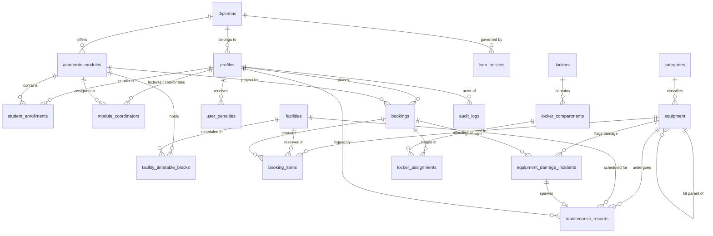

# Database Schema, Entity Relationship & Data Dictionary Specification

**Project:** Ngee Ann Polytechnic School of Film & Media Studies (FMS) Equipment & Facility Booking System  
**Tender Reference:** `FY26/FMS/003x/ITQ`  
**Specification Version:** `1.0.0`  
**Target Engine:** PostgreSQL 16+ on Supabase (AWS Singapore `ap-southeast-1`)  
**Extensions Required:** `uuid-ossp`, `btree_gist`, `pgcrypto`  

---

## 1. Entity Relationship Overview (ERD)



---

## 2. Table Relationships & Cardinality Dictionary (Plain-English Narrative)

To ensure zero ambiguity during development, here is the complete plain-language relationship breakdown across all tables:

### 2.1 Identity, Users & Academic Programmes

1. **A User (`auth.users`) has exactly ONE Profile (`profiles`) [1:1]**
   - Each authenticated Supabase user account corresponds to exactly one profile row containing their student ID, diploma, and system role.
   - *Foreign Key:* `profiles.id REFERENCES auth.users(id) ON DELETE CASCADE`.

2. **A Diploma (`diplomas`) has MANY Profiles (`profiles`) [1:N]**
   - One academic programme (e.g. `FSV - Film, Sound & Video`) has many enrolled students and affiliated staff.
   - A student belongs to at most one primary diploma.
   - *Foreign Key:* `profiles.diploma_id REFERENCES diplomas(id) ON DELETE SET NULL`.

3. **A Diploma (`diplomas`) offers MANY Academic Modules (`academic_modules`) [1:N]**
   - One diploma curriculum (e.g. `FSV`) includes multiple semester courses (e.g. *Cinematography*, *Directing*, *Sound Design*).
   - Each module belongs strictly to one parent diploma.
   - *Foreign Key:* `academic_modules.diploma_id REFERENCES diplomas(id) ON DELETE CASCADE`.

4. **An Academic Module (`academic_modules`) has MANY Lecturers (`profiles`) via Module Coordinators (`module_coordinators`) [N:M]**
   - A course can be coordinated/taught by multiple lecturers (e.g. 2 co-lecturers).
   - A lecturer can coordinate multiple academic modules.
   - *Junction Table:* `module_coordinators` links `module_id` and `lecturer_id`.
   - *Behavior:* When a student reserves equipment for this module, any of the assigned coordinators can approve it.

5. **A Student (`profiles`) is enrolled in MANY Academic Modules (`academic_modules`) via Student Enrollments (`student_enrollments`) [N:M]**
   - A student takes 4 to 6 course modules per semester.
   - Each module contains a class roster of 20 to 30 students.
   - *Junction Table:* `student_enrollments` links `student_id`, `module_id`, `class_group` (e.g. `FSV-2A`), and `semester`.

6. **A User Profile (`profiles`) has MANY Penalties & Strikes (`user_penalties`) [1:N]**
   - A student can accumulate multiple penalty strikes over their 3-year study period (e.g. late returns, uncollected reservations).
   - Each penalty belongs to exactly one student.
   - *Foreign Key:* `user_penalties.user_id REFERENCES profiles(id) ON DELETE CASCADE`.

7. **A Diploma (`diplomas`) has MANY Loan Policies (`loan_policies`) [1:N]**
   - A diploma defines distinct loan rules per role tier (e.g. Year 1 students get max 2 items for 24h; Year 3 film majors get max 6 items for 72h).
   - *Foreign Key:* `loan_policies.diploma_id REFERENCES diplomas(id) ON DELETE CASCADE`.

---

### 2.2 Inventory, Kits & Physical Store Layout

8. **A Category (`categories`) has MANY Subcategories (`categories`) [1:N Self-Referential]**
   - A parent category (e.g. *Cameras & Rigs*) contains multiple subcategories (e.g. *Cinema Cameras*, *Action Cams*, *Gimbals*).
   - A top-level category has `parent_id = NULL`.
   - *Foreign Key:* `categories.parent_id REFERENCES categories(id) ON DELETE SET NULL`.

9. **A Category (`categories`) classifies MANY Equipment items (`equipment`) [1:N]**
   - A subcategory (e.g. *Cinema Cameras*) contains dozens of individual physical camera units.
   - Every equipment item belongs to exactly one specific category.
   - *Foreign Key:* `equipment.category_id REFERENCES categories(id) ON DELETE RESTRICT`.

10. **A Parent Kit (`equipment`) contains MANY Child Accessories (`equipment`) [1:N Self-Referential]**
    - A parent kit (e.g. *Sony FX6 Kit A* with `is_kit = true`) owns multiple physical serialized accessories (e.g. 2x batteries, 1x 24-70mm lens, 1x charger, 1x flight case).
    - Each child accessory points back to its parent kit via `parent_kit_id`.
    - Standalone equipment items have `parent_kit_id = NULL` and `is_kit = false`.
    - *Foreign Key:* `equipment.parent_kit_id REFERENCES equipment(id) ON DELETE SET NULL`.

11. **A Facility (`facilities`) has MANY Timetable Class Holds (`facility_timetable_blocks`) [1:N]**
    - A physical studio (e.g. *Sound Stage 1*) has multiple recurring weekly class schedule blocks imported from the semester timetable.
    - Each timetable hold locks out exactly one facility.
    - *Foreign Key:* `facility_timetable_blocks.facility_id REFERENCES facilities(id) ON DELETE CASCADE`.

12. **An Academic Module (`academic_modules`) occupies Facilities via Timetable Blocks (`facility_timetable_blocks`) [1:N]**
    - A course module (e.g. *FSV204 - Studio Production*) reserves studio rooms for its recurring teaching sessions.
    - *Foreign Key:* `facility_timetable_blocks.module_id REFERENCES academic_modules(id) ON DELETE CASCADE`.

---

### 2.3 Reservations & Concurrency

13. **A User (`profiles`) places MANY Bookings (`bookings`) [1:N]**
    - A student or staff member creates many reservations over time.
    - Each booking belongs strictly to one borrower.
    - *Foreign Key:* `bookings.user_id REFERENCES profiles(id) ON DELETE CASCADE`.

14. **An Academic Module (`academic_modules`) is associated with MANY Bookings (`bookings`) [1:N]**
    - Every student booking must declare which academic coursework/project it supports.
    - *Foreign Key:* `bookings.module_id REFERENCES academic_modules(id) ON DELETE RESTRICT`.

15. **A Lecturer (`profiles`) approves MANY Bookings (`bookings`) [1:N Optional]**
    - A module coordinator approves or rejects multiple student loan requests.
    - A booking has at most one approving lecturer (`approver_id`). Staff bookings have `approver_id = NULL` (auto-approved).
    - *Foreign Key:* `bookings.approver_id REFERENCES profiles(id) ON DELETE SET NULL`.

16. **A Booking (`bookings`) contains MANY Booking Items (`booking_items`) [1:N]**
    - A single booking basket can include multiple physical items (e.g. 1 camera kit, 2 light stands, and 1 edit suite session).
    - Each item in the basket is an individual row in `booking_items`.
    - *Foreign Key:* `booking_items.booking_id REFERENCES bookings(id) ON DELETE CASCADE`.

17. **An Equipment item (`equipment`) is reserved across MANY Booking Items (`booking_items`) over time [1:N Optional]**
    - A physical camera is booked repeatedly across different non-overlapping date-time windows.
    - If `item_type = 'EQUIPMENT'`, `equipment_id` is required; `facility_id` is `NULL`.
    - *Foreign Key:* `booking_items.equipment_id REFERENCES equipment(id) ON DELETE RESTRICT`.
    - *Concurrency Rule:* PostgreSQL GiST exclusion constraint guarantees no two active records can have overlapping `time_range`.

18. **A Facility room (`facilities`) is reserved across MANY Booking Items (`booking_items`) over time [1:N Optional]**
    - A studio or sound stage is booked by students across various non-overlapping time slots.
    - If `item_type = 'FACILITY'`, `facility_id` is required; `equipment_id` is `NULL`.
    - *Foreign Key:* `booking_items.facility_id REFERENCES facilities(id) ON DELETE RESTRICT`.

19. **A Store Officer (`profiles`) checks out and returns MANY Booking Items (`booking_items`) [1:N Optional]**
    - A store counter technician scans out items (`checkout_by`) and inspects incoming returns (`return_by`).
    - *Foreign Keys:* `booking_items.checkout_by REFERENCES profiles(id)`, `booking_items.return_by REFERENCES profiles(id)`.

---

### 2.4 Smart Locker Hardware Integration

20. **A Locker Bank (`lockers`) contains MANY Locker Compartments (`locker_compartments`) [1:N]**
    - A physical locker bank (e.g. *Locker Bay A at Block 52*) has 24 individual doors/compartments.
    - Each compartment belongs to exactly one locker bank.
    - *Foreign Key:* `locker_compartments.locker_id REFERENCES lockers(id) ON DELETE CASCADE`.

21. **A Locker Compartment (`locker_compartments`) has MANY Locker Assignments (`locker_assignments`) over time [1:N]**
    - A compartment door is assigned to a student booking, completed/cleared, and later assigned to another booking.
    - *Foreign Key:* `locker_assignments.compartment_id REFERENCES locker_compartments(id) ON DELETE RESTRICT`.

22. **A Booking (`bookings`) can have ONE OR MORE Locker Assignments (`locker_assignments`) [1:N]**
    - Typically, a booking is staged into 1 compartment. If a student borrows an oversized kit (e.g. heavy lighting stands + camera rig), store staff can stage items across 2 adjacent compartments.
    - *Foreign Key:* `locker_assignments.booking_id REFERENCES bookings(id) ON DELETE CASCADE`.

---

### 2.5 Damage Incidents & Compliance Audit Trail

23. **An Equipment item (`equipment`) can have MANY Damage Incidents (`equipment_damage_incidents`) [1:N]**
    - Over its operational lifespan, an asset may suffer multiple separate incidents (e.g. cracked lens hood in Jan, scratched sensor in Oct).
    - *Foreign Key:* `equipment_damage_incidents.equipment_id REFERENCES equipment(id) ON DELETE RESTRICT`.

24. **A Booking (`bookings`) can generate ONE OR MORE Damage Incidents (`equipment_damage_incidents`) [1:N]**
    - If equipment returned from a specific shoot is damaged, an incident report links directly to that loan contract.
    - *Foreign Key:* `equipment_damage_incidents.booking_id REFERENCES bookings(id) ON DELETE RESTRICT`.

25. **A Student Borrower (`profiles`) is responsible for MANY Damage Incidents (`equipment_damage_incidents`) [1:N]**
    - Tracks student accountability for repair or replacement billing.
    - *Foreign Key:* `equipment_damage_incidents.borrower_id REFERENCES profiles(id) ON DELETE RESTRICT`.

26. **A User (`auth.users` / `profiles`) generates MANY Audit Logs (`audit_logs`) [1:N]**
    - Every create, update, delete, locker unlock, or status change performed by any user is recorded as an immutable audit record.
    - *Foreign Key:* `audit_logs.actor_id REFERENCES auth.users(id) ON DELETE SET NULL` (preserves historical compliance audit records even if an account is later deleted).

27. **An Equipment unit (`equipment`) undergoes MANY Maintenance Records (`maintenance_records`) [1:N]**
    - An asset can have multiple servicing, calibration, or repair intervals scheduled over its lifespan.
    - If `item_type = 'EQUIPMENT'`, `equipment_id` is required; `facility_id` is `NULL`.
    - *Foreign Key:* `maintenance_records.equipment_id REFERENCES equipment(id) ON DELETE CASCADE`.

28. **A Facility room (`facilities`) is scheduled for MANY Maintenance Records (`maintenance_records`) [1:N]**
    - A studio, edit suite, or sound stage can have planned maintenance windows (e.g. air-con servicing, lighting grid overhaul).
    - If `item_type = 'FACILITY'`, `facility_id` is required; `equipment_id` is `NULL`.
    - *Foreign Key:* `maintenance_records.facility_id REFERENCES facilities(id) ON DELETE CASCADE`.

29. **A Damage Incident (`equipment_damage_incidents`) can spawn at most ONE Maintenance Record (`maintenance_records`) [1:1 Optional]**
    - When a damaged return incident requires vendor repair, store staff generate a maintenance work order linked directly to that incident.
    - *Foreign Key:* `maintenance_records.incident_id REFERENCES equipment_damage_incidents(id) ON DELETE SET NULL`.

30. **A Store Officer / Administrator (`profiles`) logs and resolves MANY Maintenance Records (`maintenance_records`) [1:N]**
    - Technical officers schedule planned servicing blackouts and record vendor completion details.
    - *Foreign Key:* `maintenance_records.logged_by REFERENCES profiles(id) ON DELETE SET NULL`.

---

## 3. Core PostgreSQL Enums

```sql
-- Role Hierarchy
CREATE TYPE user_role AS ENUM (
    'STUDENT',
    'LECTURER',
    'TECHNICAL_OFFICER',
    'ADMIN'
);

-- Equipment Lifecycle States
CREATE TYPE equipment_status AS ENUM (
    'AVAILABLE',
    'RESERVED',
    'ON_LOAN',
    'MAINTENANCE',
    'DECOMMISSIONED'
);

-- Equipment Item Hierarchy Type
CREATE TYPE equipment_type AS ENUM (
    'STANDALONE',
    'KIT_PARENT',
    'KIT_ACCESSORY'
);

-- Booking Lifecycle States
CREATE TYPE booking_status AS ENUM (
    'DRAFT',
    'PENDING_APPROVAL',
    'APPROVED',
    'READY_FOR_COLLECTION',
    'REJECTED',
    'COLLECTED',
    'OVERDUE',
    'COMPLETED',
    'CANCELLED'
);

-- Fulfillment / Collection Channels
CREATE TYPE fulfillment_channel AS ENUM (
    'COUNTER',
    'SMART_LOCKER',
    'STUDIO_DELIVERY'
);

-- Reservation Item Type
CREATE TYPE booking_item_type AS ENUM (
    'EQUIPMENT',
    'FACILITY'
);

-- Locker Compartment Size
CREATE TYPE locker_size AS ENUM (
    'SMALL',
    'MEDIUM',
    'LARGE'
);

-- Locker Compartment Operational State
CREATE TYPE compartment_status AS ENUM (
    'EMPTY',
    'OCCUPIED_PICKUP_READY',
    'OCCUPIED_RETURN_PENDING',
    'MAINTENANCE',
    'DOOR_AJAR'
);

-- Equipment Physical Condition Grade
CREATE TYPE condition_grade AS ENUM (
    'PRISTINE',
    'GOOD',
    'MINOR_WEAR',
    'DAMAGED',
    'MISSING_ACCESSORY'
);

-- Penalty & Incident Status
CREATE TYPE incident_status AS ENUM (
    'OPEN',
    'INVESTIGATING',
    'BILLED',
    'WAIVED',
    'RESOLVED'
);

-- Maintenance & Servicing Reason
CREATE TYPE maintenance_type AS ENUM (
    'ROUTINE_INSPECTION',
    'CALIBRATION',
    'DAMAGE_REPAIR',
    'FIRMWARE_UPDATE',
    'FACILITY_SERVICING'
);
```

---

## 4. Database Tables & Field-Level Dictionary

### 4.1 Identity & Academic Reference Domain

#### `profiles` (User Profiles & Identity Extension)
> **What this table is designed to handle:**  
> Extends Supabase `auth.users` with institutional academic credentials, contact details, and role assignments (`STUDENT`, `LECTURER`, `TECHNICAL_OFFICER`, `ADMIN`). It serves as the single source of truth for student identification (`student_id: S10245678A`), diploma programme, cohort year, emergency contact phone number, and borrowing suspension flags (`is_suspended`, `suspension_until`). All RBAC policies, quota checks, and audit trails anchor to this entity.

| Column | Type | Constraints | Description |
| :--- | :--- | :--- | :--- |
| `id` | `UUID` | `PRIMARY KEY REFERENCES auth.users(id) ON DELETE CASCADE` | Matches Supabase Auth user ID. |
| `student_id` | `VARCHAR(15)` | `UNIQUE` (Nullable for staff) | E.g. `S10245678A`. |
| `full_name` | `VARCHAR(150)` | `NOT NULL` | Registered student/staff full name. |
| `email` | `VARCHAR(255)` | `NOT NULL UNIQUE` | Official email (`@np.edu.sg` or `@connect.np.edu.sg`). |
| `phone_number` | `VARCHAR(20)` | `NULLABLE` | Student contact number for emergency return SMS. |
| `role` | `user_role` | `NOT NULL DEFAULT 'STUDENT'` | Access tier for RBAC and RLS. |
| `diploma_id` | `UUID` | `REFERENCES diplomas(id) ON DELETE SET NULL` | Student's primary diploma. |
| `cohort_year` | `INT` | `CHECK (cohort_year BETWEEN 1 AND 3)` | Current year of study (1, 2, or 3). |
| `is_suspended` | `BOOLEAN` | `NOT NULL DEFAULT FALSE` | Flagged if student exceeds penalty strike limit. |
| `suspension_until`| `TIMESTAMPTZ`| `NULLABLE` | End date of borrowing suspension. |
| `created_at` | `TIMESTAMPTZ`| `NOT NULL DEFAULT NOW()` | Record creation timestamp. |
| `updated_at` | `TIMESTAMPTZ`| `NOT NULL DEFAULT NOW()` | Record last updated timestamp. |

#### `diplomas` (Academic Programmes in FMS)
> **What this table is designed to handle:**  
> Represents the accredited diploma programmes offered by the School of Film & Media Studies (e.g. `FSV` - Film, Sound & Video, `MCM` - Mass Communication). It acts as the organizational anchor for course module catalogs, student cohort categorization, and diploma-specific equipment loan policies (e.g. higher-tier cinema packages restricted to film students).

| Column | Type | Constraints | Description |
| :--- | :--- | :--- | :--- |
| `id` | `UUID` | `PRIMARY KEY DEFAULT gen_random_uuid()` | Unique identifier. |
| `code` | `VARCHAR(10)` | `NOT NULL UNIQUE` | E.g. `FSV` (Film, Sound & Video), `MCM` (Media Post-Production). |
| `name` | `VARCHAR(150)`| `NOT NULL` | Full diploma programme name. |
| `is_active` | `BOOLEAN` | `NOT NULL DEFAULT TRUE` | Active enrollment flag. |

#### `academic_modules` (Courses & Project Units)
> **What this table is designed to handle:**  
> Stores individual academic coursework modules and graduation project units (e.g. `FSV301 - Advanced Cinematography`). Every student equipment reservation must be tagged to an active module, ensuring that bookings represent legitimate coursework requirements and routing approvals to the correct supervising faculty.

| Column | Type | Constraints | Description |
| :--- | :--- | :--- | :--- |
| `id` | `UUID` | `PRIMARY KEY DEFAULT gen_random_uuid()` | Unique identifier. |
| `diploma_id` | `UUID` | `REFERENCES diplomas(id) ON DELETE CASCADE` | Associated diploma. |
| `module_code` | `VARCHAR(20)` | `NOT NULL UNIQUE` | E.g. `FSV301` (Advanced Cinematography). |
| `title` | `VARCHAR(200)`| `NOT NULL` | Module display name. |
| `is_active` | `BOOLEAN` | `NOT NULL DEFAULT TRUE` | Active semester offering flag. |

#### `module_coordinators` (Lecturers Assigned to Approve Module Loans)
> **What this table is designed to handle:**  
> Maps teaching faculty and lecturers to the specific academic modules they coordinate. When a student submits an equipment booking for coursework, this junction table identifies which lecturer(s) have approval authority to review, approve, or reject the loan request.

| Column | Type | Constraints | Description |
| :--- | :--- | :--- | :--- |
| `id` | `UUID` | `PRIMARY KEY DEFAULT gen_random_uuid()` | Unique identifier. |
| `module_id` | `UUID` | `REFERENCES academic_modules(id) ON DELETE CASCADE` | Target module. |
| `lecturer_id` | `UUID` | `REFERENCES profiles(id) ON DELETE CASCADE` | Lecturer profile ID. |
| `created_at` | `TIMESTAMPTZ`| `NOT NULL DEFAULT NOW()` | Assignment timestamp. |
| *Constraint* | `UNIQUE (module_id, lecturer_id)` | Prevents duplicate coordinator mappings. |

#### `student_enrollments` (Module Roster Ingestion)
> **What this table is designed to handle:**  
> Ingests semester class rosters (via CSV import) to track which students are actively enrolled in which module, class group (e.g. `FSV-2A`), and academic term. Enforces loan eligibility, guaranteeing that students can only reserve specialized equipment tiers authorized for their currently enrolled subjects.

| Column | Type | Constraints | Description |
| :--- | :--- | :--- | :--- |
| `id` | `UUID` | `PRIMARY KEY DEFAULT gen_random_uuid()` | Unique identifier. |
| `student_id` | `UUID` | `REFERENCES profiles(id) ON DELETE CASCADE` | Student profile ID. |
| `module_id` | `UUID` | `REFERENCES academic_modules(id) ON DELETE CASCADE` | Enrolled module. |
| `class_group` | `VARCHAR(10)` | `NOT NULL` | E.g. `FSV-2A`. |
| `semester` | `VARCHAR(20)` | `NOT NULL` | E.g. `AY2026/27 Sem 1`. |
| *Constraint* | `UNIQUE (student_id, module_id, semester)` | Prevents duplicate enrollments. |

---

### 4.2 Inventory Domain (Equipment & Facilities)

#### `categories` (Equipment Hierarchy Classification)
> **What this table is designed to handle:**  
> Manages the hierarchical taxonomy and classification tree of all film, audio, and lighting gear (e.g. *Cameras & Rigs* $\rightarrow$ *Cinema Cameras*). Powers catalog browsing, nested category sidebar filters, Lucide icon rendering, and URL-friendly slugs in the student portal.

| Column | Type | Constraints | Description |
| :--- | :--- | :--- | :--- |
| `id` | `UUID` | `PRIMARY KEY DEFAULT gen_random_uuid()` | Unique identifier. |
| `parent_id` | `UUID` | `REFERENCES categories(id) ON DELETE SET NULL` | Supports subcategories (e.g. Cameras -> Cinema Cameras). |
| `name` | `VARCHAR(100)`| `NOT NULL` | Display category name. |
| `slug` | `VARCHAR(100)`| `NOT NULL UNIQUE` | URL-safe slug for catalog routing. |
| `icon_name` | `VARCHAR(50)` | `NULLABLE` | Lucide icon identifier. |

#### `equipment` (Self-Referential Physical Asset Master)
> **What this table is designed to handle:**  
> Serves as the central physical inventory registry for up to 1,000 assets across Block 52 store bays (`#01-01`, `#01-02`, `#01-03`). Uses a self-referential parent-child link (`parent_kit_id`) so that both complex packages (e.g. *Sony FX6 Kit A* with `is_kit = true`) and their serialized accessories (lenses, batteries, flight cases) are uniquely tracked with barcodes (`asset_tag_id`), serial numbers, replacement values, shelf locations, and real-time operational availability states (`AVAILABLE`, `ON_LOAN`, `MAINTENANCE`).

| Column | Type | Constraints | Description |
| :--- | :--- | :--- | :--- |
| `id` | `UUID` | `PRIMARY KEY DEFAULT gen_random_uuid()` | Internal relational primary key. |
| `asset_tag_id`| `VARCHAR(50)` | `NOT NULL UNIQUE` | Barcode/QR string affixed to hardware (`NP-FMS-CAM-0142`). |
| `serial_number`| `VARCHAR(100)`| `NULLABLE` | Manufacturer hardware serial number. |
| `name` | `VARCHAR(200)`| `NOT NULL` | E.g. `Sony FX6 Cinema Camera (Kit A)`. |
| `brand` | `VARCHAR(100)`| `NOT NULL` | E.g. `Sony`, `Canon`, `Aputure`, `Sennheiser`. |
| `model` | `VARCHAR(100)`| `NOT NULL` | E.g. `ILME-FX6V`. |
| `category_id` | `UUID` | `REFERENCES categories(id) ON DELETE RESTRICT` | Category classification. |
| `item_type` | `equipment_type`| `NOT NULL DEFAULT 'STANDALONE'` | `STANDALONE`, `KIT_PARENT`, or `KIT_ACCESSORY`. |
| `parent_kit_id`| `UUID` | `REFERENCES equipment(id) ON DELETE SET NULL` | Points to parent kit if this item is a bundled accessory. |
| `is_kit` | `BOOLEAN` | `NOT NULL DEFAULT FALSE` | Flag for quick filtering of parent bundles. |
| `status` | `equipment_status`| `NOT NULL DEFAULT 'AVAILABLE'` | Real-time availability state. |
| `store_location`| `VARCHAR(50)`| `NOT NULL` | Physical store bay (`Block 52 #01-01`, `#01-02`, `#01-03`). |
| `shelf_location`| `VARCHAR(50)`| `NULLABLE` | Internal shelf/bin code (`Rack B, Shelf 3`). |
| `replacement_cost_sgd`| `NUMERIC(10,2)`| `NOT NULL DEFAULT 0.00` | Replacement value for insurance and damage billing. |
| `is_oversized` | `BOOLEAN` | `NOT NULL DEFAULT FALSE` | Exceeds smart locker dimensions (mandates counter/studio pickup). |
| `thumbnail_url`| `TEXT` | `NULLABLE` | Image hosted in Supabase Storage. |
| `created_at` | `TIMESTAMPTZ`| `NOT NULL DEFAULT NOW()` | Asset onboarding timestamp. |
| `updated_at` | `TIMESTAMPTZ`| `NOT NULL DEFAULT NOW()` | Asset update timestamp. |

#### `facilities` (Studios, Edit Suites & Sound Stages)
> **What this table is designed to handle:**  
> Manages the physical room inventory of FMS production facilities (film studios, sound stages, Foley suites, and edit suites). Records unique room codes (`BLK52-01-08-STUDIO1`), maximum capacities, access instructions, and operational availability for student reservation.

| Column | Type | Constraints | Description |
| :--- | :--- | :--- | :--- |
| `id` | `UUID` | `PRIMARY KEY DEFAULT gen_random_uuid()` | Unique identifier. |
| `room_code` | `VARCHAR(50)` | `NOT NULL UNIQUE` | E.g. `BLK52-01-08-STUDIO1`. |
| `name` | `VARCHAR(150)`| `NOT NULL` | Display title (e.g. `Film Sound Stage 1`). |
| `capacity` | `INT` | `NOT NULL DEFAULT 1` | Maximum occupant capacity. |
| `location_details`| `TEXT` | `NULLABLE` | Room access instructions. |
| `is_active` | `BOOLEAN` | `NOT NULL DEFAULT TRUE` | Available for reservation. |

#### `facility_timetable_blocks` (Recurring Academic Class Holds)
> **What this table is designed to handle:**  
> Stores recurring weekly academic teaching schedules imported from semester timetable CSVs (Clause 7.1). Automatically blocks out studio rooms during designated teaching hours across the term, rendering class hours unavailable on the student booking calendar without polluting the transactional `bookings` table.

| Column | Type | Constraints | Description |
| :--- | :--- | :--- | :--- |
| `id` | `UUID` | `PRIMARY KEY DEFAULT gen_random_uuid()` | Unique identifier. |
| `facility_id` | `UUID` | `REFERENCES facilities(id) ON DELETE CASCADE` | Blocked room. |
| `module_id` | `UUID` | `REFERENCES academic_modules(id) ON DELETE CASCADE` | Associated teaching module. |
| `lecturer_id` | `UUID` | `REFERENCES profiles(id) ON DELETE SET NULL` | Teaching faculty member. |
| `day_of_week` | `SMALLINT` | `CHECK (day_of_week BETWEEN 1 AND 7)` | 1 = Monday, 7 = Sunday. |
| `start_time` | `TIME` | `NOT NULL` | Class block start (e.g. `09:00:00`). |
| `end_time` | `TIME` | `NOT NULL` | Class block end (e.g. `12:00:00`). |
| `valid_from` | `DATE` | `NOT NULL` | Semester start date. |
| `valid_until` | `DATE` | `NOT NULL` | Semester end date. |
| `class_group` | `VARCHAR(20)` | `NOT NULL` | E.g. `FSV-2A`. |

---

### 4.3 Transactional Reservation Domain

#### `bookings` (Master Reservation Header)
> **What this table is designed to handle:**  
> Acts as the root reservation record for every loan transaction, coordinating the complete workflow state (`DRAFT` $\rightarrow$ `PENDING_APPROVAL` $\rightarrow$ `APPROVED` $\rightarrow$ `READY_FOR_COLLECTION` $\rightarrow$ `COLLECTED` $\rightarrow$ `OVERDUE` $\rightarrow$ `COMPLETED` $\rightarrow$ `CANCELLED`). Tracks the borrowing user, associated academic coursework module, shoot/project title, lecturer approval decisions, fulfillment channels (`collection_method` and `return_method` across `COUNTER`, `SMART_LOCKER`, or `STUDIO_DELIVERY`), physical pickup locations (`collection_location`), and generates cryptographically signed offline QR pass tokens (`qr_pass_token`) rendered on student mobile devices for counter and smart locker collection.

| Column | Type | Constraints | Description |
| :--- | :--- | :--- | :--- |
| `id` | `UUID` | `PRIMARY KEY DEFAULT gen_random_uuid()` | Internal relational primary key. |
| `booking_number`| `VARCHAR(30)` | `NOT NULL UNIQUE` | Human-friendly reference (`BK-202610-0042`). |
| `user_id` | `UUID` | `REFERENCES profiles(id) ON DELETE CASCADE` | Student/Staff borrower profile. |
| `module_id` | `UUID` | `REFERENCES academic_modules(id) ON DELETE RESTRICT` | Associated project course. |
| `project_title` | `VARCHAR(200)`| `NOT NULL` | Brief description of coursework/shoot. |
| `status` | `booking_status`| `NOT NULL DEFAULT 'DRAFT'` | Workflow state. |
| `approver_id` | `UUID` | `REFERENCES profiles(id) ON DELETE SET NULL` | Lecturer who approved or rejected. |
| `approved_at` | `TIMESTAMPTZ`| `NULLABLE` | Timestamp of approval decision. |
| `rejection_reason`| `TEXT` | `NULLABLE` | Lecturer feedback if rejected. |
| `collection_method`| `fulfillment_channel`| `NOT NULL DEFAULT 'COUNTER'` | `COUNTER`, `SMART_LOCKER`, or `STUDIO_DELIVERY`. |
| `collection_location`| `VARCHAR(200)`| `NULLABLE` | E.g. `Block 52 Smart Locker Bank A, Door #14` or `Store Counter Bay 1`. |
| `return_method` | `fulfillment_channel`| `NOT NULL DEFAULT 'COUNTER'` | Designated return channel. |
| `return_location`| `VARCHAR(200)`| `NULLABLE` | E.g. `Smart Locker Bank A` or `Store Counter Return Bay`. |
| `qr_pass_token` | `TEXT` | `NULLABLE UNIQUE` | Signed JWT token rendered as offline QR pass. |
| `qr_pass_expires`| `TIMESTAMPTZ`| `NULLABLE` | Token expiration boundary. |
| `created_at` | `TIMESTAMPTZ`| `NOT NULL DEFAULT NOW()` | Booking creation timestamp. |
| `updated_at` | `TIMESTAMPTZ`| `NOT NULL DEFAULT NOW()` | Booking update timestamp. |

#### `booking_items` (Reserved Assets with GiST Exclusion Guarantee)
> **What this table is designed to handle:**  
> Tracks each individual equipment unit or facility room reserved within a booking cart. Crucially enforces PostgreSQL GiST exclusion constraints (`tstzrange` overlap `&&`) to physically prevent any overlapping double-bookings at the database engine level. Also records physical checkout/return timestamps, inspecting store officer IDs, incoming/outgoing physical condition grades, inspector notes, and high-resolution damage photos uploaded to Supabase Storage.

| Column | Type | Constraints | Description |
| :--- | :--- | :--- | :--- |
| `id` | `UUID` | `PRIMARY KEY DEFAULT gen_random_uuid()` | Unique identifier. |
| `booking_id` | `UUID` | `REFERENCES bookings(id) ON DELETE CASCADE` | Parent reservation. |
| `item_type` | `booking_item_type`| `NOT NULL` | `EQUIPMENT` or `FACILITY`. |
| `equipment_id` | `UUID` | `REFERENCES equipment(id) ON DELETE RESTRICT` | Target equipment unit (Nullable if facility). |
| `facility_id` | `UUID` | `REFERENCES facilities(id) ON DELETE RESTRICT` | Target room (Nullable if equipment). |
| `time_range` | `TSTZRANGE` | `NOT NULL` | Booking period: `[start_time, end_time)`. |
| `status` | `booking_status`| `NOT NULL DEFAULT 'APPROVED'` | Item reservation status (synced or individually cancelled). |
| `checked_out_at`| `TIMESTAMPTZ`| `NULLABLE` | Actual physical handover timestamp. |
| `checkout_by` | `UUID` | `REFERENCES profiles(id) ON DELETE SET NULL` | Store officer who scanned item out. |
| `returned_at` | `TIMESTAMPTZ`| `NULLABLE` | Actual physical return timestamp. |
| `return_by` | `UUID` | `REFERENCES profiles(id) ON DELETE SET NULL` | Store officer who inspected return. |
| `condition_out`| `condition_grade`| `NOT NULL DEFAULT 'GOOD'` | Condition at checkout. |
| `condition_in` | `condition_grade`| `NULLABLE` | Condition at return. |
| `inspection_photos`| `TEXT[]` | `DEFAULT ARRAY[]::TEXT[]` | Supabase Storage photo URLs for damage/wear. |
| `inspection_notes` | `TEXT` | `NULLABLE` | Counter officer observation notes. |

##### GiST Concurrency Safeguard:
```sql
-- Prevents overlapping active bookings for the SAME equipment item
ALTER TABLE booking_items 
ADD CONSTRAINT no_overlapping_equipment_bookings
EXCLUDE USING gist (
    equipment_id WITH =,
    time_range WITH &&
)
WHERE (equipment_id IS NOT NULL AND status NOT IN ('CANCELLED', 'REJECTED'));

-- Prevents overlapping active bookings for the SAME facility room
ALTER TABLE booking_items 
ADD CONSTRAINT no_overlapping_facility_bookings
EXCLUDE USING gist (
    facility_id WITH =,
    time_range WITH &&
)
WHERE (facility_id IS NOT NULL AND status NOT IN ('CANCELLED', 'REJECTED'));
```

---

### 4.4 Smart Locker Hardware Domain

#### `lockers` (Locker Bays / Controllers)
> **What this table is designed to handle:**  
> Represents physical smart locker banks and IoT controller cabinets deployed at Block 52. Tracks controller network IP addresses, hashed communication API keys for hardware authentication, total compartment counts, physical corridor placement notes, and real-time network heartbeat connectivity (`is_online`).

| Column | Type | Constraints | Description |
| :--- | :--- | :--- | :--- |
| `id` | `UUID` | `PRIMARY KEY DEFAULT gen_random_uuid()` | Unique identifier. |
| `name` | `VARCHAR(100)`| `NOT NULL` | E.g. `Block 52 Smart Locker Bank A`. |
| `controller_ip` | `INET` | `NULLABLE` | IoT controller network address. |
| `api_key_hash` | `TEXT` | `NOT NULL` | Hashed communication secret. |
| `total_compartments`| `INT` | `NOT NULL DEFAULT 24` | Total door count. |
| `location_notes`| `VARCHAR(200)`| `NOT NULL` | E.g. `Block 52 Ground Floor Corridor`. |
| `is_online` | `BOOLEAN` | `NOT NULL DEFAULT TRUE` | Live hardware heartbeat status. |

#### `locker_compartments` (Individual Locker Doors)
> **What this table is designed to handle:**  
> Models each individual locker door/bay inside a physical locker bank. Tracks the door's physical number (`1` to `24`), physical dimension classification (`SMALL`, `MEDIUM`, `LARGE` for varying camera kit sizes), and real-time magnetic sensor states (`EMPTY`, `OCCUPIED_PICKUP_READY`, `OCCUPIED_RETURN_PENDING`, `MAINTENANCE`, `DOOR_AJAR`).

| Column | Type | Constraints | Description |
| :--- | :--- | :--- | :--- |
| `id` | `UUID` | `PRIMARY KEY DEFAULT gen_random_uuid()` | Unique identifier. |
| `locker_id` | `UUID` | `REFERENCES lockers(id) ON DELETE CASCADE` | Parent locker bank. |
| `compartment_number`| `INT` | `NOT NULL` | Door physical number (`1` to `24`). |
| `size` | `locker_size` | `NOT NULL DEFAULT 'MEDIUM'` | `SMALL`, `MEDIUM`, or `LARGE`. |
| `status` | `compartment_status`| `NOT NULL DEFAULT 'EMPTY'` | Real-time sensor state. |
| *Constraint* | `UNIQUE (locker_id, compartment_number)` | Unique door number per bank. |

#### `locker_assignments` (Staged Booking Pickup & Return Allocations)
> **What this table is designed to handle:**  
> Manages the temporary binding of an approved reservation to a specific locker door for after-hours contactless pickup or return. Stores hashed 6-digit backup PINs, access time windows (`valid_from` to `valid_until`), execution timestamps of unlock signals, and physical magnetic sensor confirmation events (`door_opened_at`, `door_closed_at`) along with the trigger mechanism (`QR_CODE`, `PIN_CODE`, `STAFF_MASTER_KEY`).

| Column | Type | Constraints | Description |
| :--- | :--- | :--- | :--- |
| `id` | `UUID` | `PRIMARY KEY DEFAULT gen_random_uuid()` | Unique identifier. |
| `compartment_id`| `UUID` | `REFERENCES locker_compartments(id) ON DELETE RESTRICT` | Assigned door. |
| `booking_id` | `UUID` | `REFERENCES bookings(id) ON DELETE CASCADE` | Staged reservation. |
| `pin_code_hash` | `TEXT` | `NOT NULL` | Hashed 6-digit backup PIN. |
| `valid_from` | `TIMESTAMPTZ`| `NOT NULL` | Earliest student access window. |
| `valid_until` | `TIMESTAMPTZ`| `NOT NULL` | Staging timeout boundary. |
| `unlocked_at` | `TIMESTAMPTZ`| `NULLABLE` | Timestamp door was triggered open. |
| `door_opened_at`| `TIMESTAMPTZ`| `NULLABLE` | Hardware sensor confirmation: door physically swung open. |
| `door_closed_at`| `TIMESTAMPTZ`| `NULLABLE` | Hardware sensor confirmation: door closed. |
| `unlock_method` | `VARCHAR(30)` | `NULLABLE` | `QR_CODE`, `PIN_CODE`, or `STAFF_MASTER_KEY`. |

---

### 4.5 Governance, Penalties & Compliance Domain

#### `loan_policies` (Departmental Quotas & Loan Boundaries)
> **What this table is designed to handle:**  
> Stores configurable departmental loan limits, quotas, and timing rules mapped per diploma and user role tier. Allows FMS store administrators to adjust maximum simultaneous loan counts, maximum duration hours (e.g. 72 hours), advance reservation booking horizons (e.g. 14 days), and strike thresholds dynamically via the Admin portal without requiring code changes or application redeployments.

| Column | Type | Constraints | Description |
| :--- | :--- | :--- | :--- |
| `id` | `UUID` | `PRIMARY KEY DEFAULT gen_random_uuid()` | Unique identifier. |
| `diploma_id` | `UUID` | `REFERENCES diplomas(id) ON DELETE CASCADE` | Target diploma. |
| `role` | `user_role` | `NOT NULL` | Target role tier. |
| `max_simultaneous_items`| `INT` | `NOT NULL DEFAULT 4` | Concurrency loan limit. |
| `max_loan_duration_hours`| `INT` | `NOT NULL DEFAULT 72` | E.g. 72 hours (3 days). |
| `max_advance_booking_days`| `INT`| `NOT NULL DEFAULT 14` | How early reservations can be placed. |
| `strike_suspension_threshold`| `INT`| `NOT NULL DEFAULT 3` | Strikes before auto-suspension. |
| `suspension_duration_days`| `INT` | `NOT NULL DEFAULT 14` | Period of account lockout. |

#### `user_penalties` (Overdue Strikes & Damage Violations)
> **What this table is designed to handle:**  
> Tracks disciplinary strikes and loan violations incurred by borrowers (Clause 8.1 & 8.2). Records strike counts, infractions (e.g. *Overdue Return by 4 Hours*, *Uncollected Booking*), issuing store officer IDs, and formal administrative waivers with justification. When an active student's strike count reaches their diploma policy threshold (e.g. 3 strikes), a database trigger automatically sets `profiles.is_suspended = true` and calculates `suspension_until`.

| Column | Type | Constraints | Description |
| :--- | :--- | :--- | :--- |
| `id` | `UUID` | `PRIMARY KEY DEFAULT gen_random_uuid()` | Unique identifier. |
| `user_id` | `UUID` | `REFERENCES profiles(id) ON DELETE CASCADE` | Penalized user. |
| `booking_id` | `UUID` | `REFERENCES bookings(id) ON DELETE SET NULL` | Triggering booking. |
| `strike_count` | `INT` | `NOT NULL DEFAULT 1` | Strikes applied (1 to 3). |
| `reason` | `VARCHAR(255)`| `NOT NULL` | E.g. `Overdue Return by 4 Hours`. |
| `issued_by` | `UUID` | `REFERENCES profiles(id) ON DELETE SET NULL` | Staff officer ID. |
| `is_waived` | `BOOLEAN` | `NOT NULL DEFAULT FALSE` | Administrative relief flag. |
| `waived_reason` | `TEXT` | `NULLABLE` | Staff justification for waiving strike. |
| `created_at` | `TIMESTAMPTZ`| `NOT NULL DEFAULT NOW()` | Issuance timestamp. |

#### `equipment_damage_incidents` (Damage Claims & Repair Tracking)
> **What this table is designed to handle:**  
> Manages defect claims, physical damage reports, and missing accessory tracking flagged during equipment return inspections. Generates formal incident tickets (`INC-202610-0012`), stores high-resolution damage photos uploaded to Supabase Storage, records repair or replacement cost estimates, tracks responsible student borrower liability, and coordinates administrative billing or waiver resolution workflows.

| Column | Type | Constraints | Description |
| :--- | :--- | :--- | :--- |
| `id` | `UUID` | `PRIMARY KEY DEFAULT gen_random_uuid()` | Unique identifier. |
| `incident_number`| `VARCHAR(30)` | `NOT NULL UNIQUE` | E.g. `INC-202610-0012`. |
| `equipment_id` | `UUID` | `REFERENCES equipment(id) ON DELETE RESTRICT` | Damaged hardware unit. |
| `booking_id` | `UUID` | `REFERENCES bookings(id) ON DELETE RESTRICT` | Active loan when damaged. |
| `borrower_id` | `UUID` | `REFERENCES profiles(id) ON DELETE RESTRICT` | Responsible student. |
| `status` | `incident_status`| `NOT NULL DEFAULT 'OPEN'` | Resolution state. |
| `description` | `TEXT` | `NOT NULL` | Description of physical defect. |
| `photo_urls` | `TEXT[]` | `NOT NULL` | High-res condition photos in Supabase S3. |
| `estimated_cost_sgd`| `NUMERIC(10,2)`| `NOT NULL DEFAULT 0.00` | Estimated repair/replacement quote. |
| `resolved_by` | `UUID` | `REFERENCES profiles(id) ON DELETE SET NULL` | Administrator handling incident. |
| `resolved_at` | `TIMESTAMPTZ`| `NULLABLE` | Resolution timestamp. |
| `created_at` | `TIMESTAMPTZ`| `NOT NULL DEFAULT NOW()` | Incident creation timestamp. |

#### `maintenance_records` (Asset Servicing, Calibration & Facility Outages)
> **What this table is designed to handle:**  
> Records planned and unplanned maintenance outages, routine servicing, warranty repairs, sensor calibrations, and facility blackouts (e.g. sound stage acoustic baffle servicing, studio air-con overhaul). Tracks maintenance types, external authorized service vendors (e.g. *Sony Singapore Service Centre*, *Daikin Singapore*), repair costs, and outage date-time windows (`time_range`). Enforces a GiST exclusion constraint so that scheduled maintenance windows physically prevent any student bookings on the target equipment or facility during the downtime.

| Column | Type | Constraints | Description |
| :--- | :--- | :--- | :--- |
| `id` | `UUID` | `PRIMARY KEY DEFAULT gen_random_uuid()` | Unique identifier. |
| `maintenance_number`| `VARCHAR(30)` | `NOT NULL UNIQUE` | E.g. `MNT-202610-0005`. |
| `item_type` | `booking_item_type`| `NOT NULL` | `EQUIPMENT` or `FACILITY`. |
| `equipment_id` | `UUID` | `REFERENCES equipment(id) ON DELETE CASCADE` | Hardware asset under maintenance (NULL if facility). |
| `facility_id` | `UUID` | `REFERENCES facilities(id) ON DELETE CASCADE` | Facility room under maintenance (NULL if equipment). |
| `incident_id` | `UUID` | `REFERENCES equipment_damage_incidents(id) ON DELETE SET NULL` | Linked damage claim if triggered by an incident. |
| `maintenance_type` | `maintenance_type`| `NOT NULL` | `ROUTINE_INSPECTION`, `CALIBRATION`, `DAMAGE_REPAIR`, etc. |
| `service_vendor` | `VARCHAR(150)`| `NULLABLE` | External service vendor/contractor name. |
| `time_range` | `TSTZRANGE` | `NOT NULL` | Planned outage window `[start_time, end_time)`. |
| `cost_sgd` | `NUMERIC(10,2)`| `NOT NULL DEFAULT 0.00` | Maintenance/servicing invoiced cost. |
| `is_completed` | `BOOLEAN` | `NOT NULL DEFAULT FALSE` | Flag indicating servicing is finished and asset restored. |
| `actual_completed_at`| `TIMESTAMPTZ`| `NULLABLE` | Exact timestamp asset was returned to operational service. |
| `notes` | `TEXT` | `NOT NULL` | Work order scope, technician findings, or repairs done. |
| `logged_by` | `UUID` | `REFERENCES profiles(id) ON DELETE SET NULL` | Store officer or admin logging the record. |
| `created_at` | `TIMESTAMPTZ`| `NOT NULL DEFAULT NOW()` | Record creation timestamp. |
| `updated_at` | `TIMESTAMPTZ`| `NOT NULL DEFAULT NOW()` | Record update timestamp. |
| *Constraint* | `CHECK ((item_type = 'EQUIPMENT' AND equipment_id IS NOT NULL AND facility_id IS NULL) OR (item_type = 'FACILITY' AND facility_id IS NOT NULL AND equipment_id IS NULL))` | Enforces strictly one target asset type. |

##### GiST Maintenance Safeguard:
```sql
-- Prevents overlapping active maintenance periods for the SAME equipment item
ALTER TABLE maintenance_records 
ADD CONSTRAINT no_overlapping_equipment_maintenance
EXCLUDE USING gist (
    equipment_id WITH =,
    time_range WITH &&
)
WHERE (equipment_id IS NOT NULL AND is_completed = FALSE);

-- Prevents overlapping active maintenance periods for the SAME facility room
ALTER TABLE maintenance_records 
ADD CONSTRAINT no_overlapping_facility_maintenance
EXCLUDE USING gist (
    facility_id WITH =,
    time_range WITH &&
)
WHERE (facility_id IS NOT NULL AND is_completed = FALSE);
```

#### `audit_logs` (Immutable 36-Month Legal Audit Trail — Clause 3.0)
> **What this table is designed to handle:**  
> Fulfills the strict 36-month non-repudiation audit trail mandated by GeBIZ ITQ Clause 3.0. Captures an immutable, tamper-proof record of every single security-sensitive and operational action across the system: user logins, booking creations, status transitions, lecturer approvals, counter checkouts/returns, smart locker door releases, and administrative user overrides. Recorded with the acting user's ID, snapshot of their active role, client IP address, Singapore edge country headers, before-and-after change diffs (`metadata`), and exact server timestamps. Enforced by PostgreSQL triggers that strictly forbid `UPDATE` and `DELETE` queries.

| Column | Type | Constraints | Description |
| :--- | :--- | :--- | :--- |
| `id` | `UUID` | `PRIMARY KEY DEFAULT gen_random_uuid()` | Unique event ID. |
| `actor_id` | `UUID` | `REFERENCES auth.users(id) ON DELETE SET NULL` | User who initiated action. |
| `actor_role` | `VARCHAR(50)` | `NOT NULL` | Snapshot of role at time of action. |
| `action_type` | `VARCHAR(100)`| `NOT NULL` | E.g. `CREATE_BOOKING`, `UNLOCK_LOCKER`, `SUSPEND_USER`. |
| `entity_name` | `VARCHAR(100)`| `NOT NULL` | Target table (e.g. `bookings`, `equipment`). |
| `entity_id` | `VARCHAR(100)`| `NULLABLE` | Target primary key. |
| `ip_address` | `INET` | `NULLABLE` | Edge client IP. |
| `country_code` | `VARCHAR(10)` | `NULLABLE` | Edge country header (`SG`). |
| `metadata` | `JSONB` | `DEFAULT '{}'::jsonb` | State changes (before & after values). |
| `created_at` | `TIMESTAMPTZ`| `NOT NULL DEFAULT NOW()` | Immutable event timestamp. |

---

## 5. Key Row-Level Security (RLS) Policy Specifications

### Policy: Students Access to Equipment Catalog (`equipment`)
```sql
CREATE POLICY "Students can view available and active equipment"
ON public.equipment FOR SELECT
TO authenticated
USING (
    status != 'DECOMMISSIONED'
);
```

### Policy: Students Manage Own Bookings (`bookings`)
```sql
CREATE POLICY "Students can view and create their own bookings"
ON public.bookings FOR ALL
TO authenticated
USING (
    auth.uid() = user_id
    OR (SELECT role FROM profiles WHERE id = auth.uid()) IN ('LECTURER', 'TECHNICAL_OFFICER', 'ADMIN')
);
```

### Policy: Lecturers Review Assigned Module Bookings (`bookings`)
```sql
CREATE POLICY "Lecturers can review bookings for their coordinated modules"
ON public.bookings FOR UPDATE
TO authenticated
USING (
    EXISTS (
        SELECT 1 FROM module_coordinators
        WHERE module_coordinators.module_id = bookings.module_id
          AND module_coordinators.lecturer_id = auth.uid()
    )
);
```

### Policy: Audit Logs are Immutable
```sql
CREATE POLICY "Audit logs can only be inserted, never updated or deleted"
ON public.audit_logs FOR INSERT
TO authenticated
WITH CHECK (true);

-- Revoke UPDATE and DELETE from all roles
REVOKE UPDATE, DELETE ON public.audit_logs FROM public, authenticated, anon;
```

### Policy: Access to Maintenance Records (`maintenance_records`)
```sql
-- Students can view maintenance outage time windows (for blackout calendar rendering) without seeing internal financial costs or vendor notes
CREATE POLICY "Students can view public maintenance outage windows"
ON public.maintenance_records FOR SELECT
TO authenticated
USING (true);

-- Only Technical Officers and Admins can create or update maintenance records
CREATE POLICY "Store staff can manage maintenance records"
ON public.maintenance_records FOR ALL
TO authenticated
USING (
    (SELECT role FROM profiles WHERE id = auth.uid()) IN ('TECHNICAL_OFFICER', 'ADMIN')
);
```

---

## 6. Unified Operational Availability Query Pattern

To determine whether an **Equipment unit** or **Facility room** is available for student booking over a requested window `[$start_time, $end_time)`:

```sql
-- Checks both physical status, active student reservations, and scheduled maintenance blackouts
SELECT eq.id, eq.name, eq.asset_tag_id
FROM equipment eq
WHERE eq.id = $equipment_id
  -- 1. Immediate Physical Operational Check
  AND eq.status NOT IN ('MAINTENANCE', 'DECOMMISSIONED')
  -- 2. No Overlapping Student Reservations in booking_items
  AND NOT EXISTS (
      SELECT 1 FROM booking_items bi
      WHERE bi.equipment_id = eq.id
        AND bi.status NOT IN ('CANCELLED', 'REJECTED')
        AND bi.time_range && tstzrange($start_time, $end_time)
  )
  -- 3. No Overlapping Scheduled Maintenance Outages in maintenance_records
  AND NOT EXISTS (
      SELECT 1 FROM maintenance_records mr
      WHERE mr.equipment_id = eq.id
        AND mr.is_completed = FALSE
        AND mr.time_range && tstzrange($start_time, $end_time)
  );
```
*(The identical pattern applies to `facilities`, replacing `eq.id` with `facilities.id` and checking `facilities.is_active = TRUE` alongside `facility_timetable_blocks`).*

