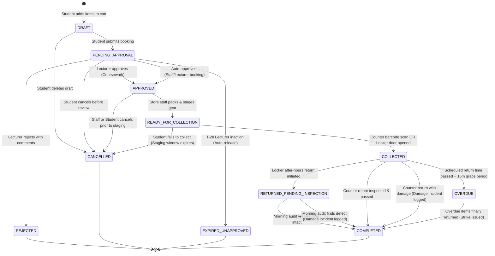
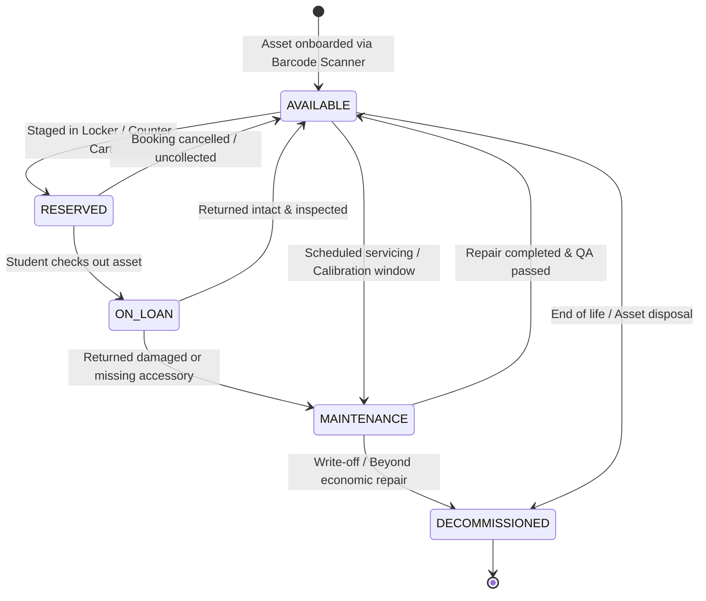
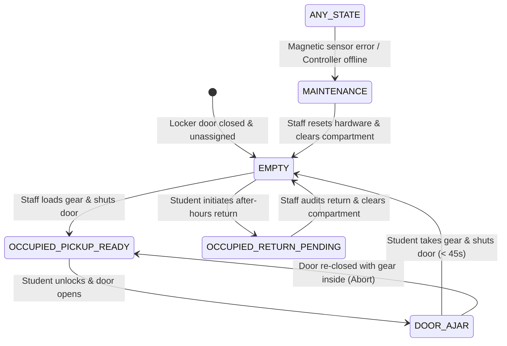
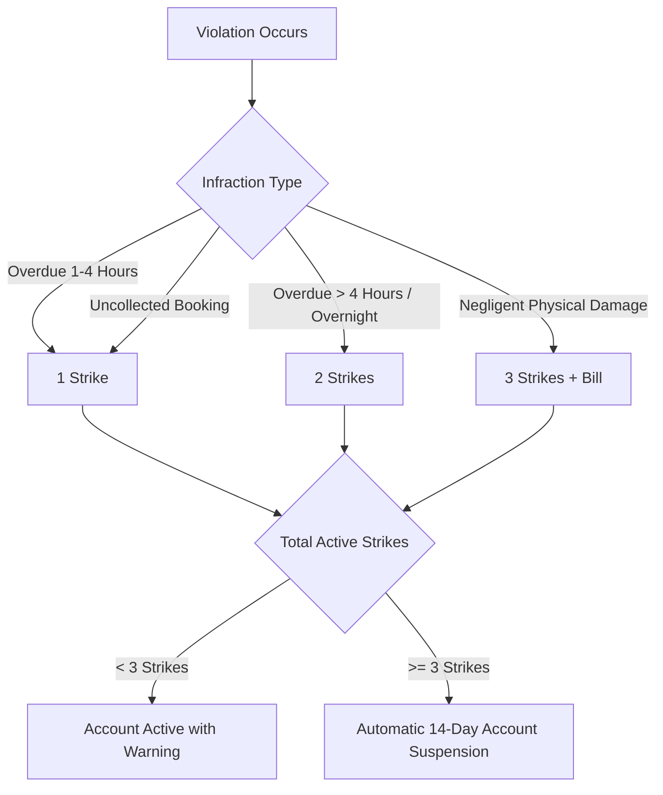

# State Machines, Lifecycle Transitions & Business Rules Specification

**Project:** Ngee Ann Polytechnic School of Film & Media Studies (FMS) Equipment & Facility Booking System  
**Tender Reference:** `FY26/FMS/003x/ITQ`  
**Specification Version:** `1.0.0`  
**Status:** Approved for Implementation  

---

## 1. Overview & Architectural Principles

This document defines the formal finite state machines (FSM), state transition matrices, invariant guards, and operational edge-case business rules governing the FMS booking system.

All state transitions in this system adhere to four core engineering rules:
1. **Single Source of Truth (Database-Level State Enforcement):** State transitions are validated by PostgreSQL constraints and stored procedures. No application layer may transition an entity without satisfying explicit invariant guards.
2. **Atomic Execution:** Operations spanning multiple entities (e.g. transitioning a booking to `COLLECTED` while flipping `equipment.status` to `ON_LOAN` and recording `booking_items.checked_out_at`) execute inside isolated database transactions (`BEGIN ... COMMIT`).
3. **Immutable 36-Month Non-Repudiation (Clause 3.0):** Every state transition automatically generates an audit log entry in `audit_logs` recording the actor ID, acting role, client IP, Singapore edge country verification, before-and-after state diff, and timestamp.
4. **Resilient Hardware State Handling:** Hardware IoT communications with Block 52 smart lockers operate asynchronously with idempotent retry queues, timeout guards, and magnetic door sensor physical confirmation.

---

## 2. Master Booking Lifecycle State Machine (`bookings.status`)

### 2.1 State Diagram



### 2.2 Booking State Transition Matrix

| Current State | Event / Trigger | Next State | Authorized Actor | Invariant Guards (Preconditions) | Side Effects & Database Actions |
| :--- | :--- | :--- | :--- | :--- | :--- |
| **`DRAFT`** | `SUBMIT_BOOKING` | `PENDING_APPROVAL` | Student | - Cart contains $\ge 1$ item.<br>- No GiST time-range overlap.<br>- Borrower not suspended (`is_suspended = FALSE`).<br>- Concurrency quota within `loan_policies`. | - Freezes requested item time windows in `booking_items`.<br>- Generates human booking reference (`BK-YYYYMM-XXXX`).<br>- Dispatches notification to assigned `module_coordinators`. |
| **`DRAFT`** | `DISCARD_DRAFT` | `CANCELLED` | Student | - Booking is in `DRAFT`. | - Deletes associated unconfirmed `booking_items`. |
| **`PENDING_APPROVAL`** | `APPROVE_BOOKING` | `APPROVED` | Lecturer | - User is assigned coordinator in `module_coordinators`.<br>- Booking is within academic calendar. | - Sets `approver_id = auth.uid()` and `approved_at = NOW()`.<br>- Generates signed offline `qr_pass_token`.<br>- Emits push notification to student: *"Booking Approved"*. |
| **`PENDING_APPROVAL`** | `REJECT_BOOKING` | `REJECTED` | Lecturer | - User is assigned coordinator in `module_coordinators`.<br>- Mandatory `rejection_reason` provided ($\ge 10$ chars). | - Sets `rejection_reason` and `approved_at = NOW()`.<br>- Releases GiST time range reservations in `booking_items`.<br>- Emits push notification to student with rejection feedback. |
| **`PENDING_APPROVAL`** | `CANCEL_REQUEST` | `CANCELLED` | Student / Staff | - Booking not yet acted upon by lecturer. | - Sets `status = 'CANCELLED'`.<br>- Releases GiST time reservations. |
| **`APPROVED`** | `STAGE_COUNTER` | `READY_FOR_COLLECTION` | Technical Officer | - Booking `collection_method = 'COUNTER'`.<br>- All equipment units physically located and verified. | - Sets `collection_location = 'Store Counter Bay X'`.<br>- Sets `bookings.status = 'READY_FOR_COLLECTION'`.<br>- Sends push/email: *"Gear is packed and ready for pickup at Counter"*. |
| **`APPROVED`** | `STAGE_LOCKER` | `READY_FOR_COLLECTION` | Technical Officer | - Booking `collection_method = 'SMART_LOCKER'`.<br>- No item has `is_oversized = TRUE`.<br>- Target compartment has `status = 'EMPTY'`. | - Inserts `locker_assignments` record with 6-digit hashed PIN.<br>- Updates `locker_compartments.status = 'OCCUPIED_PICKUP_READY'`.<br>- Updates `bookings.collection_location = 'Locker Bank A, Door #14'`.<br>- Sets `bookings.status = 'READY_FOR_COLLECTION'`.<br>- Sends push/SMS: *"Ready in Locker Door #14. PIN: 829104"*. |
| **`READY_FOR_COLLECTION`** | `COUNTER_CHECKOUT` | `COLLECTED` | Technical Officer | - Store officer scans student mobile QR pass.<br>- Student presents physical student matriculation card.<br>- Outgoing condition verified. | - Atomic transaction:<br>  1. Sets `booking_items.checked_out_at = NOW()` and `checkout_by`.<br>  2. Updates `equipment.status = 'ON_LOAN'`.<br>  3. Cascades `ON_LOAN` to kit accessories.<br>  4. Sets `bookings.status = 'COLLECTED'`. |
| **`READY_FOR_COLLECTION`** | `LOCKER_UNLOCK` | `COLLECTED` | System (IoT Webhook) | - User verified via 50m GPS geofence OR PIN code at kiosk.<br>- Locker sensor triggers `door_opened_at`. | - Atomic transaction:<br>  1. Sets `locker_assignments.unlocked_at = NOW()`.<br>  2. Sets `locker_assignments.door_opened_at = NOW()`.<br>  3. Sets `booking_items.checked_out_at = NOW()`.<br>  4. Updates `equipment.status = 'ON_LOAN'`.<br>  5. Sets `bookings.status = 'COLLECTED'`. |
| **`READY_FOR_COLLECTION`** | `STAGING_TIMEOUT` | `CANCELLED` | Automated Cron Worker | - Collection window passed (`NOW() > valid_until` or booking start + 2 hours).<br>- Items never picked up. | - Sets `bookings.status = 'CANCELLED'`.<br>- If locker: sets compartment to `MAINTENANCE` (requires staff audit) or releases back to `EMPTY`.<br>- Logs `UNCOLLECTED_BOOKING` infraction in `user_penalties` (1 strike).<br>- Releases equipment back to `AVAILABLE`. |
| **`COLLECTED`** | `RETURN_PASS` | `COMPLETED` | Technical Officer | - All items physically returned.<br>- Return scan completed.<br>- `condition_in` is `PRISTINE`, `GOOD`, or `MINOR_WEAR`. | - Sets `booking_items.returned_at = NOW()` and `return_by`.<br>- Updates `equipment.status = 'AVAILABLE'`.<br>- Sets `bookings.status = 'COMPLETED'`.<br>- Issues digital return handover receipt PDF. |
| **`COLLECTED`** | `RETURN_DAMAGED` | `COMPLETED` | Technical Officer | - Gear returned with defects (`condition_in = 'DAMAGED'`). | - Sets `booking_items.returned_at = NOW()`.<br>- Updates `equipment.status = 'MAINTENANCE'`.<br>- Creates `equipment_damage_incidents` (`status = 'OPEN'`).<br>- Uploads damage inspection photos to Supabase Storage.<br>- Sets `bookings.status = 'COMPLETED'` with incident flag. |
| **`COLLECTED`** | `OVERDUE_TRIGGER` | `OVERDUE` | Automated Cron Worker | - Current timestamp exceeds `upper(booking_items.time_range) + INTERVAL '15 minutes'`.<br>- Items have `returned_at IS NULL`. | - Sets `bookings.status = 'OVERDUE'`.<br>- Dispatches urgent SMS/Push alert: *"OVERDUE: Return gear immediately to avoid loan suspension"*. |
| **`OVERDUE`** | `RETURN_OVERDUE` | `COMPLETED` | Technical Officer | - Overdue items physically returned and inspected. | - Sets `booking_items.returned_at = NOW()`.<br>- Calculates overdue hours.<br>- Inserts `user_penalties` record (overdue strike).<br>- If total active strikes $\ge 3$, sets `profiles.is_suspended = TRUE`.<br>- Sets `equipment.status = 'AVAILABLE'`.<br>- Sets `bookings.status = 'COMPLETED'`. |

---

## 3. Physical Asset Operational State Machine (`equipment.status`)

### 3.1 State Diagram



### 3.2 Kit Parent-Child Cascade Rules

When managing kits (e.g. *Sony FX6 Cinema Kit A*, `is_kit = TRUE`):
1. **Kit Checkout Cascade:** Setting parent kit to `ON_LOAN` automatically cascades `status = 'ON_LOAN'` to all child accessory records (`WHERE parent_kit_id = parent.id`).
2. **Partial Return Exception:** If a child accessory (e.g. 50mm Lens or Battery #2) is missing upon return:
   - The parent kit **cannot** return to `AVAILABLE`.
   - The parent kit transitions to `MAINTENANCE` (Status: *"Incomplete Kit - Missing Accessory"*).
   - An incident ticket is generated in `equipment_damage_incidents` specifying the missing serialized item.
   - The parent kit remains locked from student bookings until store staff replace the missing piece or de-link the accessory.

---

## 4. Smart Locker Hardware State Machine (`locker_compartments.status`)

### 4.1 State Diagram



### 4.2 Hardware Telemetry & Sensor Protocols

```
┌────────────────────────────────────────────────────────┐
│ 1. Student Requests Unlock (Mobile PWA / Kiosk PIN)    │
│    - Validates 50m Block 52 GPS Geofence               │
│    - Verifies valid_from <= NOW() <= valid_until       │
└──────────────────────────┬─────────────────────────────┘
                           │ Dispatches IoT Command
┌──────────────────────────▼─────────────────────────────┐
│ 2. Locker Controller Triggers 12V Solenoid Latch       │
│    - Controller pulses lock relay                      │
│    - Records locker_assignments.unlocked_at = NOW()    │
└──────────────────────────┬─────────────────────────────┘
                           │ Magnetic Reed Switch Detects
┌──────────────────────────▼─────────────────────────────┐
│ 3. Door Physical Open Confirmation                     │
│    - Magnetic contact breaks                           │
│    - Controller emits: DOOR_OPENED event               │
│    - Records locker_assignments.door_opened_at = NOW() │
│    - Starts 45-second Safety Timer                     │
└──────────────────────────┬─────────────────────────────┘
                           │ Door Physically Swings Shut
┌──────────────────────────▼─────────────────────────────┐
│ 4. Door Physical Close Confirmation                    │
│    - Magnetic contact restores                         │
│    - Controller emits: DOOR_CLOSED event               │
│    - Records locker_assignments.door_closed_at = NOW() │
│    - Triggers booking transition to COLLECTED          │
└────────────────────────────────────────────────────────┘
```

#### Sensor Safety Rules & Exceptions:
- **Door Ajar Alarm (Safety Timeout):** If `door_opened_at` occurs but `door_closed_at` is not triggered within **45 seconds**, the locker controller beeps an audible warning buzzer, and the system sends an urgent Push Notification to the student: *"Please ensure Locker Door #14 is firmly closed"*.
- **Emergency Tamper Alarm:** If magnetic reed switch detects door opening without a preceding authenticated unlock signal (`unlocked_at IS NULL`), an immediate security incident is flagged with client IP and CCTV timestamp.
- **Auto-Relock Guard:** If the solenoid latch unlocks but the student never pulls the door open within **30 seconds**, the latch mechanically relocks to prevent unauthorized theft from passersby.

---

## 5. Penalties, Suspensions & Discipline Escalation Rules

### 5.1 Strike Accumulation Thresholds (Clause 8.1 & 8.2)

Disciplinary actions are governed by `loan_policies` mapped per diploma:



### 5.2 Automatic Suspension Trigger Logic

When a new row is inserted into `user_penalties`:
```sql
CREATE OR REPLACE FUNCTION trigger_evaluate_student_suspension()
RETURNS TRIGGER AS $$
DECLARE
    v_active_strikes INT;
    v_threshold INT;
    v_suspension_days INT;
    v_diploma_id UUID;
    v_current_semester_id UUID;
BEGIN
    -- 1. Identify active operational semester
    SELECT id INTO v_current_semester_id 
    FROM academic_semesters 
    WHERE is_current = TRUE 
       OR CURRENT_DATE BETWEEN start_date AND end_date
    LIMIT 1;

    -- 2. Identify student diploma and policy
    SELECT diploma_id INTO v_diploma_id FROM profiles WHERE id = NEW.user_id;
    
    SELECT strike_suspension_threshold, suspension_duration_days
    INTO v_threshold, v_suspension_days
    FROM loan_policies
    WHERE diploma_id = v_diploma_id AND role = 'STUDENT';
    
    -- Fallback defaults if no policy mapped
    v_threshold := COALESCE(v_threshold, 3);
    v_suspension_days := COALESCE(v_suspension_days, 14);
    
    -- 3. Calculate un-waived active strikes strictly within current semester (Tender scope)
    SELECT COALESCE(SUM(strike_count), 0)
    INTO v_active_strikes
    FROM user_penalties
    WHERE user_id = NEW.user_id 
      AND is_waived = FALSE
      AND (semester_id = v_current_semester_id OR semester_id IS NULL);
    
    -- 4. Enforce suspension if threshold reached
    IF v_active_strikes >= v_threshold THEN
        UPDATE profiles
        SET is_suspended = TRUE,
            suspension_until = NOW() + (v_suspension_days || ' days')::INTERVAL
        WHERE id = NEW.user_id;
    END IF;
    
    RETURN NEW;
END;
$$ LANGUAGE plpgsql;
```

---

## 6. Comprehensive Edge-Case Protocols

### 6.1 Edge Case: Damaged Return During Smart Locker After-Hours Return
- **The Problem:** A student returns a camera kit via a smart locker at 11:00 PM. The system cannot physically inspect the glass lenses inside the locker until store staff arrive at 08:30 AM the next morning.
- **The Protocol:**
  1. The locker return transition sets `bookings.status = 'RETURNED_PENDING_INSPECTION'`.
  2. The equipment status remains `RESERVED` (not yet `AVAILABLE`).
  3. At 08:30 AM, store officers perform the **Morning Locker Clearance Audit**.
  4. If an item is damaged or missing, the officer flags `RETURN_DAMAGED`, which links the liability to the student who closed the locker door, attaching locker sensor timestamps and CCTV footage.

### 6.2 Edge Case: Lecturer Approval Inaction (Auto-Cancellation / Reminder)
- **The Problem:** A student submits a booking 5 days in advance for a shoot starting Friday at 09:00 AM, but the assigned lecturer has not logged in to review it.
- **The Protocol:**
  1. **T-48 Hours:** System dispatches an automated digest email to all assigned module co-lecturers: *"Action Required: Pending student shoot approval for FSV301"*.
  2. **T-24 Hours:** System sends an urgent alert and highlights the booking in red on the lecturer dashboard.
  3. **T-2 Hours:** If still unapproved, the booking status automatically transitions to `EXPIRED_UNAPPROVED`, and the student is notified so they can immediately contact their course coordinator. GiST reservation locks are released to prevent holding equipment hostage.

### 6.3 Edge Case: Unexpected Equipment Breakdown Before an Upcoming Loan
- **The Problem:** Camera Kit A is damaged by Student 1 on Wednesday afternoon. Student 2 has an approved booking to collect Camera Kit A on Thursday morning at 09:00 AM.
- **The Protocol:**
  1. When Kit A transitions to `MAINTENANCE`, a PostgreSQL trigger detects all future approved `booking_items` containing Kit A.
  2. The system triggers an **"Inventory Collision Alert"** on the Store Officer’s dashboard.
  3. The dashboard presents an automated **1-Click Substitution Wizard**:
     - System searches for an identical available asset (e.g. *Sony FX6 Kit B*).
     - With one click, the officer swaps the assignment in `booking_items`.
     - Student 2 receives an instant notification: *"Update: Your booking BK-202610-0042 has been updated to Sony FX6 Kit B. Your pickup pass is ready."*
  4. If no substitute asset exists, the system flags the booking for urgent administrative resolution.

### 6.4 Edge Case: Return Grace Period & Overdue Calculations
- **Grace Period:** A **15-minute grace period** is granted past the scheduled return time before any automated disciplinary action is taken.
- **Overdue Tier 1 (15 mins to 2 hours late):** Automated notification sent every 30 minutes. 1 penalty strike issued upon return.
- **Overdue Tier 2 (> 2 hours late or overnight):** 2 penalty strikes issued. Immediate notification sent to the student’s module coordinator.
- **Overdue Tier 3 (> 24 hours late / Uncontactable):** Immediate account lockout. Case escalated to FMS Department Academic Disciplinary Board.

### 6.5 Student Eligibility & Authorization Invariant Pipeline (Clause 4.2, 5.1, 6.1, 8.1)
- **The Protocol:** Before any reservation or cart hold is created in `bookings`, the system executes an atomic **5-Gate Eligibility Pipeline**:
  1. **Gate 1 (Disciplinary Suspension):** Evaluates `profiles.is_suspended`. If `TRUE` and `NOW() < suspension_until`, all borrowing is blocked. If `NOW() >= suspension_until`, status auto-reinstates to `FALSE`.
  2. **Gate 2 (Active Semester Enrollment):** Evaluates `student_enrollments` joined with `academic_semesters` (`is_current = TRUE`). The student must be actively matriculated in the current academic semester and can only submit bookings tagged to their officially enrolled module codes.
  3. **Gate 3 (Curriculum Tier Gating):** Enforces diploma and module prerequisites on equipment categories (e.g. Tier 3 Cinema packages like ARRI/RED and Sound Stages are restricted to Year 3 `FSV` students enrolled in Advanced Cinematography; unauthorized gear is locked with required prerequisite tags).
  4. **Gate 4 (Policy Quotas & Booking Horizon):** Compares requested dates against `loan_policies` mapped to the student's diploma and cohort year (e.g. Year 1 max 24h duration, max 7 days in advance; Year 2/3 max 72h duration, max 14 days in advance).
  5. **Gate 5 (Concurrency Cap):** Verifies that $(\text{Items on Loan}) + (\text{Items in Cart}) + (\text{Active Approved Bookings}) \le \text{max\_simultaneous\_items}$ (e.g. max 4 items).
- **Group Bookings Extension (Clause 4.2):** Gates 1, 2, and 4 are evaluated for **every secondary crew member** registered in `booking_members`. If any crew member is suspended or un-enrolled, the system rejects their addition to the production crew.

---

## 7. Approval & Sign-Off

| Role | Name | Department | Status |
| :--- | :--- | :--- | :--- |
| **Lead Technical Architect** | Beyond Sensor / Solution Architecture | Core Team | Signed Off |
| **System Owner** | School of Film & Media Studies (FMS) | Ngee Ann Polytechnic | Pending Review |
