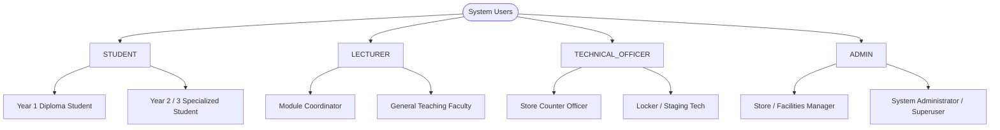

# Role-Based & Attribute-Based Access Control (RBAC / ABAC) Matrix

**Project:** Ngee Ann Polytechnic School of Film & Media Studies (FMS) Equipment & Facility Booking System  
**Tender Reference:** `FY26/FMS/003x/ITQ`  
**Specification Version:** `1.0.0`  
**Status:** Approved for Implementation  

---

## 1. Security Architecture & Authorization Principles

This document defines the definitive Role-Based Access Control (RBAC) and Attribute-Based Access Control (ABAC) matrix for the FMS booking system.

Security enforcement operates through **three independent defensive layers (Defense-in-Depth)**:
1. **Edge Route Protection (`proxy.ts`):** Evaluates user JWT session claims, Singapore territory geofence (`x-vercel-ip-country = SG`), and route group permissions before route execution.
2. **Database Engine Row-Level Security (PostgreSQL RLS):** The ultimate authorization boundary. Every SQL query—whether initiated directly from the client PWA (Pattern 1) or via Server Actions (Pattern 2)—executes under PostgreSQL RLS policies anchored to `auth.uid()`.
3. **Execution Pattern Partitioning:**
   - **Pattern 1 (Direct-to-Supabase):** Client browser connects directly to Supabase via PostgREST with anonymous/user JWT. Enforces S$0.00 Vercel serverless compute costs for 95% of reads/writes.
   - **Pattern 2 (Server Action / API):** Strictly isolated administrative and hardware-interfacing operations run in serverless functions marked with `import 'server-only'` using `SUPABASE_SERVICE_ROLE_KEY`.

---

## 2. Actor & Role Taxonomy



### 2.1 Role Definitions & Capabilities

| Role Code | Primary Users | Scope of Access | Administrative Privileges |
| :--- | :--- | :--- | :--- |
| **`STUDENT`** | Enrolled NP FMS students (Diploma in Film, Sound & Video `FSV`, Mass Communication `MCM`, etc.). | Can browse active catalog, create bookings for enrolled modules, access mobile offline QR pass, unlock assigned locker doors within 50m geofence. | None. Blocked from viewing internal asset replacement costs, damage repair invoices, and other students' bookings. |
| **`LECTURER`** | Academic faculty, module leaders, and project supervisors. | Can review, approve, or reject student bookings for assigned modules; place batch class reservations; view facility schedules; reserve teaching gear. | Academic approval authority over assigned modules. Cannot modify store inventory or waive disciplinary strikes. |
| **`TECHNICAL_OFFICER`** | Lab technicians, counter staff, and equipment store officers at Block 52. | Full operational store access: scan checkout/returns, inspect physical condition, upload damage photos, stage locker compartments, create maintenance work orders. | Counter operational authority. Cannot adjust loan quota policies or delete audit logs. |
| **`ADMIN`** | FMS Store Managers, Deputy Directors, and System Administrators. | System-wide master access: user provisioning, disciplinary strike waivers, loan policy tuning, semester CSV timetable/roster imports, 36-month audit log reviews. | Superuser authority across all domains. Audit logs remain immutable even to Admins. |

---

## 3. Comprehensive Database Table-Level RBAC Matrix

The following matrix maps every database table to permitted CRUD actions per role:
- **`SELECT` (Read):** $\text{ALL}$ (All rows), $\text{OWN}$ (Own rows only), $\text{ASSIGNED}$ (Assigned module/duty), $\text{NONE}$ (Denied).
- **`INSERT` (Create):** $\text{YES}$ (Permitted), $\text{RESTRICTED}$ (Conditional rules apply), $\text{NO}$ (Denied).
- **`UPDATE` (Edit):** $\text{OWN}$ (Own drafts/profiles), $\text{FIELD}$ (Specific fields only), $\text{NO}$ (Denied).
- **`DELETE` (Remove):** $\text{DRAFT}$ (Drafts only), $\text{NO}$ (Denied/Soft-delete only).

| Database Table | `STUDENT` | `LECTURER` | `TECHNICAL_OFFICER` | `ADMIN` | Core Policy Enforcement Rule |
| :--- | :---: | :---: | :---: | :---: | :--- |
| **`profiles`** | Read: OWN<br>Write: OWN (Phone/bio)<br>Delete: NO | Read: ALL<br>Write: OWN<br>Delete: NO | Read: ALL<br>Write: Suspensions<br>Delete: NO | Read: ALL<br>Write: ALL<br>Delete: NO | Students cannot alter their own `role`, `diploma_id`, or `is_suspended`. |
| **`diplomas`** | Read: ALL<br>Write: NO | Read: ALL<br>Write: NO | Read: ALL<br>Write: NO | Read: ALL<br>Write: ALL<br>Delete: NO | Reference catalog; modified only by store administrators. |
| **`academic_modules`** | Read: ALL<br>Write: NO | Read: ALL<br>Write: NO | Read: ALL<br>Write: NO | Read: ALL<br>Write: ALL<br>Delete: NO | Semester module master; populated via timetable CSV sync. |
| **`module_coordinators`**| Read: ALL<br>Write: NO | Read: ALL<br>Write: NO | Read: ALL<br>Write: NO | Read: ALL<br>Write: ALL<br>Delete: NO | Defines approval routing authority. Managed by Admin. |
| **`student_enrollments`** | Read: OWN<br>Write: NO | Read: ASSIGNED<br>Write: NO | Read: ALL<br>Write: NO | Read: ALL<br>Write: ALL (CSV)<br>Delete: NO | Ingested via student management system roster CSV. |
| **`categories`** | Read: ALL<br>Write: NO | Read: ALL<br>Write: NO | Read: ALL<br>Write: ALL<br>Delete: NO | Read: ALL<br>Write: ALL<br>Delete: NO | Taxonomy tree; editable by store officers. |
| **`equipment`** | Read: ACTIVE<br>Write: NO | Read: ALL<br>Write: NO | Read: ALL<br>Write: Status/Notes<br>Delete: NO | Read: ALL<br>Write: ALL<br>Delete: RESTRICT | Students see items where `status != 'DECOMMISSIONED'`. Replacement cost masked from students. |
| **`facilities`** | Read: ACTIVE<br>Write: NO | Read: ALL<br>Write: NO | Read: ALL<br>Write: Status<br>Delete: NO | Read: ALL<br>Write: ALL<br>Delete: RESTRICT | Students see `is_active = TRUE` facilities. |
| **`facility_timetable_blocks`** | Read: ALL<br>Write: NO | Read: ALL<br>Write: NO | Read: ALL<br>Write: NO | Read: ALL<br>Write: ALL (CSV)<br>Delete: ALL | Recurring teaching blackout schedule. |
| **`bookings`** | Read: OWN<br>Insert: YES (DRAFT)<br>Update: DRAFT<br>Delete: DRAFT | Read: ASSIGNED / OWN<br>Insert: YES<br>Update: APPROVE<br>Delete: NO | Read: ALL<br>Insert: YES (Counter)<br>Update: STAGE / CANCEL<br>Delete: NO | Read: ALL<br>Insert: YES<br>Update: ALL<br>Delete: NO | Students manage own bookings. Lecturers update `status` for their assigned modules. |
| **`booking_items`** | Read: OWN<br>Insert: DRAFT<br>Update: DRAFT<br>Delete: DRAFT | Read: ASSIGNED / OWN<br>Insert: YES<br>Update: NO<br>Delete: NO | Read: ALL<br>Insert: YES<br>Update: CHECKOUT/RETURN<br>Delete: NO | Read: ALL<br>Insert: YES<br>Update: ALL<br>Delete: NO | Store officers record `checked_out_at`, `returned_at`, and condition grades. |
| **`lockers`** | Read: ONLINE<br>Write: NO | Read: ALL<br>Write: NO | Read: ALL<br>Write: Status/Config<br>Delete: NO | Read: ALL<br>Write: ALL<br>Delete: RESTRICT | Controller IPs and API keys accessible strictly via Pattern 2 server secrets. |
| **`locker_compartments`** | Read: OWN ASSIGNED<br>Write: NO | Read: ALL<br>Write: NO | Read: ALL<br>Write: Maintenance<br>Delete: NO | Read: ALL<br>Write: ALL<br>Delete: NO | Students only see door number assigned to their active booking. |
| **`locker_assignments`** | Read: OWN ACTIVE<br>Write: NO | Read: ASSIGNED<br>Write: NO | Read: ALL<br>Insert: YES (Stage)<br>Update: ALL<br>Delete: NO | Read: ALL<br>Write: ALL<br>Delete: NO | Stores hashed PIN and sensor timestamps. PIN revealed only to the borrower. |
| **`loan_policies`** | Read: ALL<br>Write: NO | Read: ALL<br>Write: NO | Read: ALL<br>Write: NO | Read: ALL<br>Write: ALL<br>Delete: NO | Departmental limits and suspension thresholds. Admin configurable. |
| **`user_penalties`** | Read: OWN<br>Write: NO | Read: ASSIGNED<br>Write: NO | Read: ALL<br>Insert: YES (Strikes)<br>Update: NO | Read: ALL<br>Insert: YES<br>Update: WAIVE<br>Delete: NO | Store officers issue strikes; only Admins can formally waive strikes with justification. |
| **`equipment_damage_incidents`**| Read: OWN<br>Write: NO | Read: ASSIGNED<br>Write: NO | Read: ALL<br>Insert: YES<br>Update: Notes/Photos<br>Delete: NO | Read: ALL<br>Write: RESOLVE/BILL<br>Delete: NO | Students view claims billed to them. Officers log defects; Admins resolve liability. |
| **`maintenance_records`** | Read: TIME RANGES<br>Write: NO | Read: ALL<br>Write: NO | Read: ALL<br>Insert: YES<br>Update: COMPLETED<br>Delete: NO | Read: ALL<br>Write: ALL<br>Delete: NO | Students read blackout outage windows; store staff manage vendor work orders. |
| **`audit_logs`** | Read: NO<br>Write: TRIGGER<br>Update: FORBIDDEN<br>Delete: FORBIDDEN | Read: NO<br>Write: TRIGGER<br>Update: FORBIDDEN<br>Delete: FORBIDDEN | Read: OWN ACTIONS<br>Write: TRIGGER<br>Update: FORBIDDEN<br>Delete: FORBIDDEN | Read: ALL (Search)<br>Write: TRIGGER<br>Update: FORBIDDEN<br>Delete: FORBIDDEN | **Immutable (Clause 3.0):** Database triggers forbid `UPDATE` and `DELETE` for all roles. |

---

## 4. Application Route Group & UI Capability Matrix

The Next.js 16 App Router enforces route-level protection via role-specific route groups under `apps/web/src/app/`:

```
apps/web/src/app/
├── (auth)/             # Public authentication & Magic Link callbacks
├── (student)/          # Student booking portal & offline PWA passes
├── (lecturer)/         # Lecturer approval inbox & class booking dashboard
├── (counter)/          # Rapid barcode scanner & return inspection terminal
└── (admin)/            # Fleet inventory, audit logs, policies & roster sync
```

### 4.1 Route Access Control Rules

| App Route Path | Authorized Roles | Access Verification Mechanism | Target Capabilities |
| :--- | :--- | :--- | :--- |
| `/(auth)/*` | `PUBLIC` | None | Student/Staff email login, NP Azure AD SSO callback, session establishment. |
| `/(student)/catalog` | `STUDENT`, `LECTURER`, `ADMIN` | Session JWT check in `proxy.ts` | Search inventory, category filtering, availability calendar check. |
| `/(student)/cart` | `STUDENT`, `LECTURER` | Role check in `proxy.ts` | Basket management, project title input, module selection. |
| `/(student)/loans` | `STUDENT`, `LECTURER` | Role check in `proxy.ts` | Active bookings, loan history, strike penalty status. |
| `/(student)/pass/[id]` | `STUDENT` (Borrower only) | RLS: `auth.uid() = user_id` | Offline-cached PWA QR pass, 6-digit locker PIN, 50m unlock trigger. |
| `/(lecturer)/approvals`| `LECTURER`, `ADMIN` | Role `LECTURER` or `ADMIN` | Pending booking queue for coordinated modules, 1-click approve/reject. |
| `/(lecturer)/classes` | `LECTURER`, `ADMIN` | Role `LECTURER` or `ADMIN` | Class group loan tracking, block bookings for studio teaching sessions. |
| `/(counter)/checkout` | `TECHNICAL_OFFICER`, `ADMIN` | Role `TECHNICAL_OFFICER` / `ADMIN` | High-speed barcode/QR scanner, identity verification, item handover. |
| `/(counter)/return` | `TECHNICAL_OFFICER`, `ADMIN` | Role `TECHNICAL_OFFICER` / `ADMIN` | Return scanner, physical condition checklist (`GOOD`/`DAMAGED`), photo capture. |
| `/(counter)/staging` | `TECHNICAL_OFFICER`, `ADMIN` | Role `TECHNICAL_OFFICER` / `ADMIN` | Smart Locker staging wizard, compartment door allocation, pickup PIN dispatch. |
| `/(admin)/equipment` | `ADMIN`, `TECHNICAL_OFFICER` | Role `ADMIN` (Full) / `OFFICER` (Read) | Fleet asset management, barcode printing, commissioning/decommissioning. |
| `/(admin)/policies` | `ADMIN` | Strictly `role = 'ADMIN'` | Tuning max items, loan durations (24h/72h), strike suspension thresholds. |
| `/(admin)/roster` | `ADMIN` | Strictly `role = 'ADMIN'` | CSV bulk upload for student module enrollments and semester timetables. |
| `/(admin)/audit` | `ADMIN` | Strictly `role = 'ADMIN'` | Filterable 36-month compliance audit trail with JSON metadata diffs. |

---

## 5. Architectural Pattern Security Partitioning

To maintain **S$0.00 Vercel serverless compute costs** while eliminating privileged key leakage:

```
┌────────────────────────────────────────────────────────────────────────┐
│ PATTERN 1: Direct-to-Supabase (95% of App Traffic — Client Safe)       │
│ - Communicates via PostgREST using NEXT_PUBLIC_SUPABASE_ANON_KEY       │
│ - Strictly bounded by PostgreSQL Row-Level Security                    │
│ - Operations: Browsing catalog, viewing own loans, polling locker state│
└────────────────────────────────────────────────────────────────────────┘

┌────────────────────────────────────────────────────────────────────────┐
│ PATTERN 2: Server Actions / Route Handlers (5% Admin & Hardware Ops)    │
│ - Enforces `import 'server-only'` to guarantee zero client bundling    │
│ - Uses SUPABASE_SERVICE_ROLE_KEY protected on the server side          │
│ - Operations: IoT locker dispatch, strike waivers, CSV user imports    │
└────────────────────────────────────────────────────────────────────────┘
```

### 5.1 Pattern 2 Privileged Server Actions Matrix

| Server Action Name | File Path | Privileged Operation | Invariant Checks & Guardrails |
| :--- | :--- | :--- | :--- |
| `triggerLockerUnlockAction` | `apps/web/src/actions/locker.ts` | Dispatches unlock pulse to Block 52 IoT controller. | 1. Student verified within 50m GPS geofence.<br>2. Active assignment in `locker_assignments`.<br>3. `valid_from <= NOW() <= valid_until`.<br>4. Rate limit: Max 3 unlock attempts per 5 mins. |
| `waivePenaltyStrikeAction` | `apps/web/src/actions/penalties.ts` | Sets `user_penalties.is_waived = TRUE` and lifts suspension. | 1. Caller must have `role = 'ADMIN'`.<br>2. Mandatory `waived_reason` ($\ge 15$ chars).<br>3. Automatically logs `WAIVE_PENALTY` in `audit_logs`. |
| `syncRosterCsvAction` | `apps/web/src/actions/roster.ts` | Bulk upserts semester student enrollments and modules. | 1. Caller must have `role = 'ADMIN'`.<br>2. Validates CSV schema with Zod.<br>3. Auto-provisions missing student profiles. |
| `resolveDamageIncidentAction`| `apps/web/src/actions/incidents.ts`| Updates incident status (`BILLED` / `WAIVED` / `RESOLVED`). | 1. Caller must have `role = 'ADMIN'`.<br>2. If billed, records finance reference number.<br>3. Flips `equipment.status` back to `AVAILABLE` upon repair. |

---

## 6. Concrete PostgreSQL Row-Level Security (RLS) Policies

### 6.1 Equipment Catalog Access (`equipment`)

```sql
ALTER TABLE public.equipment ENABLE ROW LEVEL SECURITY;

-- Students & Public can only view non-decommissioned gear
CREATE POLICY "Public and students can view active inventory"
ON public.equipment FOR SELECT
TO authenticated
USING (
    status != 'DECOMMISSIONED'
    OR (SELECT role FROM profiles WHERE id = auth.uid()) IN ('TECHNICAL_OFFICER', 'ADMIN')
);

-- Only Store Staff and Admins can update asset metadata
CREATE POLICY "Staff can update equipment records"
ON public.equipment FOR UPDATE
TO authenticated
USING (
    (SELECT role FROM profiles WHERE id = auth.uid()) IN ('TECHNICAL_OFFICER', 'ADMIN')
);
```

### 6.2 Booking Header Access (`bookings`)

```sql
ALTER TABLE public.bookings ENABLE ROW LEVEL SECURITY;

-- Students view own bookings; Staff view all; Lecturers view assigned modules
CREATE POLICY "Users can view authorized bookings"
ON public.bookings FOR SELECT
TO authenticated
USING (
    auth.uid() = user_id
    OR (SELECT role FROM profiles WHERE id = auth.uid()) IN ('TECHNICAL_OFFICER', 'ADMIN')
    OR (
        (SELECT role FROM profiles WHERE id = auth.uid()) = 'LECTURER'
        AND EXISTS (
            SELECT 1 FROM module_coordinators mc
            WHERE mc.module_id = bookings.module_id AND mc.lecturer_id = auth.uid()
        )
    )
);

-- Students can insert bookings if active and within loan quota
CREATE POLICY "Eligible students can submit draft bookings"
ON public.bookings FOR INSERT
TO authenticated
WITH CHECK (
    auth.uid() = user_id
    AND (SELECT is_suspended FROM profiles WHERE id = auth.uid()) = FALSE
);

-- Lecturers can approve/reject bookings for their modules
CREATE POLICY "Lecturers can update approval status"
ON public.bookings FOR UPDATE
TO authenticated
USING (
    (SELECT role FROM profiles WHERE id = auth.uid()) IN ('TECHNICAL_OFFICER', 'ADMIN')
    OR (
        (SELECT role FROM profiles WHERE id = auth.uid()) = 'LECTURER'
        AND EXISTS (
            SELECT 1 FROM module_coordinators mc
            WHERE mc.module_id = bookings.module_id AND mc.lecturer_id = auth.uid()
        )
    )
);
```

### 6.3 Disciplinary Penalties Access (`user_penalties`)

```sql
ALTER TABLE public.user_penalties ENABLE ROW LEVEL SECURITY;

-- Students view their own strikes; Staff view all
CREATE POLICY "Students view own penalties"
ON public.user_penalties FOR SELECT
TO authenticated
USING (
    auth.uid() = user_id
    OR (SELECT role FROM profiles WHERE id = auth.uid()) IN ('TECHNICAL_OFFICER', 'ADMIN')
);

-- Technical Officers can issue strikes
CREATE POLICY "Store staff can issue penalty strikes"
ON public.user_penalties FOR INSERT
TO authenticated
WITH CHECK (
    (SELECT role FROM profiles WHERE id = auth.uid()) IN ('TECHNICAL_OFFICER', 'ADMIN')
);

-- Only Admins can waive strikes (Updates)
CREATE POLICY "Admins can waive strikes"
ON public.user_penalties FOR UPDATE
TO authenticated
USING (
    (SELECT role FROM profiles WHERE id = auth.uid()) = 'ADMIN'
);
```

### 6.4 36-Month Legal Audit Trail Immutability (`audit_logs`)

```sql
ALTER TABLE public.audit_logs ENABLE ROW LEVEL SECURITY;

-- Only Admins can read the compliance audit trail
CREATE POLICY "Admins can inspect audit logs"
ON public.audit_logs FOR SELECT
TO authenticated
USING (
    (SELECT role FROM profiles WHERE id = auth.uid()) = 'ADMIN'
);

-- Audit logs are append-only: INSERT permitted, UPDATE and DELETE revoked
CREATE POLICY "System triggers can append audit entries"
ON public.audit_logs FOR INSERT
TO authenticated
WITH CHECK (true);

-- Explicitly revoke destructive operations at the engine level
REVOKE UPDATE, DELETE ON public.audit_logs FROM public, authenticated, anon;
```

---

## 7. Approval & Security Sign-Off

| Review Area | Evaluator | Sign-Off Status |
| :--- | :--- | :--- |
| **PDPA & Data Minimization** | Solution Architect | Verified Compliant |
| **Row-Level Security Isolation** | Database Lead | Verified Compliant |
| **Next.js 16 Route Group Security** | Fullstack Lead | Verified Compliant |
