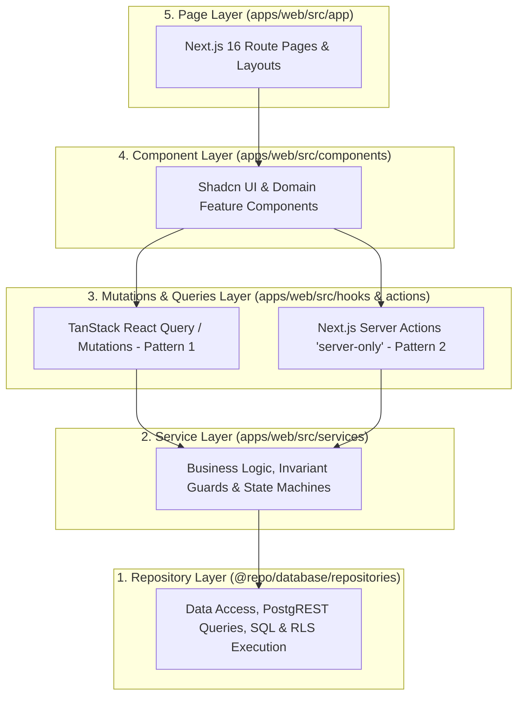

# Typed Service & Repository Interface Contracts

**Project:** Ngee Ann Polytechnic School of Film & Media Studies (FMS) Equipment & Facility Booking System  
**Tender Reference:** `FY26/FMS/003x/ITQ`  
**Specification Version:** `1.0.0`  
**Status:** Approved for Implementation  

---

## 1. Architectural Pattern & 5-Layer Separation of Concerns

To guarantee that subsequent development remains modular, maintainable, and strictly testable, the codebase enforces a **5-layer clean architecture**:



### Layer Responsibility Matrix

| Layer | Location | Primary Responsibility | Prohibited Practices |
| :--- | :--- | :--- | :--- |
| **1. Repository** | `@repo/database/repositories/` | Data access abstraction. Executes PostgREST queries, raw SQL, and transaction blocks. Maps database snake_case columns to TypeScript camelCase domain entities. | **No** business rules, UI state, or notification dispatches. |
| **2. Service** | `apps/web/src/services/` | Enforces business policies, state machine transitions, quota validation, invariant checks, and cross-repository orchestration. | **No** direct React hooks or JSX rendering. |
| **3. Queries / Actions** | `apps/web/src/hooks/` & `src/actions/` | Exposes TanStack Query hooks (`useQuery`, `useMutation`) for Pattern 1 client direct calls; exposes Server Actions with `import 'server-only'` for Pattern 2 privileged operations. | **No** business logic buried inside event handlers. |
| **4. Components** | `apps/web/src/components/` & `@repo/ui` | Modular UI widgets, forms, dialogs, and tables using Shadcn UI. Consumes hooks and triggers mutations. | **No** direct database calls or un-typed fetch requests. |
| **5. Page** | `apps/web/src/app/(role)/*` | Next.js 16 App Router composition root. Manages SEO metadata, server component prefetching, and layout rendering. | **No** monolithic component logic inside page files. |

---

## 2. Shared Types & Standard Result Monad

To eliminate unhandled runtime exceptions and guarantee uniform error handling across both client and server:

```typescript
// packages/database/src/types/result.ts
export type Result<T, E = AppError> = 
  | { success: true; data: T }
  | { success: false; error: E };

export interface AppError {
  code: 
    | 'UNAUTHORIZED'
    | 'FORBIDDEN'
    | 'NOT_FOUND'
    | 'CONFLICT_DOUBLE_BOOKING'
    | 'QUOTA_EXCEEDED'
    | 'ACCOUNT_SUSPENDED'
    | 'HARDWARE_OFFLINE'
    | 'INVALID_INPUT'
    | 'INTERNAL_ERROR';
  message: string;
  details?: Record<string, unknown>;
}
```

---

## 3. Domain 1: Inventory & Equipment Catalog Contracts

### 3.1 Zod Schemas & Domain Models

```typescript
// packages/database/src/schemas/equipment.schema.ts
import { z } from 'zod';

export const EquipmentStatusEnum = z.enum([
  'AVAILABLE',
  'RESERVED',
  'ON_LOAN',
  'MAINTENANCE',
  'DECOMMISSIONED',
]);

export const EquipmentTypeEnum = z.enum([
  'STANDALONE',
  'KIT_PARENT',
  'KIT_ACCESSORY',
]);

export const EquipmentFilterSchema = z.object({
  searchQuery: z.string().optional(),
  categoryId: z.string().uuid().optional(),
  itemType: EquipmentTypeEnum.optional(),
  status: EquipmentStatusEnum.optional(),
  storeLocation: z.string().optional(),
  availableWindow: z.object({
    startTime: z.string().datetime(),
    endTime: z.string().datetime(),
  }).optional(),
  page: z.number().int().min(1).default(1),
  pageSize: z.number().int().min(1).max(100).default(20),
});

export type EquipmentFilterInput = z.infer<typeof EquipmentFilterSchema>;

export interface EquipmentEntity {
  id: string;
  assetTagId: string;
  serialNumber: string | null;
  name: string;
  brand: string;
  model: string;
  categoryId: string;
  itemType: z.infer<typeof EquipmentTypeEnum>;
  parentKitId: string | null;
  isKit: boolean;
  isOversized: boolean;
  status: z.infer<typeof EquipmentStatusEnum>;
  storeLocation: string;
  shelfLocation: string | null;
  replacementCostSgd: number;
  thumbnailUrl: string | null;
  createdAt: string;
  updatedAt: string;
  accessories?: EquipmentEntity[];
}
```

### 3.2 Repository & Service Interfaces

```typescript
// packages/database/src/repositories/equipment.repository.interface.ts
export interface IEquipmentRepository {
  findById(id: string): Promise<EquipmentEntity | null>;
  findByAssetTag(assetTagId: string): Promise<EquipmentEntity | null>;
  findMany(filter: EquipmentFilterInput): Promise<{ items: EquipmentEntity[]; totalCount: number }>;
  findKitAccessories(parentKitId: string): Promise<EquipmentEntity[]>;
  updateStatus(id: string, status: EquipmentEntity['status']): Promise<void>;
  checkTemporalAvailability(equipmentId: string, startTime: string, endTime: string): Promise<boolean>;
}

// apps/web/src/services/equipment.service.interface.ts
export interface IEquipmentService {
  getCatalog(filter: EquipmentFilterInput): Promise<Result<{ items: EquipmentEntity[]; totalCount: number }>>;
  getAssetDetails(id: string): Promise<Result<EquipmentEntity>>;
  getAssetByBarcode(assetTagId: string): Promise<Result<EquipmentEntity>>;
  checkItemsAvailability(equipmentIds: string[], startTime: string, endTime: string): Promise<Result<Record<string, boolean>>>;
}
```

---

## 4. Domain 2: Bookings & Cart Engine Contracts

### 4.1 Zod Schemas & Domain Models

```typescript
// packages/database/src/schemas/booking.schema.ts
import { z } from 'zod';

export const FulfillmentChannelEnum = z.enum([
  'COUNTER',
  'SMART_LOCKER',
  'STUDIO_DELIVERY',
]);

export const BookingStatusEnum = z.enum([
  'DRAFT',
  'PENDING_APPROVAL',
  'APPROVED',
  'READY_FOR_COLLECTION',
  'REJECTED',
  'COLLECTED',
  'OVERDUE',
  'COMPLETED',
  'CANCELLED',
]);

export const CreateBookingDraftSchema = z.object({
  moduleId: z.string().uuid({ message: 'Valid academic module is required' }),
  projectTitle: z.string().min(3).max(200, { message: 'Project title must be between 3 and 200 characters' }),
  collectionMethod: FulfillmentChannelEnum.default('COUNTER'),
  returnMethod: FulfillmentChannelEnum.default('COUNTER'),
  items: z.array(z.object({
    itemType: z.enum(['EQUIPMENT', 'FACILITY']),
    equipmentId: z.string().uuid().optional(),
    facilityId: z.string().uuid().optional(),
    startTime: z.string().datetime({ message: 'Start time must be ISO-8601' }),
    endTime: z.string().datetime({ message: 'End time must be ISO-8601' }),
  })).min(1, { message: 'Booking basket must contain at least 1 item' }),
});

export type CreateBookingDraftInput = z.infer<typeof CreateBookingDraftSchema>;

export interface BookingHeaderEntity {
  id: string;
  bookingNumber: string;
  userId: string;
  moduleId: string;
  projectTitle: string;
  status: z.infer<typeof BookingStatusEnum>;
  approverId: string | null;
  approvedAt: string | null;
  rejectionReason: string | null;
  collectionMethod: z.infer<typeof FulfillmentChannelEnum>;
  collectionLocation: string | null;
  returnMethod: z.infer<typeof FulfillmentChannelEnum>;
  returnLocation: string | null;
  qrPassToken: string | null;
  qrPassExpires: string | null;
  createdAt: string;
  updatedAt: string;
}

export interface BookingItemEntity {
  id: string;
  bookingId: string;
  itemType: 'EQUIPMENT' | 'FACILITY';
  equipmentId: string | null;
  facilityId: string | null;
  timeRange: [string, string]; // [start, end)
  status: z.infer<typeof BookingStatusEnum>;
  checkedOutAt: string | null;
  checkoutBy: string | null;
  returnedAt: string | null;
  returnBy: string | null;
  conditionOut: string;
  conditionIn: string | null;
  inspectionPhotos: string[];
  inspectionNotes: string | null;
}
```

### 4.2 Repository & Service Interfaces

```typescript
// packages/database/src/repositories/booking.repository.interface.ts
export interface IBookingRepository {
  findById(id: string): Promise<{ booking: BookingHeaderEntity; items: BookingItemEntity[] } | null>;
  findByNumber(bookingNumber: string): Promise<{ booking: BookingHeaderEntity; items: BookingItemEntity[] } | null>;
  findByUser(userId: string, status?: string[]): Promise<BookingHeaderEntity[]>;
  findPendingByModuleCoordinator(lecturerId: string): Promise<BookingHeaderEntity[]>;
  createBookingWithItems(input: CreateBookingDraftInput, userId: string): Promise<BookingHeaderEntity>;
  updateStatus(bookingId: string, status: BookingHeaderEntity['status'], approverId?: string, rejectionReason?: string): Promise<void>;
  updateItemCheckout(itemId: string, officerId: string, conditionOut: string): Promise<void>;
  updateItemReturn(itemId: string, officerId: string, conditionIn: string, notes?: string, photos?: string[]): Promise<void>;
}

// apps/web/src/services/booking.service.interface.ts
export interface IBookingService {
  createDraft(userId: string, input: CreateBookingDraftInput): Promise<Result<BookingHeaderEntity>>;
  submitForApproval(bookingId: string, userId: string): Promise<Result<void>>;
  approveBooking(bookingId: string, lecturerId: string): Promise<Result<void>>;
  rejectBooking(bookingId: string, lecturerId: string, reason: string): Promise<Result<void>>;
  stageBooking(bookingId: string, officerId: string, channel: 'COUNTER' | 'SMART_LOCKER', targetLocation: string): Promise<Result<void>>;
  checkoutAtCounter(bookingId: string, officerId: string, itemConditions: Record<string, string>): Promise<Result<void>>;
  returnAtCounter(bookingId: string, officerId: string, returnData: Record<string, { conditionIn: string; notes?: string; photos?: string[] }>): Promise<Result<void>>;
  generateQrPass(bookingId: string, userId: string): Promise<Result<{ token: string; qrCodeDataUrl: string }>>;
}
```

---

## 5. Domain 3: Smart Locker Hardware Integration Contracts

### 5.1 Zod Schemas & Hardware Telemetry DTOs

```typescript
// packages/locker-client/src/schemas/locker.schema.ts
import { z } from 'zod';

export const LockerUnlockRequestSchema = z.object({
  bookingId: z.string().uuid(),
  compartmentId: z.string().uuid(),
  userGps: z.object({
    latitude: z.number().min(-90).max(90),
    longitude: z.number().min(-180).max(180),
    accuracyMeters: z.number().max(100),
  }),
  unlockMethod: z.enum(['QR_CODE', 'PIN_CODE', 'STAFF_MASTER_KEY']),
  pinCode: z.string().length(6).optional(),
});

export type LockerUnlockRequestInput = z.infer<typeof LockerUnlockRequestSchema>;

export interface LockerTelemetryEvent {
  lockerId: string;
  compartmentNumber: number;
  eventType: 'DOOR_OPENED' | 'DOOR_CLOSED' | 'DOOR_AJAR_TIMEOUT' | 'HEARTBEAT';
  timestamp: string;
  sensorState: {
    magneticContactClosed: boolean;
    solenoidLocked: boolean;
  };
}
```

### 5.2 Hardware Adapter & Locker Service Interfaces

```typescript
// packages/locker-client/src/adapters/locker-client.interface.ts
export interface ILockerHardwareAdapter {
  sendUnlockPulse(controllerIp: string, apiKey: string, compartmentNumber: number): Promise<{ success: boolean; latencyMs: number }>;
  pollDoorSensor(controllerIp: string, compartmentNumber: number): Promise<{ doorClosed: boolean }>;
  verifyControllerHeartbeat(controllerIp: string): Promise<boolean>;
}

// apps/web/src/services/locker.service.interface.ts
export interface ILockerService {
  stageLockerPickup(bookingId: string, compartmentId: string, officerId: string): Promise<Result<{ pinCode: string }>>;
  handleStudentUnlockRequest(input: LockerUnlockRequestInput, userId: string): Promise<Result<{ unlockedAt: string }>>;
  processHardwareTelemetryWebhook(event: LockerTelemetryEvent, webhookSignature: string): Promise<Result<void>>;
  clearCompartment(compartmentId: string, officerId: string): Promise<Result<void>>;
}
```

---

## 6. Domain 4: Facilities, Timetable & Maintenance Contracts

### 6.1 Repository & Service Interfaces

```typescript
// packages/database/src/repositories/facility.repository.interface.ts
export interface IFacilityRepository {
  findById(id: string): Promise<FacilityEntity | null>;
  findAvailable(startTime: string, endTime: string): Promise<FacilityEntity[]>;
  findTimetableBlocks(facilityId: string, semesterStart: string, semesterEnd: string): Promise<TimetableBlockEntity[]>;
  createTimetableBlock(block: CreateTimetableBlockInput): Promise<void>;
}

// apps/web/src/services/maintenance.service.interface.ts
export interface IMaintenanceService {
  scheduleMaintenance(input: {
    itemType: 'EQUIPMENT' | 'FACILITY';
    targetId: string;
    maintenanceType: string;
    vendorName?: string;
    startTime: string;
    endTime: string;
    notes: string;
    officerId: string;
  }): Promise<Result<{ maintenanceId: string }>>;
  completeMaintenance(maintenanceId: string, actualCostSgd: number, notes: string, officerId: string): Promise<Result<void>>;
  getActiveBlackouts(targetId: string, targetType: 'EQUIPMENT' | 'FACILITY'): Promise<Result<MaintenanceRecordEntity[]>>;
}
```

---

## 7. Concrete Pattern Implementation Walkthrough

To ensure zero ambiguity during implementation, here is the complete code trace for a student placing a booking across the 5 layers:

```
[Layer 5: Page]
apps/web/src/app/(student)/cart/page.tsx
  │  Renders checkout page layout
  ▼
[Layer 4: Component]
apps/web/src/components/cart/BookingCheckoutForm.tsx
  │  User clicks "Submit Reservation"
  │  Calls useSubmitBookingMutation()
  ▼
[Layer 3: Mutation Hook]
apps/web/src/hooks/useBookingMutations.ts
  │  Validates input via CreateBookingDraftSchema
  │  Calls bookingService.createDraft()
  ▼
[Layer 2: Service]
apps/web/src/services/booking.service.ts
  │  1. Invariant: Validates student is enrolled in target module
  │  2. Policy: Verifies student has active quota (<= 4 items)
  │  3. Business Rule: Verifies borrower is not suspended
  │  4. Calls bookingRepository.createBookingWithItems()
  ▼
[Layer 1: Repository]
@repo/database/repositories/booking.repository.ts
  │  1. Opens atomic PostgreSQL transaction
  │  2. Generates booking_number
  │  3. Inserts bookings header
  │  4. Inserts booking_items (GiST exclusion validates no concurrency overlap)
  │  5. Commits and returns domain entity
```

---

## 8. Approval & Architecture Sign-Off

| Technical Boundary | Lead Architect | Implementation Readiness |
| :--- | :--- | :--- |
| **Data Layer (Repository)** | Database Lead | Approved |
| **Business Rules (Service)** | Solution Architect | Approved |
| **API & Mutations (Hooks/Actions)** | Fullstack Lead | Approved |
| **Hardware Boundary (Locker Adapter)** | IoT Integration Lead | Approved |
