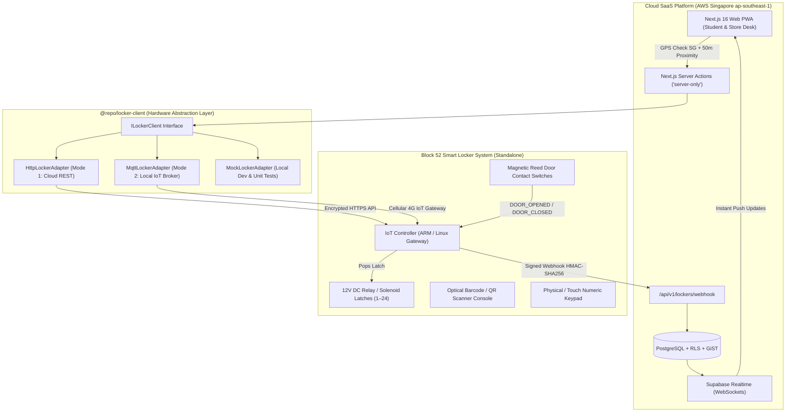

# Smart Locker Hardware Integration Specification & Operations Guide

**Project:** Ngee Ann Polytechnic School of Film & Media Studies (FMS) Equipment & Facility Booking System  
**Tender Reference:** `FY26/FMS/003x/ITQ`  
**Specification Version:** `1.0.0`  
**Target Hardware:** Block 52 Smart Locker Bank A (24-Door Controller System)  
**Tender Clauses Governed:** Clause 1.2, 4.3, 6.1, 14.2, 14.3, 14.4  

---

## 1. System Architecture & Dual-Mode Integration Strategy

To fulfill **Clause 14.4** (*"The system shall support integration with existing smart locker systems via vendor-managed interfaces... No integration with Ngee Ann Polytechnic core systems or infrastructure is required"*), the architecture operates a **Vendor-Managed Dual-Mode Abstraction Layer** through the `@repo/locker-client` package.



### 1.1 Dual Integration Modes
1. **Mode 1: Vendor Cloud REST API & Webhooks (Primary)**
   - Used when the existing smart locker vendor operates a cloud gateway.
   - Outbound REST requests from Next.js Server Actions trigger compartment allocations and solenoid releases.
   - Inbound webhook events update the PostgreSQL database.
2. **Mode 2: Cellular 4G IoT Gateway / Direct Socket (Standalone Fallback)**
   - Used if the locker controller is air-gapped on campus.
   - A dedicated vendor-supplied 4G router communicates via MQTT / HTTPS over cellular, completely isolated from Ngee Ann Polytechnic institutional network infrastructure.

---

## 2. Dedicated Smart Locker Application Pages & Screen Layouts

The smart locker integration touches **three specific portals and four dedicated user interfaces**:

---

### Page 1: Student Contactless Mobile Locker Pass & Proximity Unlock
- **Route:** `apps/web/src/app/(student)/pass/[id]/page.tsx`
- **Primary Persona:** Enrolled Student Borrower (Mobile PWA)
- **Visual Design:**
  - **Auto-Brightness High-Contrast Card:** White background with deep black elements for reliable scanning at the locker console.
  - **Dynamic Cryptographic QR Pass:** Signed JWT QR pass with local IndexedDB/Serwist PWA caching (functions 100% offline).
  - **6-Digit Backup PIN:** Large numerical readout (e.g. `829-104`) for manual keypad entry if the student's camera or screen is cracked.
  - **Visual Distance Radar (`<GeofenceRadar />`):** Displays real-time GPS proximity to Block 52.
  - **"Unlock Door" Action Button (`<LockerUnlockButton />`):**
    - State A (Distance > 50m): Disabled with label *"Approach Block 52 to Unlock (You are 350m away)"*.
    - State B (Distance $\le$ 50m & Valid Window): Enabled in pulsing emerald with label *"Unlock Door #14 Now"*.
    - State C (Door Popped): Shows live animated countdown timer (45 seconds) with label *"Door #14 is Open. Please take gear and firmly close door"*.

---

### Page 2: Store Counter Locker Staging & Assignment Wizard
- **Route:** `apps/web/src/app/(counter)/lockers/page.tsx`
- **Primary Persona:** Technical Officer / Store Technician (Touch POS / Desktop)
- **Visual Design:**
  - **24-Door Graphical Elevation Matrix (`<LockerElevationMatrix />`):** An authentic SVG representation of the physical locker cabinet at Block 52.
    - Each door displays: Door number (`1` to `24`), dimension tag (`S`, `M`, `L`), real-time state badge (`EMPTY`, `OCCUPIED_PICKUP_READY`, `OCCUPIED_RETURN_PENDING`, `DOOR_AJAR`, `MAINTENANCE`), and temperature/connectivity health.
  - **Staging Drawer (`<StageLockerWizard />`):**
    - Step 1: Scan student booking QR pass or type booking reference (`BK-202610-0042`).
    - Step 2: System analyzes kit dimensions; if gear is `is_oversized = TRUE`, system displays a blocking alert *"Gear exceeds locker dimensions. Route to Store Counter Bay 1"*.
    - Step 3: Suggests available empty doors matching item size category.
    - Step 4: Technician taps *"Pop Door & Stage"*. Solenoid pops open door, technician places gear inside, shuts door, and magnetic sensor triggers confirmation.

---

### Page 3: Morning Locker Return Audit & Discrepancy Queue
- **Route:** `apps/web/src/app/(counter)/lockers/audit/page.tsx`
- **Primary Persona:** Technical Officer / Store Manager (Desktop / Tablet)
- **Visual Design:**
  - Dedicated table listing all gear returned into lockers overnight (between 18:00 and 08:30).
  - Shows Compartment #, Return Timestamp, Borrower Name, Student ID, Asset Tag, and Action (`Perform Physical Audit`).
  - **Audit Clearance Modal:**
    - Technician inspects optical lenses, batteries, and accessories against the kit manifest.
    - If intact: Taps *"Audit Passed - Restock Asset"*. Asset status returns to `AVAILABLE`, compartment resets to `EMPTY`.
    - If damaged/missing: Taps *"Flag Defect"*. Pre-fills an `equipment_damage_incidents` ticket with return timestamp, locker compartment telemetry, and responsible student ID.

---

### Page 4: Store Manager Locker Administration & Hardware Diagnostics
- **Route:** `apps/web/src/app/(manager)/lockers/settings/page.tsx`
- **Primary Persona:** Store Manager / System Administrator (Desktop)
- **Visual Design:**
  - Real-time controller connectivity monitor (heartbeat ping latency, 4G signal strength, battery backup status).
  - Door Maintenance Overrides: One-click buttons to mark faulty compartments as `MAINTENANCE` (taking them out of the booking pool) or trigger emergency solenoid release.
  - 36-Month Hardware Audit Log: Chronological log of every door open/close/ajar event with actor timestamps.

---

## 3. Physical State Machine & Hardware Protocols

```
┌────────────────────────────────────────────────────────┐
│ 1. Student Triggers Unlock (Mobile App / Kiosk)        │
│    - Validates 50m Block 52 Geofence (1.332°N, 103.774°E)│
│    - Validates valid_from <= NOW() <= valid_until      │
└──────────────────────────┬─────────────────────────────┘
                           │ POST /api/v1/lockers/{id}/open
┌──────────────────────────▼─────────────────────────────┐
│ 2. Locker Controller Pulses 12V Solenoid Latch         │
│    - Solenoid unlatches door                           │
│    - Records locker_assignments.unlocked_at = NOW()    │
└──────────────────────────┬─────────────────────────────┘
                           │ Magnetic Reed Switch Breaks
┌──────────────────────────▼─────────────────────────────┐
│ 3. Hardware Detects: DOOR_OPENED Event                 │
│    - Controller emits webhook: event="DOOR_OPENED"     │
│    - SaaS records door_opened_at = NOW()               │
│    - Starts 45-Second Door-Ajar Safety Timer           │
└──────────────────────────┬─────────────────────────────┘
                           │ Door Physically Pushed Closed
┌──────────────────────────▼─────────────────────────────┐
│ 4. Hardware Detects: DOOR_CLOSED Event                 │
│    - Magnetic contact restored                         │
│    - Controller emits webhook: event="DOOR_CLOSED"     │
│    - SaaS records door_closed_at = NOW()               │
│    - Atomic Transaction: Sets booking to COLLECTED,    │
│      updates equipment to ON_LOAN, frees compartment   │
└────────────────────────────────────────────────────────┘
```

### 3.1 Hardware Safety Guards & Fail-Safes
- **Door-Ajar Alarm:** If `DOOR_OPENED` occurs but `DOOR_CLOSED` is not detected within **45 seconds**, the controller sounds an audible beeper and the SaaS triggers an urgent push notification: *"Please ensure Locker Door #14 is firmly closed"*.
- **Auto-Relock Guard:** If the solenoid unlocks but the user does not swing open the door within **30 seconds**, the latch mechanically relocks to prevent theft.
- **Tamper Alert:** If magnetic contact breaks without an authenticated preceding unlock command (`unlocked_at IS NULL`), an immediate security incident is recorded in `audit_logs` with timestamp and CCTV camera tag.
- **Physical Master Cylinder Key:** Store Senior Officers retain physical mechanical master keys to manually access compartments during power outages or hardware faults.

---

## 4. Complete API & Webhook Specifications

### 4.1 Internal Hardware Control Service Contract (`ILockerClient`)
Defined in `@repo/locker-client/src/types.ts`:

```typescript
export interface ILockerClient {
  /** Heartbeat check to verify controller connectivity */
  getSystemStatus(): Promise<Result<{ isOnline: boolean; signalStrength: number }>>;

  /** Lists all 24 compartments and real-time sensor states */
  getCompartments(): Promise<Result<LockerCompartmentDto[]>>;

  /** Registers a booking access token (PIN & QR hash) on the physical controller */
  stageBooking(params: {
    compartmentId: string;
    bookingId: string;
    pinHash: string;
    qrToken: string;
    validFrom: Date;
    validUntil: Date;
  }): Promise<Result<{ staged: boolean }>>;

  /** Triggers the 12V relay to unlock a specific compartment door */
  unlockCompartment(compartmentId: string, actorId: string, reason: string): Promise<Result<{ unlocked: boolean }>>;

  /** Revokes access tokens upon cancellation or expiration */
  revokeTokens(compartmentId: string): Promise<Result<{ revoked: boolean }>>;
}
```

### 4.2 Inbound Hardware Webhook Specification
- **Endpoint:** `POST /api/v1/lockers/webhook`
- **Authentication:** HMAC-SHA256 signature in `X-Locker-Signature` header verified using `LOCKER_WEBHOOK_SECRET`.
- **Payload Schema:**

```json
{
  "eventId": "evt_9481948201",
  "eventType": "DOOR_CLOSED",
  "timestamp": "2026-10-12T14:32:10+08:00",
  "lockerBankId": "LOC-BLK52-BANK-A",
  "compartmentNumber": 14,
  "bookingReference": "BK-202610-0042",
  "authMethod": "QR_CODE",
  "durationOpenSeconds": 18
}
```

---

## 5. Scheduled Background Automation (Cron Jobs)

1. **Advance Pickup Reminder (`/api/cron/locker-advance-reminder` - Every 10 mins):**
   - Identifies bookings where `valid_until` is within 60 minutes.
   - Dispatches SMS & Email: *"Reminder: Please collect your gear from Locker #14 by 4:00 PM today to avoid loan cancellation."*
2. **Locker Timeout & Auto-Cancellation (`/api/cron/locker-expiry-handler` - Every 5 mins):**
   - Identifies uncollected bookings past their pickup window.
   - Transitions booking to `CANCELLED`.
   - Sends API call to revoke student PIN and QR pass on the locker controller.
   - Emits a 1-strike penalty to `user_penalties` (`UNCOLLECTED_BOOKING`).
   - Flags compartment for Store Officer clearance in the Morning Audit queue.
3. **Hardware Health Monitor (`/api/cron/locker-health-monitor` - Every 15 mins):**
   - Verifies controller heartbeat. If ping is missed for $> 15$ minutes, automatically marks locker as `OFFLINE` on store dashboards and diverts all new bookings to counter pickup.
